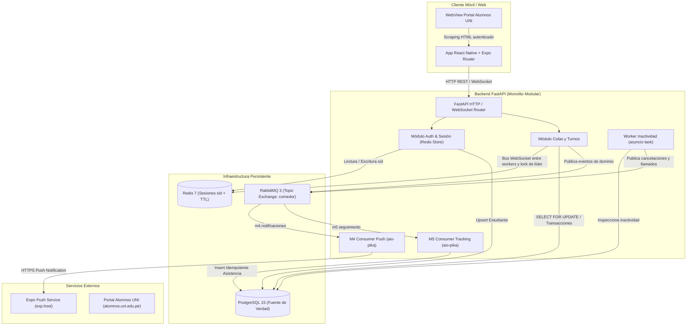
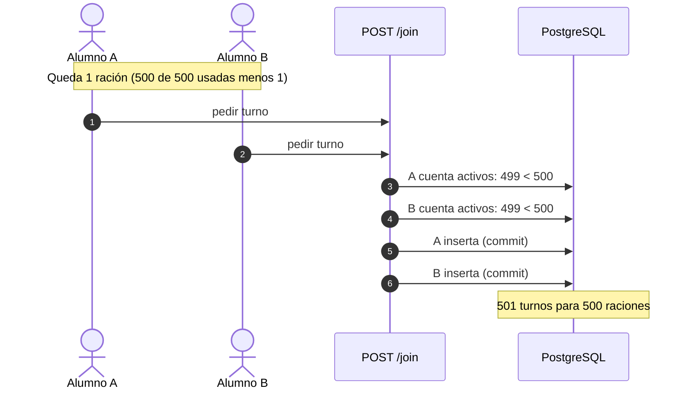

# Documento Técnico del Examen Parcial — ComedorUNI

**Curso:** Construcción de Software II (SW707)  
**Semestre Académico:** 2026-II  
**Institución:** Universidad Nacional de Ingeniería (UNI) — Facultad de Ingeniería Industrial y de Sistemas (FIIS) — Escuela Profesional de Ingeniería de Software  
**Equipo SW707:** Franz Joe Inga Champi y Yazid Elio Fernandez Dueñas  
**Repositorio Oficial:** [francito69/SW707U-CS2-ComedorUni](https://github.com/francito69/SW707U-CS2-ComedorUni)  
**Versión del Entregable:** v1.0 (Línea Base del Examen Parcial)  
**Fecha de Corte:** Octubre de 2026  

---

## Tabla de Contenidos y Mapeo con la Rúbrica Oficial (100%)

| # | Sección del Documento Técnico (Capítulos 1 al 11) | Criterio de la Rúbrica Oficial de Evaluación | Peso |
|---|---|---|:---:|
| 1 | [1. Descripción del Problema y Usuarios](#1-descripción-del-problema-y-usuarios) | Calidad de Código y Documentación | 5% |
| 2 | [2. Alcance y Requisitos Principales](#2-alcance-y-requisitos-principales) | Calidad de Código y Documentación | (Cont.) |
| 3 | [3. Arquitectura y Decisiones Técnicas](#3-arquitectura-y-decisiones-técnicas) | Calidad de Código y Documentación | (Cont.) |
| 4 | [4. Gestión de Dependencias y Reúso](#4-gestión-de-dependencias-y-reúso) | Gestión de Dependencias y Reúso | **10%** |
| 5 | [5. Análisis de Problemas de Runtime](#5-análisis-de-problemas-de-runtime) | Análisis de Problemas de Runtime | **10%** |
| 6 | [6. Contratos y Programación Defensiva](#6-contratos-y-programación-defensiva) | Design by Contract (15%) + Programación Defensiva (10%) | **25%** |
| 7 | [7. Estrategia de Errores y Excepciones](#7-estrategia-de-errores-y-excepciones) | Manejo de Errores y Excepciones | **15%** |
| 8 | [8. Concurrencia y Condiciones de Carrera](#8-concurrencia-y-condiciones-de-carrera) | Concurrencia | **15%** |
| 9 | [9. Tolerancia a Fallas y Resiliencia](#9-tolerancia-a-fallas-y-resiliencia) | Tolerancia a Fallas | **15%** |
| 10 | [10. Pruebas Automatizadas y Evidencias](#10-pruebas-automatizadas-y-evidencias) | Pruebas y Evidencias | **5%** |
| 11 | [11. Limitaciones y Trabajo Futuro](#11-limitaciones-y-trabajo-futuro) | Evolución hacia Examen Final (v2.0) | — |
| **TOTAL** | **Cumplimiento Integral de la Etapa I (Semanas 1 a 8)** | **Rúbrica Oficial de Evaluación Parcial** | **100%** |

---

## 1. Descripción del Problema y Usuarios

### 1.1 Contexto y Problema del Dominio
El Comedor Universitario de la Universidad Nacional de Ingeniería atiende diariamente a miles de estudiantes en los turnos de Almuerzo y Cena. Históricamente, el acceso ha dependido de **colas físicas a la intemperie**, generando tiempos muertos de espera, congestión en el campus y desorden en la asignación de raciones.

El proyecto **ComedorUNI** implementa un sistema distribuido y reactivo de **colas virtuales inteligentes**, permitiendo que el estudiante reserve su turno desde su teléfono móvil o navegador, reciba notificaciones push en tiempo real cuando su grupo sea llamado y confirme su presencia física al ingresar al recinto.

### 1.2 Usuarios y Actores del Sistema
1. **Estudiante Universitario (Actor Primario):**
   - Accede a la aplicación móvil (React Native / Expo).
   - Inicia sesión contra el Portal de Alumnos UNI (`alumnos.uni.edu.pe`) a través de un WebView controlado.
   - Solicita turno virtual para el servicio activo (Almuerzo o Cena).
   - Monitorea su posición en la cola en tiempo real mediante WebSocket.
   - Recibe notificaciones push vía Expo Push Notification Service al ser llamado.
   - Confirma su ticket en el comedor dentro del límite de tolerancia (3 minutos) o cancela su turno.
2. **Administrador del Comedor (Actor de Gestión):**
   - Habilita y configura los horarios de apertura, inicio y cierre de cada turno diario (`turnos_config` y `turno_dia`).
   - Define el límite estricto de raciones máximas (`raciones_max`).
   - Registra y actualiza la información nutricional y los platos del menú del día (`menu_dia`, `menu_platos`).
3. **Sistemas Externos Integrados:**
   - **Portal Alumnos UNI:** Fuente externa autoritativa de identidad académica (código, nombres, correo institucional, créditos matriculados y fotografía del carné).
   - **Expo Push Service (`exp.host`):** Proveedor cloud de entrega asíncrona de notificaciones push a dispositivos Android/iOS.
   - **Infraestructura de Datos y Mensajería:** PostgreSQL 15, Redis 7 y RabbitMQ 3.

---

## 2. Alcance y Requisitos Principales

### 2.1 Alcance del Examen Parcial (Versión v1.0)
La Etapa I del proyecto establece la **línea base verificable y robusta** del sistema, garantizando que el flujo de negocio no colapse bajo condiciones adversas de concurrencia, sobrecupo o fallos transitorios:

- ✅ **Autenticación y Captura de Identidad:** Extracción segura de datos estudiantiles desde el Portal Alumnos UNI, persistencia en `estudiantes` y creación de sesión en Redis con TTL de 8 horas.
- ✅ **Gestión de Turnos y Capacidad:** Encolamiento controlado con verificación de unicidad de estudiante y límite de aforo diario.
- ✅ **Sincronización en Tiempo Real:** Canal bidireccional WebSocket para estado de cola, emisión de pings y avisos de llamado.
- ✅ **Desacoplamiento Asíncrono por Eventos:** Publicación en RabbitMQ (Topic Exchange `comedor`) de eventos de dominio (`turno.encolado`, `turno.llamado`, `turno.cancelado`, `turno.atendido`).
- ✅ **Consumidores Especializados:**
  - **Módulo M4 (Notificaciones):** Escucha `turno.llamado` y `turno.cancelado` y despacha notificaciones push a través de Expo Push Service.
  - **Módulo M5 (Seguimiento):** Escucha `turno.encolado` y `turno.atendido` y registra la trazabilidad histórica de asistencia de forma idempotente en PostgreSQL.
- ✅ **Worker Autónomo de Inactividad:** Tarea asíncrona que cada 60 s cancela a quien no confirmó dentro de los 3 minutos desde que lo llamaron y llena los cupos libres con las siguientes personas de la cola (máximo `raciones_max / 10` llamadas a la vez). Quien no confirma no frena la cola: puede confirmar hasta que vence su plazo, pero sin recuperar su lugar (su grupo de comedor se asigna según el orden en que confirma).

### 2.2 Requisitos No Funcionales y Restricciones
- **Integridad Referencial y Unicidad:** Imposibilidad física de que un alumno obtenga dos turnos activos para el mismo servicio, respaldado por índices condicionales únicos en base de datos.
- **Atomicidad Transaccional:** Control estricto de aforo restante bajo peticiones concurrentes simultáneas.
- **No Divulgación de Secretos:** Respuestas de error HTTP limpias sin filtración de credenciales, HTML raspado, SQL tracebacks o rutas internas de servidor.

---

## 3. Arquitectura y Decisiones Técnicas

### 3.1 Modelo de Arquitectura (Monolito Modular Asíncrono)
El backend está construido sobre **FastAPI** bajo un enfoque de **Monolito Modular** respaldado por microservicios de infraestructura (PostgreSQL, Redis, RabbitMQ). Todos los módulos de negocio comparten el mismo ciclo de vida de aplicación (`lifespan`), ejecutando los workers y consumidores como corutinas concurrentes sobre el Event Loop de `asyncio`.



### 3.2 Decisiones Registradas de Arquitectura (ADR)
- **ADR-001 (Configuración Dinámica de URLs del Backend):**  
  Se erradicó el *hardcoding* de la IP en `frontend/src/constants/api.ts`. Al arrancar, la app lee la URL vigente del backend desde un Gist de GitHub (así un cambio de URL del túnel no obliga a recompilar), la guarda en `expo-secure-store` y, si no puede leerla, usa `EXPO_PUBLIC_API_URL` / `EXPO_PUBLIC_WS_URL`. Esto permite alternar entre emulador Android (`10.0.2.2:8000`), navegador local, dispositivo en la LAN o el túnel público.
- **Conservación de PostgreSQL como Fuente Única de Verdad:**  
  Toda regla de negocio de colas, aforo, orden y numeración se resuelve transaccionalmente en PostgreSQL. Redis guarda solo estado volátil o de coordinación: sesiones (`sid`), el bus de WebSockets entre workers y el lock de líder de las tareas periódicas. Si Redis pierde un aviso, el estado correcto sigue en PostgreSQL.
- **Varios procesos de API (6 workers en producción):**  
  `run.py` levanta `WORKERS` procesos de uvicorn para usar varios núcleos. Cada proceso tiene sus propias conexiones WebSocket, así que los avisos se reparten por Redis Pub/Sub y las tareas periódicas usan un lock para correr una sola vez por ciclo (sección 8.3).
- **Prevención de Recolección de Basura en Tareas Asíncronas (`_background_tasks`):**  
  En `backend/src/main.py`, FastAPI almacena referencias fuertes en el conjunto `_background_tasks` para el worker de inactividad y los consumidores de RabbitMQ. Si se crearan con `asyncio.create_task()` sin guardar referencia, el Garbage Collector de Python destruiría la tarea silenciosamente al no haber referencias externas en el heap, deteniendo el procesamiento sin arrojar excepción.

---

## 4. Gestión de Dependencias y Reúso

### 4.1 Política de versiones
- **Backend:** `backend/requirements.txt` fija **versiones exactas** (`==`): las mismas con las que pasan la suite de pruebas y la prueba de carga. Las herramientas de desarrollo (`pytest`, `pip-audit`) están aparte, en `backend/requirements-dev.txt`. Se verificó que el conjunto se instala desde cero en un entorno limpio de Python 3.12.
- **Frontend:** `frontend/src/package-lock.json` fija el árbol completo; `package.json` usa los rangos `~` que recomienda Expo para su SDK.

### 4.2 Inventario de dependencias directas

| Componente | Dependencia | Versión | Para qué se usa en el código |
|---|---|:---:|---|
| Backend | `fastapi` | 0.141.1 | API HTTP y WebSocket; validación Pydantic en la frontera (sección 6). |
| Backend | `uvicorn[standard]` | 0.53.0 | Servidor ASGI; en producción levanta `WORKERS` procesos (`run.py`). |
| Backend | `python-dotenv` | 1.2.3 | Carga `backend/.env`. |
| Backend | `psycopg2-binary` | 2.9.13 | Driver de PostgreSQL y `ThreadedConnectionPool` (`shared/db.py`). |
| Backend | `redis` | 8.1.0 | Sesiones, bus de WebSockets entre workers y lock de líder. |
| Backend | `aio-pika` | 10.0.1 | AMQP asíncrono; `connect_robust` reconecta solo. |
| Backend | `httpx` | 0.28.1 | Envío de push a Expo (`shared/push.py`) y `TestClient` en pruebas. |
| Backend | `beautifulsoup4` | 4.15.0 | Lectura del HTML del Portal Alumnos UNI. |
| Backend | `deepface` + `tf-keras` | 0.0.101 / 2.21.0 | Verificación facial (Facenet). `tf-keras` lo exige deepface con TensorFlow ≥ 2.16. |
| Backend | `opencv-python` | 4.10.0.84 | Detector de rostros de deepface. Fijado en 4.x: la 5.x eliminó los Haar cascades (sección 5.4). |
| Backend | `pillow` / `numpy` | 13.0.0 / 2.5.3 | Decodificar la foto base64 a matriz. |
| Frontend | `expo` / `expo-router` | ~54.0.34 / ~6.0.23 | App móvil multiplataforma con rutas por archivo. |
| Frontend | `react-native` | 0.81.5 | Runtime de la app. |
| Frontend | `react-native-webview` | 13.15.0 | Login contra el Portal Alumnos dentro de la app. |
| Frontend | `expo-notifications` / `expo-secure-store` | ~0.32.17 / ~15.0.8 | Token push y caché segura de la URL del backend. |

### 4.3 Auditoría de seguridad y depuración del inventario
- **`pip-audit -r backend/requirements.txt`** (pip-audit 2.10.1, 22-oct-2026) revisó **90 paquetes** (directos y transitivos). Único hallazgo: **Pillow 12.3.0 con 35 CVE**, todas corregidas en 13.0.0. Se subió a **13.0.0** y se validó instalando el conjunto desde cero y corriendo la suite y la prueba de carga.
- **Dependencia sin uso eliminada:** `requests` estaba declarada pero ningún módulo la importa (deepface la trae como transitiva).
- **Dependencia usada sin declarar:** `numpy` se importa en `auth/biometric.py`; ahora está declarada con su versión.

### 4.4 Reúso
Se reutiliza lo existente antes de escribir código propio: el pool de `psycopg2` (envuelto, no reimplementado), la reconexión de `aio-pika`, la validación de Pydantic y el detector de deepface. Solo se escribió código propio donde no había pieza que reutilizar para este caso: el bus de WebSockets entre workers (`shared/ws_bus.py`) y el lock de líder (`shared/leader_lock.py`), de unas 40 líneas cada uno.

**Costo conocido:** `deepface` importa TensorFlow al arrancar cada worker. Con 6 workers el modelo se carga 6 veces (tiempo de arranque y memoria). Es la dependencia más pesada del sistema y está registrada como limitación (sección 11).

---

## 5. Análisis de Problemas de Runtime

Problemas que aparecieron **al ejecutar** el sistema, no al compilarlo. Para cada uno: síntoma, causa y corrección.

### 5.1 Desajuste de puerto de PostgreSQL
- **Síntoma:** `psycopg2.OperationalError: Connection refused` al arrancar sin `.env`.
- **Causa:** Compose publica PostgreSQL en el puerto `5433` del host (`5433:5432`) y `shared/db.py` usaba `5432` por defecto.
- **Corrección:** `DB_PORT=5433` en `backend/.env.example`, y el log de arranque del pool indica a qué host y puerto se conecta (`Creando pool (15-15) hacia localhost:5433/comedor_uni`).

### 5.2 Backend que arranca antes que RabbitMQ
- **Síntoma:** con Compose, los consumers M4/M5 fallaban al conectar y quedaban apagados en silencio: no salían push.
- **Corrección:** `_start_consumers_with_retry` (`main.py`) reintenta 30 veces cada 3 s. Si se rinde, lo registra como `ERROR` y devuelve `False`, de modo que el problema queda visible en el log.

### 5.3 Pool de conexiones que no reutilizaba ni esperaba (detectado con Locust)
- **Síntoma:** en la primera prueba de carga (1000 estudiantes simultáneos) hubo **11,7 % de errores 500**: `connection pool exhausted` (1405 veces) y `Address already in use` (198 veces).
- **Causa 1:** `psycopg2` solo guarda una conexión devuelta si en el pool hay menos de `minconn` libres; con `minconn=1` casi cada request abría y cerraba una conexión TCP nueva, hasta agotar los puertos efímeros de Windows.
- **Causa 2:** al llegar a `maxconn`, `ThreadedConnectionPool` **lanza** `PoolError` en vez de esperar.
- **Corrección (`shared/db.py`):** `minconn = maxconn`, y un `BoundedSemaphore` hace que el request **espere** una conexión libre hasta `DB_POOL_TIMEOUT` (10 s). Recién entonces falla, con un 503 controlado. Resultado: **0 errores** en la misma prueba (sección 8.4).

### 5.4 opencv-python 5 rompió la verificación facial
- **Síntoma:** `/verify-biometric` respondía 500 con `ValueError: Confirm that opencv is installed`.
- **Causa:** `opencv-python` 5.x dejó de incluir los archivos Haar cascade que usa el detector `opencv` de deepface.
- **Corrección:** versión fijada en `4.10.0.84` (sección 4).

### 5.5 Event loop bloqueado por `POST /queue/join`
- **Síntoma:** pedir turno era el endpoint más lento bajo carga, y mientras tanto el mismo worker atendía con retraso los WebSockets y el resto de requests.
- **Causa:** `join_queue` es `async def` (publica eventos con `await`), pero llamaba a la base de forma síncrona. Mientras esperaba el candado `FOR UPDATE`, congelaba el event loop de todo su worker.
- **Corrección:** la parte de base de datos de `/join`, `/confirm` y de los handlers de WebSocket corre con `run_in_threadpool`; el event loop queda libre. Efecto medido en la sección 8.4.

### 5.6 `localhost` lento en Windows (artefacto de medición)
Con `localhost`, cada conexión nueva intenta primero IPv6 (`::1`); uvicorn escucha solo en IPv4 y el reintento costaba unos 2 s por conexión. Con `127.0.0.1` la conexión tarda menos de 1 ms. Las mediciones de carga usan `127.0.0.1`.

### 5.7 Instrumento de observación: logging con id de request
Los 39 `print()` del backend se reemplazaron por `logging` con niveles (`shared/logs.py`). Cada request recibe un id (el `X-Request-ID` del cliente o uno generado), que aparece en cada línea de log y vuelve en la cabecera y el cuerpo de la respuesta. Con ese id, el error que ve un usuario se ubica en el log:

```text
2026-10-22 23:40:01 ERROR   [pid 21344] [req 3f9a1c0b77e2] src.shared.http_errores: POST /queue/join -> 503, dependencia no disponible
```

El nivel se controla con `LOG_LEVEL`. Las conexiones de WebSocket se registran en `DEBUG` para no inundar el log bajo carga.

---

## 6. Contratos y Programación Defensiva

### 6.1 Cómo se expresa un contrato en el código
`shared/contratos.py` define `requiere()` (precondición) y `asegura()` (postcondición o invariante). Ambas lanzan `ContratoViolado`, y a diferencia de `assert`, no se desactivan con `python -O`. Se separan dos casos:
- **Contrato violado** (bug del programa, por ejemplo un id negativo que nunca debió llegar): `ContratoViolado`, respuesta 500 y traza en el log.
- **Regla de negocio incumplida** (por ejemplo, no quedan raciones): `ErrorDeDominio`, respuesta 4xx sin traza (sección 7).

El caso de uso central, `crear_turno` (`modules/queues/service.py`), declara su contrato completo:

```python
requiere(estudiante_id > 0, "estudiante_id debe ser positivo")
requiere(turno_dia_id > 0, "turno_dia_id debe ser positivo")
requiere(raciones_max > 0, "raciones_max debe ser positivo")
...                                  # sección crítica (sección 8.2)
asegura(numero == ultimo_numero + 1, "el número de turno es el máximo previo + 1")
asegura(activos + 1 <= raciones_max, "los turnos activos no superan raciones_max")
```

Si una postcondición falla, la transacción no se confirma.

### 6.2 Matriz de contratos de la API

| Operación | Precondiciones (si fallan → respuesta) | Postcondiciones | Invariantes |
|---|---|---|---|
| **`POST /queue/join`** | `sid` UUID v4 y `tipo` ∈ {ALMUERZO, CENA, PRUEBA} → 422 · sesión activa → 401 `sesion_invalida` · turno de ese tipo abierto ahora → 400 `turno_no_activo` · estudiante registrado → 404 `estudiante_no_registrado` · turno del día habilitado → 409 `turno_no_habilitado` · sin turno activo → 409 `turno_duplicado` · quedan raciones → 400 `sin_raciones` | Turno `ESPERANDO` con número = máximo previo + 1; la respuesta incluye `raciones_restantes`; se publica `turno.encolado` (best-effort). | Turnos activos ≤ `raciones_max`. Un solo turno activo por estudiante y servicio. |
| **`POST /queue/confirm`** | Sesión activa → 401 · tiene turno activo → 404 `sin_turno_activo` · el turno no está `ATENDIDO` ni `CANCELADO` → 400 `turno_finalizado` | Si estaba `LLAMADO`: pasa a `ATENDIDO`, se fija `confirmado_at`, se publica `turno.atendido` y su cupo pasa a la siguiente persona de la cola. Si estaba `ESPERANDO`: solo renueva `ultimo_ping` ("Sigo aquí") y responde `ESPERANDO`. | `ATENDIDO` y `CANCELADO` son estados finales. |
| **`POST /queue/leave`** | Sesión activa → 401 | `ESPERANDO`/`LLAMADO` pasa a `CANCELADO` y libera la ración. Idempotente: sin turno o con turno terminado responde 200 sin cambios. | Un turno `ATENDIDO` nunca se cancela. |
| **`GET /queue/status`** | `sid` UUID v4 → 422 · sesión → 401 · turno hoy → 404 | Estado, posición y turno en atención; grupo de comedor solo si está `ATENDIDO`, calculado por el orden en que confirmó (no por su número de cola). | Grupo asignado entre 1 y 10; confirmar tarde no mueve el grupo de nadie. |
| **`POST /parse-data`** | HTML ≤ 5 MB por campo → 422 · código UNI válido en el HTML → 422 `datos_portal_invalidos` | Estudiante registrado o actualizado y sesión creada en Redis (8 h). | Un código UNI identifica a un solo estudiante. |

### 6.3 Barricadas de programación defensiva
Todo dato externo se valida en la frontera, antes de llegar a la lógica de negocio o a la base:

| Dato externo | Validación | Dónde |
|---|---|---|
| `sid` (cuerpo y query string) | UUID v4: es lo único que genera `/parse-data` | `shared/validacion.py` (`Sid`, `UUID4_PATTERN`) |
| `tipo` de turno | Lista cerrada (`Literal`) | `queues/schemas.py` |
| `push_token` | 1 a 255 caracteres, el tamaño de la columna | `queues/schemas.py` |
| Foto biométrica | 1 a 8 000 000 caracteres | `auth/schemas.py` |
| HTML del portal | ≤ 5 000 000 caracteres por campo; `device_id` ≤ 128 | `auth/schemas.py` |
| Código de alumno extraído del HTML | `^[0-9]{8}[A-Z]$`, normalizado a mayúsculas | `auth/service.py` |

**Bug real que corrigió la barricada del código UNI:** antes, si el HTML llegaba sin código, el parser devolvía `"No encontrado"` y se creaba un estudiante y una sesión con ese código. Todos los logins con HTML roto terminaban compartiendo la misma identidad. Ahora se responde 422 y no se crea nada.

**Defensa en profundidad:** toda consulta SQL usa parámetros (`%s`; una prueba revisa que ningún `execute` arme SQL con f-strings o `%`), y la base es la última barrera: `idx_turnos_activo` (un turno activo por estudiante), `idx_turnos_numero_turno_unico` (números únicos) y `CHECK` sobre los estados.

---

## 7. Estrategia de Errores y Excepciones

### 7.1 Tres clases de problemas, tres respuestas

| Clase | Ejemplos | Respuesta HTTP | Registro en el log |
|---|---|---|---|
| **Condición de error de negocio** (`ErrorDeDominio`, `shared/errores.py`) | Sesión vencida, turno duplicado, sin raciones, turno finalizado | 4xx con `codigo` estable (`sin_raciones`, `turno_duplicado`...) | `INFO`, sin traza: es un flujo esperado |
| **Falla de infraestructura** | PostgreSQL o Redis caídos, pool sin conexión libre | 503 `servicio_no_disponible`, mensaje genérico | `ERROR` con traza |
| **Error inesperado** (bug, contrato violado) | Cualquier otra excepción | 500 `error_interno`, mensaje genérico | `ERROR` con traza |

Formato de toda respuesta de error (se mantiene `detail` porque la app ya lo muestra):

```json
{"detail": "Se agotaron las raciones para este turno", "codigo": "sin_raciones", "request_id": "3f9a1c0b77e2"}
```

### 7.2 Un solo lugar registra: sin *log and throw*
`shared/http_errores.py` es la frontera: las capas de abajo solo lanzan y ahí se registra **una vez**. Los errores de negocio y de infraestructura tienen `exception_handler` propios. Los inesperados los captura un middleware y no un `exception_handler(Exception)`, porque Starlette re-lanza la excepción después de ese handler y el servidor la volvería a imprimir (doble registro). Hay una prueba que verifica que un error inesperado deja exactamente una traza en el log y que la respuesta no filtra hosts, puertos, usuarios ni trazas.

### 7.3 Excepciones absorbidas a propósito (best-effort)
Hay excepciones que se capturan y **no** se propagan, porque la operación principal ya quedó confirmada en PostgreSQL. Cada una se registra:

| Dónde | Por qué no se propaga | Nivel |
|---|---|---|
| `rabbitmq.publish` | El turno ya existe; perder el evento solo afecta push y seguimiento. | `WARNING` |
| `ws_bus.publish_to_session` / `publish_broadcast` | El aviso en tiempo real es redundante: la app consulta `/queue/status`. | `WARNING` |
| `push.send_push` | Sin push el turno sigue válido y la app lo ve por WebSocket. | `WARNING` |
| Consumers M4/M5 | Un mensaje con error no debe reintentarse en bucle ni frenar a los demás. | `ERROR` con traza |
| Ciclo del worker de inactividad | Un ciclo fallido no debe matar al worker; el siguiente reintenta. | `ERROR` con traza |

---

## 8. Concurrencia y Condiciones de Carrera

### 8.1 La carrera de la última ración
Con una sola ración disponible, dos estudiantes que piden turno en el mismo instante pueden leer ambos "queda 1" antes de que alguno inserte:



**Esta carrera existía en el código** hasta esta versión: el conteo de raciones estaba en el router, fuera de la sección crítica de `crear_turno`. `test_reproduce_sobreventa_si_el_chequeo_queda_fuera_del_candado` la reproduce contra PostgreSQL real: cinco hilos, una ración, cinco turnos asignados.

### 8.2 Solución: el conteo dentro de la sección crítica
`crear_turno` toma un candado sobre la fila del turno del día y, **bajo ese candado**, cuenta los activos, decide e inserta:

```python
cur.execute("SELECT id FROM turno_dia WHERE id = %s FOR UPDATE", (turno_dia_id,))
cur.execute("""SELECT COUNT(*) FILTER (WHERE estado != 'CANCELADO'), COALESCE(MAX(numero_turno), 0)
               FROM turnos WHERE turno_dia_id = %s""", (turno_dia_id,))
activos, ultimo_numero = cur.fetchone()
if activos >= raciones_max:
    _conn.rollback()
    raise SinRaciones()
cur.execute("INSERT INTO turnos (...) VALUES (%s, %s, %s) RETURNING numero_turno",
            (estudiante_id, turno_dia_id, ultimo_numero + 1))   # UniqueViolation -> TurnoDuplicado
```

El router mantiene los chequeos rápidos sin candado (turno existente, raciones agotadas) para responder sin esperar en los casos obvios; la regla que manda es la de dentro del candado. El número usa `MAX + 1` y no `COUNT + 1`: así nunca se recicla un número ya entregado aunque se cancelen turnos.

### 8.3 Concurrencia entre hilos y procesos
- **Pool de conexiones:** inicialización con *double-checked locking* (sin ella, dos hilos al arrancar creaban dos pools distintos y perdían conexiones) y semáforo para esperar conexión (sección 5.3).
- **Event loop:** la base de datos corre en el threadpool (sección 5.5).
- **Llamado de turnos:** la cola avanza persona por persona, con como máximo `raciones_max / 10` personas `LLAMADO` a la vez. Cada confirmación, salida o vencimiento libera un cupo y se llama a la siguiente persona en orden. `llamar_siguiente` toma el mismo candado `FOR UPDATE` del turno del día, para que dos confirmaciones simultáneas no calculen los mismos cupos libres y llamen de más (`test_llamadas_simultaneas_no_superan_los_cupos`).
- **Varios procesos (6 workers):** cada worker tiene sus propias conexiones WebSocket en memoria. Los avisos pasan por Redis Pub/Sub (`shared/ws_bus.py`) para llegar al estudiante esté en el worker que esté. Las tareas periódicas usan un lock de líder en Redis (`SET NX EX`, `shared/leader_lock.py`), para que el worker de inactividad corra una sola vez por ciclo y no seis.

### 8.4 Evidencia bajo carga real (Locust)
Prueba de "hora punta" (`backend/tests/carga/`): cada usuario de Locust es un estudiante distinto con sesión real en Redis. Todos piden turno casi a la vez (200 por segundo) y luego consultan su estado y el menú. Backend con 6 workers, infraestructura aislada, misma laptop (20 núcleos, 16 GB). Al terminar cada corrida se revisa la base.

| Corrida | Estudiantes | Peticiones/s | Errores | Pedir turno p50 / p95 | Consultar estado p95 |
|---|:---:|:---:|---|:---:|:---:|
| Código anterior (pool sin corregir)\* | 1000 | 190 | 11,7 % (errores 500) | 0,74 s / 3,9 s | 2,8 s |
| Pool corregido | 1000 | 305 | 0 % | 0,83 s / 1,4 s | 64 ms |
| **Versión v1.0** | 1000 | **306** | **1 conexión reseteada por Windows** | **0,70 s / 1,2 s** | **61 ms** |
| Pool corregido, estrés | 2000 | 590 | 0,7 % (conexiones abortadas) | 0,73 s / 1,9 s | 3,2 s |
| **Versión v1.0, estrés** | 2000 | **729** | **0,01 % (5 conexiones abortadas, ningún 500)** | **0,23 s / 0,68 s** | **0,41 s** |

\* Medida contra `localhost`, que suma la penalización de IPv6 a cada conexión nueva (sección 5.6); las demás corridas usan `127.0.0.1`.

La diferencia entre "pool corregido" y "v1.0" se nota sobre todo en el estrés: sacar la base de datos del event loop (sección 5.5) bajó el p95 de pedir turno de 1,9 s a 0,68 s y el de consultar estado de 3,2 s a 0,41 s, con un 24 % más de peticiones por segundo. Con 2000 usuarios, Locust y el backend compiten por la misma CPU, así que ese es el límite medido en esta laptop y no el del sistema.

En **todas** las corridas la base quedó consistente: ningún número de turno repetido, ningún estudiante con dos turnos, numeración sin huecos y nunca más turnos que raciones.

---

## 9. Tolerancia a Fallas y Resiliencia

| Falla | Comportamiento del sistema | Cómo se verificó |
|---|---|---|
| RabbitMQ no disponible al arrancar | Los consumers reintentan 30 veces cada 3 s; si se rinden, queda un `ERROR` en el log. | `test_consumers_reintentan_hasta_que_rabbitmq_responde`, `test_consumers_se_rinden_y_lo_registran_como_error` |
| RabbitMQ caído o colgado durante la operación | `publish` reutiliza una conexión robusta, tiene un tiempo máximo de 3 s y es best-effort: el turno se asigna igual. | `test_publish_no_propaga_la_caida_de_rabbitmq`, `test_publish_no_cuelga_el_request_si_rabbitmq_no_responde` |
| Redis caído durante un aviso en tiempo real | El aviso se registra como `WARNING` y la operación responde 200. | `test_confirmar_responde_aunque_rabbitmq_y_redis_esten_caidos` |
| PostgreSQL o Redis caídos durante un request | 503 controlado, sin filtrar detalles internos. | `test_postgres_caido_responde_503_sin_filtrar_detalles`, `test_redis_caido_responde_503` |
| Pool de conexiones saturado | El request espera hasta 10 s una conexión libre; recién entonces responde 503. | `test_pool_lleno_hace_esperar_y_falla_solo_tras_el_timeout` y Locust (sección 8.4) |
| Reentrega de un mensaje (*at-least-once*) | M5 inserta con `ON CONFLICT DO NOTHING`: el historial no se duplica. | `test_m5_es_idempotente_ante_reentrega` |
| Expo Push caído | Se registra `WARNING`; el turno sigue válido y la app lo ve por WebSocket. | Revisión de `shared/push.py` |
| Falla un ciclo del worker de inactividad | Se registra el error y el siguiente ciclo corre normalmente. | `test_worker_de_inactividad_sobrevive_a_un_ciclo_fallido` |
| Un estudiante llamado no aparece (se quedó dormido) | La cola no lo espera: los demás siguen confirmando y se llama a las siguientes personas por los otros cupos. Puede confirmar hasta 3 min después de su llamado, pero no recupera su lugar: entra al grupo que se atiende en ese momento, sin mover a quienes ya confirmaron. Pasado el plazo se cancela, aunque la app siga mandando pings. | `test_el_que_no_confirma_no_frena_la_cola`, `test_quien_confirma_tarde_entra_al_grupo_del_momento_sin_mover_a_nadie`, `test_a_los_3_minutos_se_cancela_aunque_la_app_mande_pings` |
| Muere el worker que tenía el lock de líder | El lock expira (TTL de 55 s) y otro worker toma el ciclo siguiente. | Diseño de `shared/leader_lock.py` |

---

## 10. Pruebas Automatizadas y Evidencias

### 10.1 Cómo se ejecutan
Desde la raíz del repositorio:

```powershell
# Unitarias (sin infraestructura)
python -m pytest backend/tests

# Para incluir las de integración contra PostgreSQL real, levantar antes la base aislada
docker compose -f backend/tests/carga/docker-compose.carga.yml up -d postgres
python -m pytest backend/tests
```

Sin la base de pruebas, las 13 pruebas de integración se saltan y muestran el comando para levantarla. Ninguna prueba usa la base de desarrollo: cada una crea su propio turno y sus estudiantes, y los borra al terminar.

### 10.2 Resultado

```text
76 passed in 2.59s          (con PostgreSQL de pruebas levantado)
63 passed, 13 skipped       (sin infraestructura)
```

### 10.3 Pruebas por criterio de la rúbrica
Todas las pruebas ejercitan el código real del sistema (endpoints con `TestClient`, servicios y base de datos), no copias de su lógica.

| Archivo | Pruebas | Criterio | Qué verifica |
|---|:---:|---|---|
| `test_contracts.py` | 15 | Design by Contract | `requiere`/`asegura`; precondiciones de `crear_turno` sin tocar la base; números consecutivos; invariante de aforo; ración liberada al cancelar; grupo asignado entre 1 y 10; contratos de `/confirm`. |
| `test_defensive.py` | 23 | Programación defensiva | Rechazo (422) de `tipo` y `sid` inválidos, inyección SQL, foto vacía o gigante, `push_token` largo y HTML del portal sin código UNI válido, sin que el dato llegue al servicio; SQL siempre parametrizado. |
| `test_errors_and_exceptions.py` | 14 | Errores y excepciones | Cada error de negocio con su 4xx y `codigo`; 503 sin filtrar detalles ante PostgreSQL, pool o Redis caídos; 500 genérico registrado una sola vez; `request_id` en la respuesta y en el log. |
| `test_concurrency.py` | 5 | Concurrencia | Reproducción de la sobreventa; 40 hilos por 10 raciones dan exactamente 10 turnos (1 a 10); un estudiante en paralelo obtiene un solo turno; el pool espera en vez de fallar. |
| `test_resilience.py` | 7 | Tolerancia a fallas | Reintentos de consumers; RabbitMQ caído o colgado; Redis caído en un aviso; idempotencia de M5; worker que sobrevive a un ciclo fallido. |
| `test_reasignacion.py` | 7 | Concurrencia y tolerancia a fallas | Llamado en orden hasta llenar los cupos; quien no confirma no frena la cola y puede confirmar dentro de su plazo; quien confirma tarde entra al grupo del momento sin mover a nadie; vencimiento a los 3 min desde el llamado aunque haya pings; llamadas simultáneas sin exceder cupos; al salir un llamado se llama al siguiente. |
| `test_asignar_turno.py`, `test_caracterizacion_queues.py` | 5 | Pruebas y evidencias | Caso de uso `AsignarTurno` con repositorio en memoria y caracterización de `calcular_turno_asignado`. |

**Prueba de carga:** `backend/tests/carga/` (Locust, con instrucciones en su `README.md`). Resultados en la sección 8.4.

### 10.4 Otras verificaciones
1. **Backend:** `python -m compileall -q backend/src backend/run.py` → 0 errores.
2. **Dependencias:** `pip-audit -r backend/requirements.txt` → sin vulnerabilidades conocidas tras subir Pillow (sección 4.3).
3. **Frontend:** `npx tsc --noEmit` y `npm run lint` (registro del equipo en el avance parcial).

---

## 11. Limitaciones y Trabajo Futuro (Ruta hacia el Examen Final v2.0)

1. **Biometría fuera del proceso de la API:** deepface y TensorFlow se cargan en cada worker. Moverlos a un servicio o proceso propio bajaría la memoria y el arranque, y permitiría escalar la API sin multiplicar el modelo.
2. **Unificar la rodaja hexagonal con el flujo real:** el caso de uso `AsignarTurno` (`queues/domain`) existe y está probado, pero `/join` usa `service.crear_turno`. Pasar la regla de aforo y los contratos a `AsignarTurno` dejaría un solo camino.
3. **Observabilidad entre servicios:** los logs ya llevan `request_id`; falta propagarlo en los eventos de RabbitMQ para seguir un turno de punta a punta, y emitir los logs en JSON.
4. **Carga medida desde otra máquina:** Locust corrió en la misma laptop que el backend; el techo real del sistema es mayor que el medido.
5. **Máquina de estados declarativa** para el ciclo de vida del turno (`ESPERANDO` → `LLAMADO` → `ATENDIDO`/`CANCELADO`) y **configuración externalizada** de tiempos (ping, inactividad, tamaño de grupo).

---

## Enlaces Oficiales y Recursos Multimedia
- **Video Explicativo de la Implementación:** [Ver Exposición Técnica en YouTube](https://www.youtube.com/watch?v=g4voiWE8LB8)
- **Prototipo Base en Figma:** [Ver Prototipo Interactivo en Figma Make](https://www.figma.com/make/CoKplsedJ59U6BkDTlJLht/ComedorUni?fullscreen=1&t=N6J5IE1iyzJ2c1LJ-1&code-node-id=0-6)
- **Diagramas de Arquitectura C4:** [Consultar Modelo C4 en docs/c4/](c4/)
- **Registro de Decisiones de Arquitectura:** [Consultar ADRs en docs/adr/](adr/)
