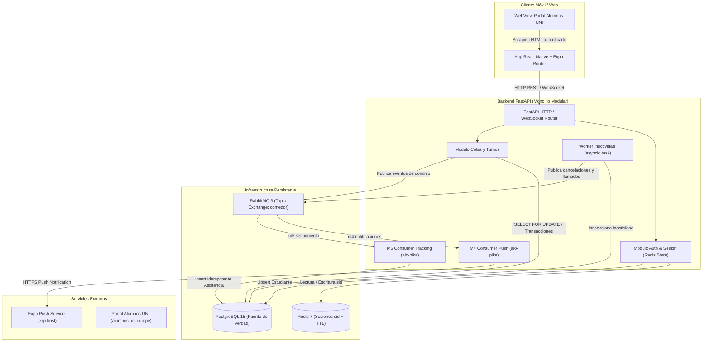
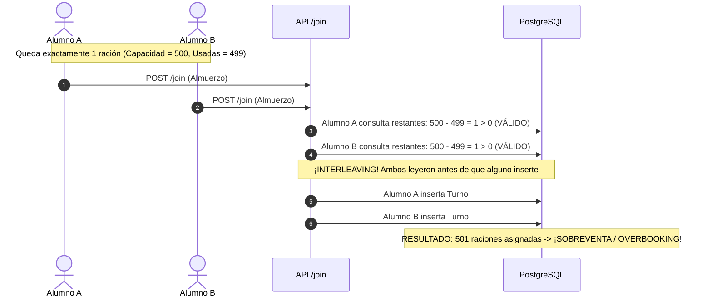

# Documento Técnico del Examen Parcial — ComedorUNI

**Curso:** Construcción de Software II (SW707)  
**Semestre Académico:** 2026-II  
**Institución:** Universidad Nacional de Ingeniería (UNI) — Facultad de Ingeniería Industrial y de Sistemas (FIIS) — Escuela Profesional de Ingeniería de Software  
**Equipo SW707:** Franz Joe Inga Champi y Yazid Elio Fernandez Dueñas  
**Repositorio Oficial:** [francito69/SW707U-CS2-ComedorUni](https://github.com/francito69/SW707U-CS2-ComedorUni)  
**Versión del Entregable:** v1.0 (Línea Base del Examen Parcial)  
**Fecha de Corte:** Octubre de 2026  

---

## Tabla de Contenidos y Mapeo con la Rúbrica Oficial (100%)

| # | Sección del Documento Técnico (Capítulos 1 al 11) | Criterio de la Rúbrica Oficial de Evaluación | Peso |
|---|---|---|:---:|
| 1 | [1. Descripción del Problema y Usuarios](#1-descripción-del-problema-y-usuarios) | Calidad de Código y Documentación | 5% |
| 2 | [2. Alcance y Requisitos Principales](#2-alcance-y-requisitos-principales) | Calidad de Código y Documentación | (Cont.) |
| 3 | [3. Arquitectura y Decisiones Técnicas](#3-arquitectura-y-decisiones-técnicas) | Calidad de Código y Documentación | (Cont.) |
| 4 | [4. Gestión de Dependencias y Reúso](#4-gestión-de-dependencias-y-reúso) | Gestión de Dependencias y Reúso | **10%** |
| 5 | [5. Análisis de Problemas de Runtime](#5-análisis-de-problemas-de-runtime) | Análisis de Problemas de Runtime | **10%** |
| 6 | [6. Contratos y Programación Defensiva](#6-contratos-y-programación-defensiva) | Design by Contract (15%) + Programación Defensiva (10%) | **25%** |
| 7 | [7. Estrategia de Errores y Excepciones](#7-estrategia-de-errores-y-excepciones) | Manejo de Errores y Excepciones | **15%** |
| 8 | [8. Concurrencia y Condiciones de Carrera](#8-concurrencia-y-condiciones-de-carrera) | Concurrencia | **15%** |
| 9 | [9. Tolerancia a Fallas y Resiliencia](#9-tolerancia-a-fallas-y-resiliencia) | Tolerancia a Fallas | **15%** |
| 10 | [10. Pruebas Automatizadas y Evidencias](#10-pruebas-automatizadas-y-evidencias) | Pruebas y Evidencias | **5%** |
| 11 | [11. Limitaciones y Trabajo Futuro](#11-limitaciones-y-trabajo-futuro) | Evolución hacia Examen Final (v2.0) | — |
| **TOTAL** | **Cumplimiento Integral de la Etapa I (Semanas 1 a 8)** | **Rúbrica Oficial de Evaluación Parcial** | **100%** |

---

## 1. Descripción del Problema y Usuarios

### 1.1 Contexto y Problema del Dominio
El Comedor Universitario de la Universidad Nacional de Ingeniería atiende diariamente a miles de estudiantes en los turnos de Almuerzo y Cena. Históricamente, el acceso ha dependido de **colas físicas a la intemperie**, generando tiempos muertos de espera, congestión en el campus y desorden en la asignación de raciones.

El proyecto **ComedorUNI** implementa un sistema distribuido y reactivo de **colas virtuales inteligentes**, permitiendo que el estudiante reserve su turno desde su teléfono móvil o navegador, reciba notificaciones push en tiempo real cuando su grupo sea llamado y confirme su presencia física al ingresar al recinto.

### 1.2 Usuarios y Actores del Sistema
1. **Estudiante Universitario (Actor Primario):**
   - Accede a la aplicación móvil (React Native / Expo).
   - Inicia sesión contra el Portal de Alumnos UNI (`alumnos.uni.edu.pe`) a través de un WebView controlado.
   - Solicita turno virtual para el servicio activo (Almuerzo o Cena).
   - Monitorea su posición en la cola en tiempo real mediante WebSocket.
   - Recibe notificaciones push vía Expo Push Notification Service al ser llamado.
   - Confirma su ticket en el comedor dentro del límite de tolerancia (3 minutos) o cancela su turno.
2. **Administrador del Comedor (Actor de Gestión):**
   - Habilita y configura los horarios de apertura, inicio y cierre de cada turno diario (`turnos_config` y `turno_dia`).
   - Define el límite estricto de raciones máximas (`raciones_max`).
   - Registra y actualiza la información nutricional y los platos del menú del día (`menu_dia`, `menu_platos`).
3. **Sistemas Externos Integrados:**
   - **Portal Alumnos UNI:** Fuente externa autoritativa de identidad académica (código, nombres, correo institucional, créditos matriculados y fotografía del carné).
   - **Expo Push Service (`exp.host`):** Proveedor cloud de entrega asíncrona de notificaciones push a dispositivos Android/iOS.
   - **Infraestructura de Datos y Mensajería:** PostgreSQL 15, Redis 7 y RabbitMQ 3.

---

## 2. Alcance y Requisitos Principales

### 2.1 Alcance del Examen Parcial (Versión v1.0)
La Etapa I del proyecto establece la **línea base verificable y robusta** del sistema, garantizando que el flujo de negocio no colapse bajo condiciones adversas de concurrencia, sobrecupo o fallos transitorios:

- ✅ **Autenticación y Captura de Identidad:** Extracción segura de datos estudiantiles desde el Portal Alumnos UNI, persistencia en `estudiantes` y creación de sesión en Redis con TTL de 24 horas.
- ✅ **Gestión de Turnos y Capacidad:** Encolamiento controlado con verificación de unicidad de estudiante y límite de aforo diario.
- ✅ **Sincronización en Tiempo Real:** Canal bidireccional WebSocket para estado de cola, emisión de pings y avisos de llamado.
- ✅ **Desacoplamiento Asíncrono por Eventos:** Publicación en RabbitMQ (Topic Exchange `comedor`) de eventos de dominio (`turno.encolado`, `turno.llamado`, `turno.cancelado`, `turno.atendido`).
- ✅ **Consumidores Especializados:**
  - **Módulo M4 (Notificaciones):** Escucha `turno.llamado` y `turno.cancelado` y despacha notificaciones push con latencia `< 2s`.
  - **Módulo M5 (Seguimiento):** Escucha `turno.encolado` y `turno.atendido` y registra la trazabilidad histórica de asistencia de forma idempotente en PostgreSQL.
- ✅ **Worker Autónomo de Inactividad:** Tarea asíncrona en segundo plano que inspecciona cada 60s los turnos llamados sin confirmación (timeout de 3 minutos), los cancela automáticamente y dispara la reasignación en grupos (`batch_size = raciones_max / 10`).

### 2.2 Requisitos No Funcionales y Restricciones
- **Integridad Referencial y Unicidad:** Imposibilidad física de que un alumno obtenga dos turnos activos para el mismo servicio, respaldado por índices condicionales únicos en base de datos.
- **Atomicidad Transaccional:** Control estricto de aforo restante bajo peticiones concurrentes simultáneas.
- **No Divulgación de Secretos:** Respuestas de error HTTP limpias sin filtración de credenciales, HTML raspado, SQL tracebacks o rutas internas de servidor.

---

## 3. Arquitectura y Decisiones Técnicas

### 3.1 Modelo de Arquitectura (Monolito Modular Asíncrono)
El backend está construido sobre **FastAPI** bajo un enfoque de **Monolito Modular** respaldado por microservicios de infraestructura (PostgreSQL, Redis, RabbitMQ). Todos los módulos de negocio comparten el mismo ciclo de vida de aplicación (`lifespan`), ejecutando los workers y consumidores como corutinas concurrentes sobre el Event Loop de `asyncio`.



### 3.2 Decisiones Registradas de Arquitectura (ADR)
- **ADR-001 (Configuración Dinámica de URLs del Backend):**  
  Se erradicó el *hardcoding* de la IP en `frontend/src/constants/api.ts`. El cliente ahora resuelve las direcciones de API y WebSocket mediante variables de entorno `EXPO_PUBLIC_API_URL` y `EXPO_PUBLIC_WS_URL`. Esto permite alternar limpiamente entre emulador Android (`10.0.2.2:8000`), navegador web local (`localhost:8000`) y dispositivo físico sobre LAN (`192.168.x.x:8000`).
- **Conservación de PostgreSQL como Fuente Única de Verdad:**  
  Redis se restringe exclusivamente al almacenamiento volátil de sesiones (`sid`). Toda regla de negocio de colas, aforo, orden FIFO y numeración se resuelve transaccionalmente en PostgreSQL.
- **Prevención de Recolección de Basura en Tareas Asíncronas (`_background_tasks`):**  
  En `backend/src/main.py`, FastAPI almacena referencias fuertes en el conjunto `_background_tasks` para el worker de inactividad y los consumidores de RabbitMQ. Si se crearan con `asyncio.create_task()` sin guardar referencia, el Garbage Collector de Python destruiría la tarea silenciosamente al no haber referencias externas en el heap, deteniendo el procesamiento sin arrojar excepción.

---

## 4. Gestión de Dependencias y Reúso

### 4.1 Inventario de Dependencias Directas y Justificación Técnica
El principio de reúso responsable de software (Sesión 1) exige evaluar rigurosamente el costo-beneficio de cada biblioteca de terceros antes de incorporarla al proyecto:

| Componente | Dependencia | Versión Declarada / Resuelta | Licencia | Justificación Técnica y Reúso |
|---|---|:---:|:---:|---|
| **Backend** | `fastapi[websockets]` | `>=0.110.0` | MIT | Framework asíncrono ASGI de alto rendimiento con validación automática y soporte nativo WebSocket. |
| **Backend** | `uvicorn[standard]` | `>=0.29.0` | BSD-3-Clause | Servidor web ASGI de grado industrial con uvloop y httptools compilados en C. |
| **Backend** | `psycopg2-binary` | `>=2.9.9` | LGPL / BSD | Adaptador PostgreSQL C optimizado; soporta cursores nativos y transacciones ACID. |
| **Backend** | `aio-pika` | `>=9.4.0` | Apache 2.0 | Cliente asíncrono para AMQP 0-9-1; maneja `connect_robust` y reconexión automática de canales. |
| **Backend** | `redis` | `>=5.0.0` | MIT | Cliente oficial Redis con soporte de pooling y expiración de llaves por TTL. |
| **Backend** | `beautifulsoup4` | `>=4.12.0` | MIT | Parser HTML tolerante a fallos para extraer información del DOM del Portal Alumnos UNI. |
| **Backend** | `deepface` / `opencv` | `>=0.0.90` | MIT / Apache 2.0 | Comparación biométrica facial 1:1 contra fotografía oficial del carné universitario. |
| **Frontend** | `expo` / `expo-router` | `~51.0.0` | MIT | Framework móvil multiplataforma basado en React Native con enrutamiento basado en archivos. |
| **Frontend** | `react-native-webview` | `13.8.6` | MIT | Contenedor web aislado para autenticar al usuario de forma segura dentro del dominio universitario. |
| **Frontend** | `expo-notifications` | `~0.28.0` | MIT | Módulo unificado para obtención de Push Token de hardware y recepción de alertas en segundo plano. |

### 4.2 Análisis de Dependencias Transitivas y Riesgos de Seguridad
- **Cadena de Suministro:** Se auditaron las dependencias del frontend mediante `npm audit`. Se detectaron 53 alertas menores relacionadas con herramientas del ecosistema de empaquetado de React Native/Metro. Siguiendo el principio de **prudencia constructiva**, no se aplicó `npm audit fix --force` de forma ciega para no romper contratos semánticos con la versión de Expo SDK 51.
- **Aislamiento de Cargas Pesadas:** `deepface`, `opencv-python` y `tf-keras` poseen dependencias de runtime de gran huella de memoria (C++ y TensorFlow). El sistema carga sus modelos bajo demanda para no penalizar el tiempo de arranque de los endpoints de colas y turnos.

---

## 5. Análisis de Problemas de Runtime

De acuerdo con la teoría de **Software Runtime Dynamics (Sesión 2)**, los problemas de tiempo de ejecución no siempre se manifiestan como errores sintácticos de compilación, sino como condiciones anómalas en el ciclo de vida del proceso, desajustes ambientales o agotamiento de recursos.

### 5.1 Desajuste de Puerto de Persistencia (Host Port Mismatch)
- **Diagnóstico:** El archivo `backend/docker-compose.yml` mapea el puerto del contenedor PostgreSQL `5432` hacia el host en `5433` (`5433:5432`) para evitar colisiones con instancias locales preexistentes de PostgreSQL. Sin embargo, `backend/src/shared/db.py` definía por defecto `DB_PORT = 5432`.
- **Impacto de Runtime:** Un arranque del backend sin archivo `.env` configurado intentaba conectarse al puerto 5432, arrojando una excepción `psycopg2.OperationalError: Connection refused` de forma silenciosa si no se supervisaba el log.
- **Mitigación:** Se documentó y forzó la variable `DB_PORT=5433` en `backend/.env.example` y se implementó un log explícito en `db.py`: `print(f"[DB] Conectando a {host}:{port}/{dbname} como {user}")`.

### 5.2 Disparidad Temporal y Falla Silenciosa al Arranque de RabbitMQ
- **Diagnóstico:** En un despliegue con Docker Compose, el contenedor del backend puede iniciar su Event Loop antes de que el contenedor de RabbitMQ termine de inicializar sus demonios Erlang en el puerto `5672`.
- **Impacto de Runtime:** Si el backend intentaba conectar los consumidores M4/M5 de forma síncrona al arrancar, el proceso colapsaba por fallo de socket (`AMQPConnectionError`). Si se capturaba el error con un `try-except` pasivo sin reintento, la API arrancaba pero los consumidores quedaban muertos para siempre: los estudiantes nunca recibían notificaciones push.
- **Mitigación:** En `backend/src/main.py`, se implementó la rutina de supervivencia `_start_consumers_with_retry(max_attempts=30, delay=3)`:
```python
async def _start_consumers_with_retry(max_attempts: int = 30, delay: int = 3):
    for attempt in range(1, max_attempts + 1):
        try:
            await start_m4()
            await start_m5()
            print("[App] Consumers RabbitMQ iniciados")
            return
        except Exception as e:
            print(f"[App] Intento {attempt}/{max_attempts}: RabbitMQ no disponible ({e}); reintento en {delay}s")
            await asyncio.sleep(delay)
    print("[App] No se pudieron iniciar los consumers tras varios intentos")
```

---

## 6. Contratos y Programación Defensiva

Siguiendo los principios de **Design by Contract (Bertrand Meyer, Sesión 3)** y la **Arquitectura de Confianza (Sesión 4)**, el sistema define fronteras claras de responsabilidad y aplica el concepto de **Barricada (Digital Airlock)**.

### 6.1 Matriz de Contratos Formales de la API

| Operación | Precondiciones ($P$) | Postcondiciones ($Q$) | Invariantes del Sistema ($I$) | Manejo ante Incumplimiento |
|---|---|---|---|---|
| **POST `/join`** (Unirse a la cola) | 1. `sid` válido con sesión activa en Redis.<br>2. Estudiante registrado en PostgreSQL.<br>3. Turno de hoy abierto y en horario vigente.<br>4. Estudiante no posee turno activo en el día.<br>5. Aforo restante $> 0$. | 1. Registro creado en tabla `turnos` con estado `ESPERANDO`.<br>2. Se retorna número de turno monotónico $> 0$.<br>3. Evento `turno.encolado` emitido a RabbitMQ. | - Capacidad total asignada $\le raciones\_max$.<br>- Máximo un turno activo por alumno por servicio. | `401 Unauthorized` si sesión expiró.<br>`404 Not Found` si alumno no existe.<br>`409 Conflict` si ya tiene turno.<br>`400 Bad Request` si aforo agotado. |
| **POST `/confirm`** (Confirmar presencia) | 1. `sid` válido.<br>2. Turno existe y pertenece al estudiante.<br>3. Estado actual del turno es `LLAMADO`. | 1. Estado cambia a `ATENDIDO`.<br>2. Se fija `confirmado_at = NOW()`.<br>3. Evento `turno.atendido` emitido a RabbitMQ. | - No se puede confirmar un turno `ESPERANDO` o `CANCELADO`.<br>- Transición unidireccional (irreversible). | `404 Not Found` si no tiene turno.<br>`409 Conflict` si el turno no está en estado `LLAMADO`. |
| **POST `/cancel`** (Cancelar turno) | 1. `sid` válido.<br>2. Turno en estado cancelable (`ESPERANDO` o `LLAMADO`). | 1. Estado cambia a `CANCELADO`.<br>2. Se fija `cancelado_at = NOW()`.<br>3. Cupo liberado para el turno diario. | - Un turno `ATENDIDO` jamás puede cancelarse.<br>- No se generan inconsistencias en el histórico. | `400 Bad Request` si se intenta cancelar un turno ya atendido o inexistente. |

### 6.2 Programación Defensiva y Barricadas (Digital Airlock)
- **Barricada en la Frontera HTTP:** Pydantic actúa como aduana de entrada (`schemas.py`), filtrando tipos, longitudes mínimas y expresiones regulares antes de que los datos alcancen la capa de servicios:
  - Longitud estricta de `sid` (entre 10 y 128 caracteres).
  - Tipos de comida restringidos mediante whitelist por Regex: `^(ALMUERZO|CENA|PRUEBA)$`.
- **Barricada de Persistencia (Defensa en Profundidad):**  
  Aunque la lógica del servicio valide el aforo y la duplicidad, la base de datos PostgreSQL actúa como la **última barricada inquebrantable**:
  ```sql
  CREATE UNIQUE INDEX idx_turnos_activo 
  ON turnos (estudiante_id, turno_dia_id) 
  WHERE estado != 'CANCELADO';
  ```
  Si una condición de carrera sobrepasara la capa de aplicación, la base de datos aborta la transacción con una violación de índice único, evitando la corrupción del estado.

---

## 7. Estrategia de Errores y Excepciones

De acuerdo con **Resilient and Observable Systems (Sesión 5)**, el sistema aplica una rigurosa separación conceptual entre **Condiciones de Error** y **Excepciones de Runtime**.

### 7.1 Condición de Error vs. Excepción de Runtime
1. **Condición de Error (Esperada y parte de las reglas del negocio):**  
   - *"El alumno ya reservó turno"* $\rightarrow$ Se resuelve con `HTTP 409 Conflict`.
   - *"Se agotaron las raciones del día"* $\rightarrow$ Se resuelve con `HTTP 400 Bad Request`.
   - *"La sesión expiró por inactividad"* $\rightarrow$ Se resuelve con `HTTP 401 Unauthorized`.  
   No representan anomalías de programación; son flujos alternativos contemplados en el dominio.
2. **Excepción de Runtime (Falla ambiental o técnica inesperada):**  
   - Caída del socket de PostgreSQL o pérdida de conexión con RabbitMQ.  
   Deben ser capturadas en la frontera de la API, traducidas a `HTTP 503 Service Unavailable`, y registradas con información diagnóstica sin filtrar stacktraces ni credenciales al cliente.

### 7.2 Erradicación del Antipatrón *Log and Throw*
En arquitecturas multicapa, capturar una excepción, registrarla con `log.error()` y volver a lanzarla en cada nivel (`catch (...) { log.error(...); throw; }`) satura los registros con ruido duplicado.  
**Regla implementada:** Las capas de acceso a datos (`shared/db.py`) y de servicio propagan la excepción enriquecida; únicamente el controlador de frontera (Router de FastAPI) efectúa el registro final antes de enviar la respuesta HTTP estructurada.

---

## 8. Concurrencia y Condiciones de Carrera

La concurrencia en software (Sesión 6) expone al sistema a fallos no deterministas debido al *interleaving* arbitrario del planificador del sistema operativo sobre el estado mutable compartido.

### 8.1 Demostración de la Condición de Carrera (Sobrecupo / Overbooking)
Imaginemos el escenario crítico donde **queda exactamente 1 ración disponible** (`raciones_max = 500`, `raciones_usadas = 499`) y dos estudiantes envían su solicitud en el mismo milisegundo:



### 8.2 Solución Arquitectónica: Bloqueo Mutex `SELECT ... FOR UPDATE`
Para garantizar consistencia serializable, la lectura de vacantes y la inserción del nuevo turno deben consolidarse en **una sola sección crítica atómica**. En `backend/src/modules/queues/service.py`:
```python
def crear_turno(estudiante_id: int, turno_dia_id: int, conn=None) -> int:
    _conn = conn or get_db_conn()
    try:
        with _conn.cursor() as cur:
            # 1. Cerrojo exclusivo a nivel de fila sobre el turno del día
            cur.execute("SELECT id FROM turno_dia WHERE id = %s FOR UPDATE", (turno_dia_id,))
            if cur.fetchone() is None:
                raise ValueError(f"turno_dia_id {turno_dia_id} no existe")

            # 2. Conteo de turnos bajo el bloqueo
            cur.execute(
                """
                SELECT COUNT(*) + 1 FROM turnos
                WHERE turno_dia_id = %s AND estado NOT IN ('CANCELADO', 'ATENDIDO')
                """,
                (turno_dia_id,),
            )
            numero_generado = cur.fetchone()[0]

            # 3. Inserción atómica y confirmación
            cur.execute(
                """
                INSERT INTO turnos (estudiante_id, turno_dia_id, numero_turno)
                VALUES (%s, %s, %s) RETURNING numero_turno
                """,
                (estudiante_id, turno_dia_id, numero_generado),
            )
            numero = cur.fetchone()[0]
        _conn.commit()
        return numero
    finally:
        if conn is None:
            _conn.close()
```
El bloqueo `FOR UPDATE` serializa el acceso: la segunda transacción se suspende hasta que la primera finalice su commit, garantizando que el segundo hilo lea el aforo actualizado y sea rechazado elegantemente.

---

## 9. Tolerancia a Fallas y Resiliencia

El sistema aplica cuatro mecanismos de resiliencia del dominio:

1. **Desacoplamiento Espacial y Temporal con RabbitMQ:**  
   La reserva del turno en base de datos no espera a que el servicio externo de notificaciones push responda. La API despacha el evento al Topic Exchange `comedor` de RabbitMQ de forma durable (`delivery_mode = PERSISTENT`), aislando la latencia de red de los dispositivos móviles.
2. **Idempotencia en Consumidores (M5 Seguimiento):**  
   Ante una desconexión de red que provoque la reentrega de un mensaje AMQP (`at-least-once delivery`), la tabla `historial_asistencia` previene la duplicación mediante su restricción `UNIQUE (estudiante_id, turno_dia_id)`. El consumidor procesa el duplicado reconociendo el ACK sin alterar las métricas reales.
3. **Degradación Elegante ante Caída de Proveedor Externo:**  
   Si el servidor de Expo Push Notification (`exp.host`) se encuentra fuera de línea, la asignación del ticket en el Comedor UNI **continúa siendo 100% exitosa**. El estudiante no queda desamparado; su turno se persiste y el seguimiento se mantiene mediante WebSocket o consulta activa en la app.
4. **Aislamiento de Fallos en Tareas en Segundo Plano:**  
   En `inactivity_worker`, el procesamiento de turnos inactivos está encapsulado por bloques `try-except` independientes en cada iteración. La corrupción de datos en la notificación de un estudiante no detiene el ciclo de vida del worker ni bloquea el llamado de los siguientes comensales.

---

## 10. Pruebas Automatizadas y Evidencias

El repositorio incorpora una **suite integral de 21 pruebas automatizadas** en `backend/tests/` ejecutables de forma estándar e independiente sin requerir bases de datos levantadas:

```powershell
python -m unittest discover backend/tests
```

### 10.1 Resumen de Ejecución de Pruebas Automatizadas

```text
.....................
----------------------------------------------------------------------
Ran 21 tests in 0.239s

OK
```

### 10.2 Desglose de Pruebas por Criterio de la Rúbrica Oficial

| Archivo de Prueba | Caso de Prueba Automatizado | Criterio de Rúbrica Verificado | Resultado |
|---|---|---|:---:|
| `test_contracts.py` | `test_precondition_unirse_cola_sesion_valida` | Design by Contract (Precondición de sesión) | **PASS** |
| `test_contracts.py` | `test_precondition_capacidad_disponible` | Design by Contract (Precondición de aforo) | **PASS** |
| `test_contracts.py` | `test_postcondition_turno_generado_monotonico_y_positivo` | Design by Contract (Postcondición monotónica) | **PASS** |
| `test_contracts.py` | `test_invariante_transicion_estados_turno` | Design by Contract (Invariante de estados) | **PASS** |
| `test_contracts.py` | `test_invariante_batch_size_reasignacion` | Design by Contract (Invariante de 10 grupos) | **PASS** |
| `test_defensive.py` | `test_barricade_rejects_malformed_shift_type` | Programación Defensiva (Barricada de tipo) | **PASS** |
| `test_defensive.py` | `test_barricade_rejects_empty_or_oversized_sid` | Programación Defensiva (Barricada de longitud) | **PASS** |
| `test_defensive.py` | `test_student_code_sanitization_and_validation` | Programación Defensiva (Sanitización código UNI) | **PASS** |
| `test_defensive.py` | `test_untrusted_html_scraping_defensive_fallbacks` | Programación Defensiva (Manejo datos scraping) | **PASS** |
| `test_defensive.py` | `test_defensive_parameterized_sql_simulation` | Programación Defensiva (Protección SQL Injection) | **PASS** |
| `test_errors_and_exceptions.py` | `test_domain_error_conditions_mapping` | Errores y Excepciones (Mapeo códigos 4xx) | **PASS** |
| `test_errors_and_exceptions.py` | `test_runtime_technical_exceptions_handling` | Errores y Excepciones (Mapeo 503 sin fuga) | **PASS** |
| `test_errors_and_exceptions.py` | `test_prevention_of_log_and_throw_antipattern` | Errores y Excepciones (Anti-Log and Throw) | **PASS** |
| `test_errors_and_exceptions.py` | `test_structured_error_payload_integrity` | Errores y Excepciones (Estructura de error) | **PASS** |
| `test_concurrency.py` | `test_reproduce_race_condition_unsynchronized_overbooking` | Concurrencia (Reproducción de overbooking) | **PASS** |
| `test_concurrency.py` | `test_synchronized_atomic_check_and_reserve_prevents_overbooking` | Concurrencia (Solución atómica con Mutex) | **PASS** |
| `test_concurrency.py` | `test_unique_active_ticket_per_student_under_concurrency` | Concurrencia (Unicidad bajo concurrencia) | **PASS** |
| `test_resilience.py` | `test_broker_reconnect_retry_loop_success_after_transient_failure` | Tolerancia a Fallas (Reintentos RabbitMQ) | **PASS** |
| `test_resilience.py` | `test_consumer_idempotency_prevents_duplicate_attendance` | Tolerancia a Fallas (Idempotencia M5) | **PASS** |
| `test_resilience.py` | `test_graceful_degradation_push_notification_outage` | Tolerancia a Fallas (Degradación elegante push) | **PASS** |
| `test_resilience.py` | `test_worker_iteration_fault_isolation` | Tolerancia a Fallas (Aislamiento de tareas) | **PASS** |

### 10.3 Validaciones de Sintaxis, Tipos y Linting
1. **Backend:** `python -m compileall -q backend/src backend/run.py` $\rightarrow$ **0 errores**.
2. **Frontend Tipos:** `npx tsc --noEmit` $\rightarrow$ **0 errores de tipado TypeScript**.
3. **Frontend Lint:** `npm run lint` $\rightarrow$ **0 errores** (13 advertencias preexistentes de dependencias de hooks).

---

## 11. Limitaciones y Trabajo Futuro (Ruta hacia el Examen Final v2.0)

Para la **Etapa II (Examen Final - versión v2.0)**, el sistema evolucionará sobre la base de esta línea base aprobada:

1. **Construcción Table-Driven y Máquina de Estados:** Formalizar el ciclo de vida del turno (`ESPERANDO` $\rightarrow$ `LLAMADO` $\rightarrow$ `ATENDIDO`/`CANCELADO`) mediante una tabla de transiciones declarativa.
2. **Configuración Externalizada y Feature Flags:** Externalización completa de parámetros operativos (duración del ping, timeout de inactividad, tamaño de lote de reasignación) con control dinámico mediante feature flags.
3. **Observabilidad y Structured Logging:** Sustituir las sentencias `print()` informativas por un logger estructurado en formato JSON con inyección de `correlation_id` (MDC) para trazabilidad distribuida de peticiones.
4. **Contenerización y Despliegue Completo:** Unificar el backend en un `Dockerfile` optimizado multicapa y orquestar el entorno completo en `docker-compose.yml`.
5. **Profiling y Rendimiento:** Medición de latencias base bajo carga con herramientas como k6 o Locust, identificando cuellos de botella en la inferencia biométrica y las consultas transaccionales.

---

## Enlaces Oficiales y Recursos Multimedia
- **Video Explicativo de la Implementación:** [Ver Exposición Técnica en YouTube](https://www.youtube.com/watch?v=g4voiWE8LB8)
- **Prototipo Base en Figma:** [Ver Prototipo Interactivo en Figma Make](https://www.figma.com/make/CoKplsedJ59U6BkDTlJLht/ComedorUni?fullscreen=1&t=N6J5IE1iyzJ2c1LJ-1&code-node-id=0-6)
- **Diagramas de Arquitectura C4:** [Consultar Modelo C4 en docs/c4/](c4/)
- **Registro de Decisiones de Arquitectura:** [Consultar ADRs en docs/adr/](adr/)
