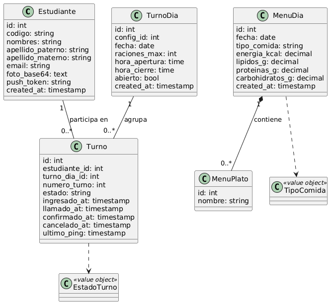
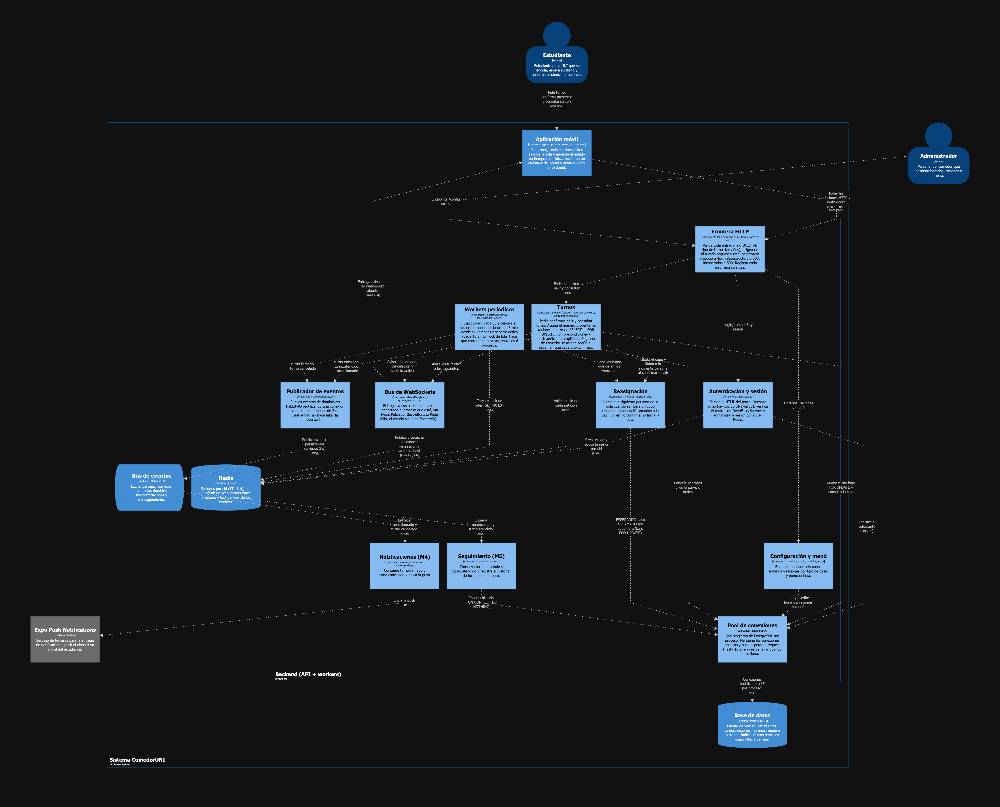
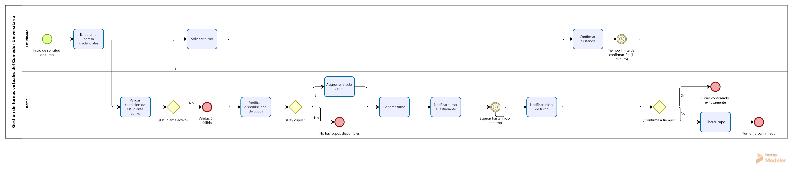
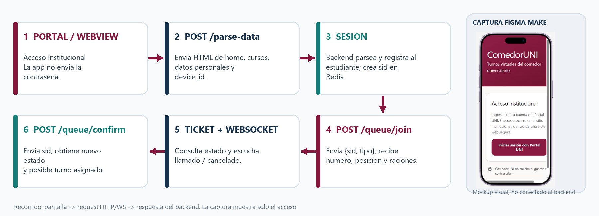
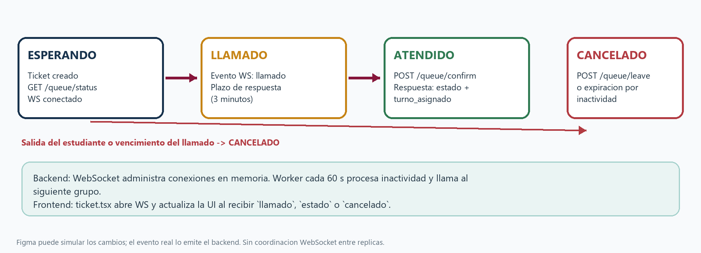
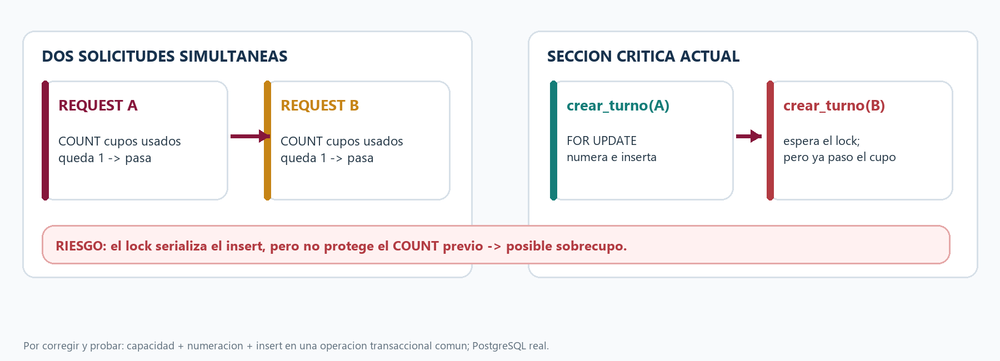
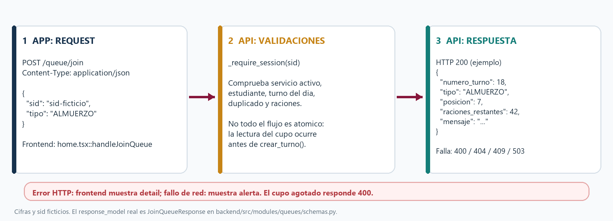
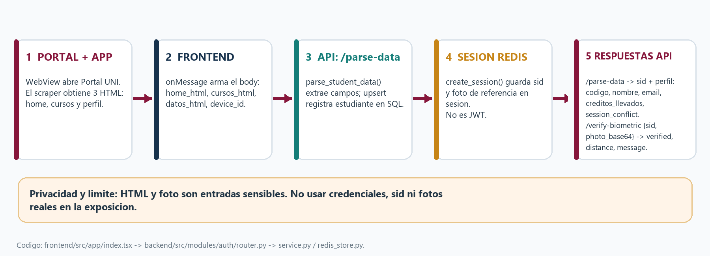
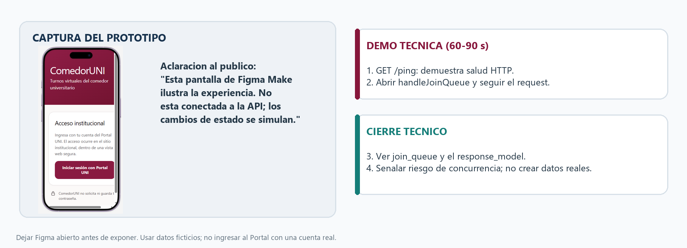

# Modelo de Vistas de Arquitectura 4+1 — ComedorUNI

El **Modelo de Vistas 4+1 de Philippe Kruchten** organiza la arquitectura de **ComedorUNI** en cinco vistas complementarias, garantizando que todos los requerimientos funcionales, no funcionales, de concurrencia y de despliegue se encuentren técnica y verificablemente articulados.

```
       +-----------------------------------+
       |        VISTA LÓGICA               |
       |  (Modelo de Dominio, Clases)      |
       +-----------------+-----------------+
                         |
+------------------------+------------------------+
| VISTA DE PROCESOS      | VISTA DE DESARROLLO    |
| (Concurrencia, Eventos,| (Paquetes, Módulos,    |
|  WebSockets, Workers)  |  Sección 16 Repo, DbC) |
+------------------------+------------------------+
                         |
       +-----------------+-----------------+
       |        VISTA FÍSICA / DESPLIEGUE  |
       |  (Contenedores, Nodos, Red)       |
       +-----------------+-----------------+
                         |
       +-----------------+-----------------+
       |      +1 VISTA DE ESCENARIOS       |
       |  (Casos de Uso Críticos y Flujos) |
       +-----------------------------------+
```

---

## 1. Vista Lógica (Logical View)

Describe la descomposición estructural y funcional del sistema: entidades del dominio, responsabilidades y relaciones estáticas.

### 1.1 Modelo de Dominio

El dominio modela la dinámica operativa del Comedor Universitario de la UNI, centrándose en la inmutabilidad de la asistencia y la equidad en el acceso:



### 1.2 Entidades Principales del Sistema

1. **`Estudiante`**: Entidad raíz de identidad. Contiene el código universitario (`codigo`), nombres, correo institucional, créditos matriculados y el hash de la fotografía oficial.
2. **`TurnosConfig`**: Define las reglas horarias (`hora_apertura`, `hora_inicio`, `hora_cierre`) y el límite estricto de cupos (`raciones_max`) para cada tipo de servicio (`ALMUERZO`, `CENA`).
3. **`TurnoDia`**: Instancia concreta de un servicio para una fecha determinada. Mantiene la cuenta transaccional de raciones concedidas.
4. **`Turno`**: Representa la solicitud de un estudiante. Posee un número correlativo (`numero`), un estado (`ESPERANDO`, `LLAMADO`, `ATENDIDO`, `CANCELADO`), el instante de llamado (`llamado_a`), y el grupo asignado para comedor (`grupo`, del 1 al 10).
5. **`RegistroSeguimiento`**: Bitácora inmutable de eventos de dominio (`turno.encolado`, `turno.llamado`, `turno.cancelado`, `turno.atendido`) para auditoría y analítica.
6. **`MenuDia` y `MenuPlato`**: Información nutricional, platos y valor calórico ofrecido en la jornada.

### 1.3 Arquitectura de Componentes Lógicos

El backend opera como un **Monolito Modular** con bajo acoplamiento entre dominios:



---

## 2. Vista de Procesos (Process View)

Aborda los aspectos dinámicos de tiempo de ejecución: flujos de control, concurrencia, sincronización de hilos, comunicación asíncrona y tolerancia a sobrecargas.

### 2.1 Diagrama de Procesos de Negocio

El flujo orquesta desde la captura de identidad institucional hasta la confirmación física en puerta:



### 2.2 Flujo General de Interacción

Muestra la interacción coordinada entre la App Móvil, la API HTTP, PostgreSQL, Redis, RabbitMQ y los workers:



### 2.3 Sincronización en Tiempo Real y Estados

El ciclo de vida del turno virtual y su transmisión reactiva hacia el teléfono del estudiante:



- **Canal WebSocket de Cola (`/queue/ws/{sid}`)**: El estudiante recibe notificaciones de posición, cuenta regresiva al ser llamado y cambio de estado sin necesidad de sondeo HTTP (`polling`).
- **Heartbeat & Pings**: La app emite un ping cada 10 s; el servidor responde y actualiza el último contacto (`last_ping`).

### 2.4 Control de Concurrencia y Prevención de Sobrecupo

Para evitar la sobreventa de raciones en la hora punta (ej. 2000 estudiantes intentando unirse simultáneamente), el sistema no confía en variables de memoria volátil:



1. **Bloqueo Pesimista Estricto**: `SELECT ... FOR UPDATE` sobre la fila del `turno_dia`.
2. **Verificación Atómica de Aforo**: Conteo de turnos activos dentro de la misma transacción. Si se alcanza `raciones_max`, se aborta y se lanza la excepción `SinRaciones`.
3. **Restricción de Unicidad**: Índice único condicional `(estudiante_id, turno_dia_id) WHERE estado != 'CANCELADO'`, impidiendo que un estudiante obtenga doble turno por peticiones en paralelo.

### 2.5 Worker Autónomo de Inactividad y Liberación de Cupos

Una corutina asíncrona periódica (`src/modules/queues/worker.py`) se ejecuta cada 60 s coordinada por un lock distribuido (`src/shared/leader_lock.py`):
- **Ventana de Tolerancia:** 3 minutos desde el llamado (`llamado_a`).
- **Política de No Bloqueo:** El estudiante que no confirma a tiempo no detiene la cola. Se llama al siguiente lote de espera (hasta `raciones_max / 10` cupos simultáneos).
- **Confirmación Rezagada:** Si el alumno rezagado confirma dentro de los 3 minutos, se le asigna cupo en el grupo que se atiende en ese instante, sin desplazar a quienes confirmaron con puntualidad. Si expira, pasa irreversiblemente a `CANCELADO`.

---

## 3. Vista de Desarrollo / Implementación (Development View)

Describe la organización del código fuente, la gestión de dependencias, los contratos de software y la conformidad con los estándares del curso.

### 3.1 Estructura Estándar del Repositorio (Sección 16)

El proyecto adopta rigurosamente la **Sección 16 del Proyecto Integrador SW707**:

```text
SW707U-CS2-ComedorUni/
├── src/                  # Código fuente modular del backend FastAPI
│   ├── modules/          # auth, queues, shifts, menu, config, notifications, tracking, reassignment
│   ├── shared/           # db, contratos, errores, http_errores, leader_lock, logs, push, rabbitmq, ws_bus
│   └── main.py           # Entrypoint ASGI y ciclo de vida de la aplicación
├── tests/                # Suite de 76 pruebas automatizadas en pytest
│   ├── conftest.py       # Fixtures, isolation, client y mock de DeepFace
│   ├── test_contracts.py # Design by Contract (15%)
│   ├── test_defensive.py # Programación Defensiva (10%)
│   ├── test_errors_and_exceptions.py # Manejo de Errores y Excepciones (15%)
│   ├── test_concurrency.py # Concurrencia y SELECT FOR UPDATE (15%)
│   ├── test_resilience.py  # Tolerancia a Fallas y Consumers (15%)
│   ├── test_reasignacion.py# Algoritmo de llamado por cupos y vencimiento
│   └── test_asignar_turno.py # Casos de uso de arquitectura hexagonal
├── docs/                 # Documentación técnica oficial, C4, 4+1, ADRs y exposiciones
│   ├── c4/               # Modelo C4 en 4 niveles con diagramas
│   ├── adr/              # Architecture Decision Records
│   ├── DocumentoTecnicoParcial.md # Documento oficial consolidado (100% rúbrica)
│   └── arquitectura-4plus1.md     # Este documento
├── config/               # Configuraciones, esquema SQL y contratos
│   ├── migrations/       # 001_init.sql (PostgreSQL 15)
│   ├── alembic/          # Migraciones evolutivas
│   └── openapi.yaml      # Especificación formal de la API
├── deployment/           # Manifiestos de despliegue y orquestación
│   ├── docker-compose.yml     # Stack de desarrollo local
│   ├── docker-compose.prod.yml# Stack de producción multi-worker (6 procesos)
│   └── Dockerfile             # Imagen Docker basada en python:3.12-slim
├── scripts/              # Scripts de automatización y métricas
│   ├── medir_acoplamiento.py  # Analizador estático de Ca, Ce e Inestabilidad (ast)
│   ├── export_openapi.py      # Extractor de esquema OpenAPI
│   └── publish_tunnel_url.ps1 # Publicador dinámico de URL a Gist
├── benchmarks/           # Pruebas de carga y estrés con Locust
│   ├── docker-compose.carga.yml # Infra aislada en tmpfs (puertos 5434, 6380, 5673)
│   ├── locustfile.py            # Escenario de carga masiva
│   ├── preparar_datos.py        # Sembrador y verificador de consistencia
│   └── README.md                # Resultados medidos con 1000 y 2000 usuarios
├── legacy/               # Registro de prototipos y decisiones superadas
├── frontend/             # Aplicación móvil / web en React Native + Expo
├── Dockerfile            # Dockerfile en la raíz
├── docker-compose.yml    # Compose de desarrollo en la raíz
├── README.md             # Guía de inicio rápido y arquitectura
├── CHANGELOG.md          # Historial de cambios Keep a Changelog (v1.0.0 Parcial)
├── .env.example          # Plantilla de variables de entorno sin secretos
└── .gitignore            # Exclusiones de Git (entornos virtuales, logs, build)
```

### 3.2 Design by Contract (DbC)

Se implementó el paradigma DbC en `src/shared/contratos.py` mediante las funciones `requiere(condicion, mensaje)` y `asegura(condicion, mensaje)`:



- **Precondiciones**: Validación estricta de argumentos antes de iniciar la transacción (ej. IDs positivos, estado coherente).
- **Postcondiciones**: Verificación de invariantes al culminar la operación (ej. el número asignado es consecutivo, la ración fue debitada exactamente en 1, el grupo asignado está en el rango $[1, 10]$).
- Si alguna cláusula falla, se lanza de inmediato la excepción de dominio `ContratoViolado`.

### 3.3 Programación Defensiva y Barricadas

- **Validación en la Frontera:** Modelos Pydantic en `schemas.py` y validadores regex en `src/shared/validacion.py` rechazan tipos inválidos, códigos malformados y payloads gigantes antes de tocar los servicios.
- **Sanitización de Scraping:** El parseo de HTML extraído del Portal Alumnos verifica la presencia de un código UNI válido de 9 caracteres (`^[0-9]{8}[A-Za-z0-9]$`), rechazando inyecciones de HTML o respuestas truncadas (`DatosPortalInvalidos`).
- **Consultas Parametrizadas:** 100% de las consultas SQL emplean tuplas de parámetros en `psycopg2`, erradicando cualquier vector de SQL Injection.

---

## 4. Vista Física / Despliegue (Physical / Deployment View)

Describe la topología física, nodos de computación, puertos de red, orquestación de contenedores y resiliencia de infraestructura.

### 4.1 Topología de Despliegue Multi-Worker

En producción (`deployment/docker-compose.prod.yml`), el backend opera con **6 workers de Uvicorn** para maximizar el paralelismo en procesadores multinúcleo:


### 4.2 Matriz de Puertos y Servicios de Red

| Servicio | Contenedor | Puerto Host (Dev) | Puerto Host (Carga) | Protocolo | Propósito |
|---|---|:---:|:---:|:---:|---|
| **FastAPI Backend** | `comedor-backend` | `8000` | `8000` | HTTP / WebSocket | Endpoints REST y canales de tiempo real |
| **PostgreSQL 15** | `comedor-postgres` | `5433` | `5434` | TCP / PostgreSQL | Persistencia relacional y transaccional |
| **Redis 7** | `comedor-redis` | `6379` | `6380` | TCP / Redis | Sesiones `sid`, Pub/Sub de WebSockets y Locks |
| **RabbitMQ AMQP** | `comedor-rabbitmq` | `5672` | `5673` | TCP / AMQP | Publicación de eventos de dominio |
| **RabbitMQ UI** | `comedor-rabbitmq` | `15672` | `15673` | HTTP | Panel web de monitoreo de colas |

### 4.3 Dimensionamiento y Resiliencia de Recursos

- **Pool de Conexiones PostgreSQL (`src/shared/db.py`)**:
  - `minconn = maxconn`: Mantiene conexiones precalentadas, eliminando la latencia de re-apretón TCP en Windows.
  - `ThreadedConnectionPool` protegido por un semáforo con tiempo de espera configurable (`DB_POOL_TIMEOUT = 10s`). En lugar de abortar inmediatamente con `PoolExhaustedError`, las peticiones esperan cupo en el pool.
  - PostgreSQL configurado con `max_connections = 300`.
- **Bus Distribuido de WebSockets (`src/shared/ws_bus.py`)**:
  - Permite que cuando un worker procesa una confirmación o cancelación, el mensaje WebSocket llegue al estudiante aunque este mantenga su conexión socket abierta contra otro worker distinto.
- **Lock Distribuido de Líder (`src/shared/leader_lock.py`)**:
  - Emplea `SET key value NX PX 55000` en Redis. Solo el worker que obtiene el lock ejecuta el ciclo del worker de inactividad, evitando ejecuciones redundantes entre los 6 procesos.

---

## +1. Vista de Escenarios / Casos de Uso (Scenarios / Use Cases)

Los escenarios representan los casos de uso críticos del sistema que integran, atraviesan y validan las cuatro vistas anteriores.

### Escenario 1: Autenticación, Scraping Seguro y Biometría Facial

Valida la integración con el Portal Alumnos UNI y la seguridad de identidad:



1. El estudiante inicia sesión en el WebView de la app contra `https://alumnos.uni.edu.pe`.
2. La app extrae el HTML seguro de los cursos matriculados y datos personales y lo envía a `POST /parse-data`.
3. El backend valida el formato del código UNI, realiza un upsert en PostgreSQL y genera un `sid` único en Redis (TTL 8h). Si existía una sesión previa en otro dispositivo, se revoca de inmediato.
4. Se ejecuta la verificación biométrica contrastando la foto del carné contra la cámara frontal mediante DeepFace.

### Escenario 2: Encolamiento Virtual en Hora Punta (Carga Concurrente)

Valida la concurrencia, atomicidad transaccional y resistencia a la sobreventa:
1. 2000 estudiantes solicitan turno simultáneamente (`POST /queue/join`) compitiendo por un cupo de 500 raciones.
2. Cada worker toma una conexión del pool; la transacción ejecuta `SELECT ... FOR UPDATE` sobre `turno_dia`.
3. Se asignan exactamente los turnos del 1 al 500, sin huecos ni saltos correlativos.
4. A partir de la petición 501, el backend responde HTTP 409 con código de dominio `SIN_RACIONES`.
5. Resultado verificado en benchmarks: **cero sobreventa, cero números duplicados, consistencia 100% verificada**.

### Escenario 3: Notificación en Tiempo Real y Despacho Asíncrono

Valida el desacoplamiento por eventos y tolerancia a fallas:
1. El backend emite el evento `turno.llamado` al exchange `comedor` de RabbitMQ.
2. Si RabbitMQ experimenta lentitud transitoria, la publicación tiene un timeout estricto de 2 s y no aborta la transacción del estudiante.
3. El consumidor M4 (`notifications/consumer.py`) recibe el mensaje y envía la notificación push a través de Expo Push Service.
4. Simultáneamente, el bus de Redis entrega el aviso al canal WebSocket `/queue/ws/{sid}` del teléfono del estudiante.

### Escenario 4: Confirmación en Puerta y Avance Autónomo de Cola

Valida la política de atención y reasignación por cupos:
1. Al llegar a la puerta del comedor, el estudiante pulsa "Confirmar Ticket" (`POST /queue/confirm`).
2. Se valida el contrato: debe estar en estado `LLAMADO` y dentro del plazo de 3 minutos.
3. Se le asigna el grupo de comedor del momento (1 a 10) y su estado pasa a `ATENDIDO`.
4. Si el estudiante no confirma dentro de los 3 minutos, el worker autónomo de inactividad lo detecta, libera su cupo y llama inmediatamente al siguiente estudiante en espera.

### Interfaz del Prototipo y Demostración

El diseño visual, la interfaz de estudiante y el prototipo funcional validan la experiencia de usuario:




- Prototipo interactivo en Figma Make: [Ver Prototipo Interactivo](https://www.figma.com/make/CoKplsedJ59U6BkDTlJLht/ComedorUni?fullscreen=1&t=N6J5IE1iyzJ2c1LJ-1&code-node-id=0-6)
- Video oficial de exposición técnica: [Ver Sustentación en YouTube](https://www.youtube.com/watch?v=g4voiWE8LB8)
