# Modelo C4 — Arquitectura de Software de ComedorUNI

El modelo C4 permite describir la arquitectura de software de **ComedorUNI** en cuatro niveles de abstracción incremental: **Contexto (Nivel 1)**, **Contenedores (Nivel 2)**, **Componentes (Nivel 3)** y **Código / Despliegue (Nivel 4)**.

---

## Nivel 1: Diagrama de Contexto del Sistema

El diagrama de contexto sitúa a ComedorUNI en su entorno operativo, identificando a los usuarios humanos y los sistemas externos autoritativos con los que interactúa.

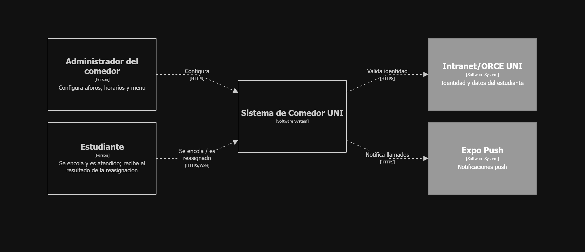

### Elementos del Nivel 1

| Elemento | Tipo | Descripción y Rol en el Sistema |
|---|---|---|
| **Estudiante** | Persona (Actor Primario) | Alumno matriculado en la UNI. Solicita turno virtual para el servicio activo (Almuerzo o Cena), monitorea su posición en tiempo real, recibe avisos de llamado y confirma su asistencia en el comedor. |
| **Administrador del Comedor** | Persona (Actor de Gestión) | Personal encargado de configurar los horarios diarios, cupos máximos de raciones (`raciones_max`) y registrar el menú nutricional del día. |
| **ComedorUNI** | Sistema de Software | Plataforma distribuida y reactiva que orquesta las colas virtuales, sincronización en tiempo real, asignación atómica de cupos y confirmación de turnos. |
| **Portal Alumnos UNI** (`alumnos.uni.edu.pe`) | Sistema Externo | Fuente autoritativa institucional de identidad, cursos matriculados y fotografía del carné estudiantil. Integrado mediante WebView controlado en la app móvil. |
| **Expo Push Notification Service** (`exp.host`) | Sistema Externo | Servicio en la nube para el despacho asíncrono y confiable de notificaciones push a dispositivos móviles Android e iOS. |

---

## Nivel 2: Diagrama de Contenedores

Muestra las aplicaciones ejecutables, almacenes de datos y brokers de mensajería que conforman la infraestructura de ComedorUNI.

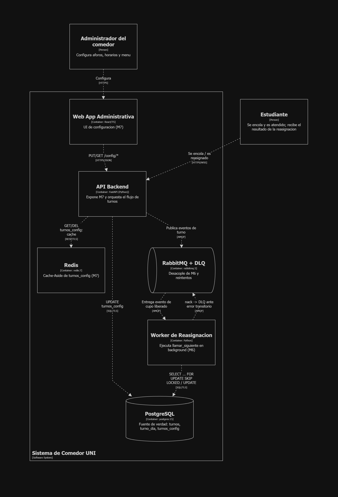

### Elementos del Nivel 2

| Contenedor | Tecnología | Responsabilidad y Protocolos |
|---|---|---|
| **Aplicación Móvil / Web** | React Native, Expo Router, TypeScript | Interfaz de usuario para estudiantes. Embebe WebView para autenticación contra el Portal Alumnos, captura fotografía para biometría, mantiene canal WebSocket abierto para estado de cola y recibe notificaciones push. |
| **Backend (API & Real-Time)** | Python 3.12, FastAPI, Uvicorn | Monolito modular asíncrono con 6 workers concurrentes. Expone API REST, canales WebSocket (`/queue/ws/{sid}`), workers asíncronos y consumidores de mensajería. |
| **Base de Datos Transaccional** | PostgreSQL 15 | Fuente única de verdad transaccional. Almacena estudiantes, configuraciones de turnos, asignación de turnos, auditoría de eventos y menús diarios. Resuelve concurrencia mediante `SELECT ... FOR UPDATE` e índices únicos parciales. |
| **Caché y Coordinación** | Redis 7 | Almacena sesiones de usuario (`sid`) con TTL de 8 horas, bus distribuido de WebSockets (`ws_bus.py`) mediante Pub/Sub entre workers, y cerrojo distribuido de líder (`leader_lock.py`). |
| **Broker de Mensajería** | RabbitMQ 3 | Bus de eventos asíncronos (Topic Exchange `comedor`). Desacopla la publicación de eventos de dominio (`turno.encolado`, `turno.llamado`, `turno.cancelado`, `turno.atendido`) de su consumo especializado. |

---

## Nivel 3: Diagrama de Componentes

Descompone el contenedor **Backend** en sus módulos funcionales y de soporte, demostrando el desacoplamiento interno y las interfaces de comunicación.

### Vista Consolidada de Componentes

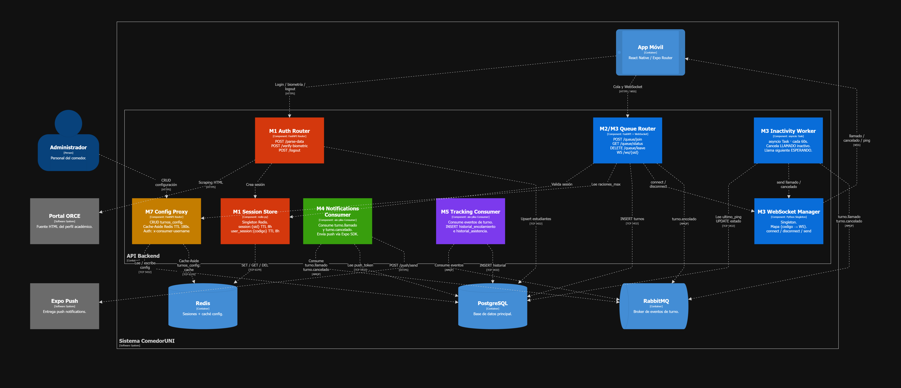

### Desglose por Módulos Funcionales

#### M1: Módulo de Autenticación y Sesión
Gestiona la extracción de datos desde el Portal Alumnos, la verificación biométrica y el ciclo de vida de la sesión en Redis.

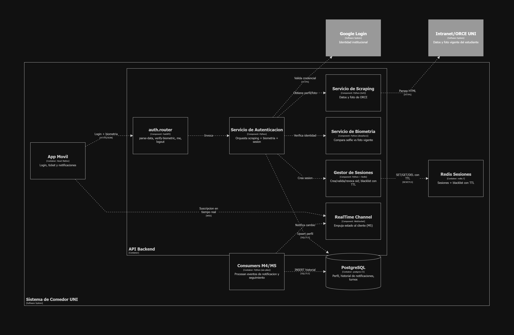
- **`src/modules/auth/router.py`**: Endpoints `/parse-data`, `/verify-biometric`, `/session/ws/{sid}`.
- **`src/modules/auth/service.py`**: Parseo robusto de HTML institucional y orquestación de sesión.
- **`src/modules/auth/biometric.py`**: Comparación facial mediante DeepFace / Facenet contra la foto oficial.
- **`src/modules/auth/redis_store.py`**: Persistencia de sesión con TTL e invalidación de sesiones previas (sesión única).

#### M2: Módulo de Gestión de Colas
Orquesta el encolamiento virtual, verificación de aforo y comunicación WebSocket en tiempo real.

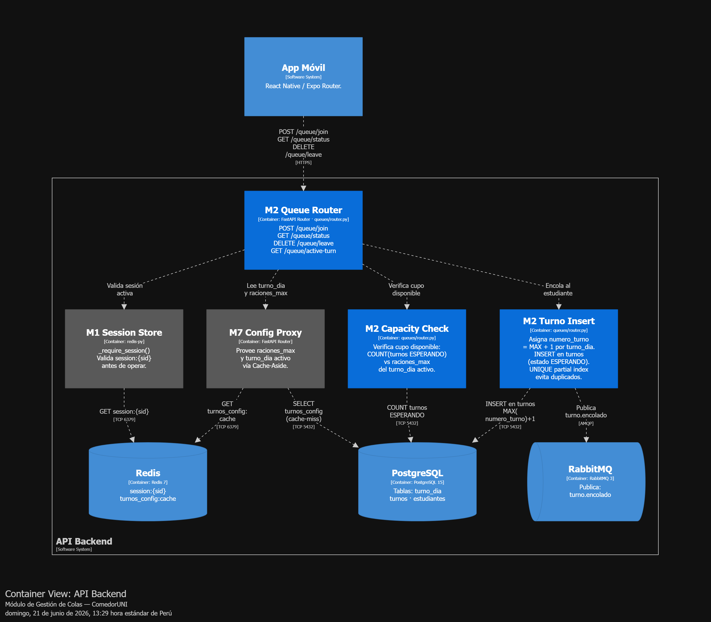
- **`src/modules/queues/router.py`**: Endpoints `/queue/join`, `/queue/status`, `/queue/confirm`, `/queue/cancel` y canal WebSocket `/queue/ws/{sid}`.
- **`src/modules/queues/service.py`**: Asignación transaccional con `SELECT ... FOR UPDATE` y validación de contratos DbC.
- **`src/modules/queues/manager.py`**: Gestión de conexiones WebSocket activas y despacho de pings periódicos.

#### M3: Módulo de Gestión de Turnos
Administra los servicios activos (Almuerzo / Cena), sus estados y la asignación de números correlativos.

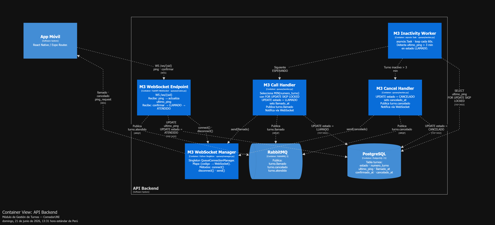
- Consulta y creación automática de turnos diarios (`ensure_turno_dia_hoy`).
- Canal de difusión WebSocket para el turno activo (`/queue/ws/active-service`).

#### M4: Módulo de Notificaciones Push
Consumidor asíncrono desacoplado para despacho a dispositivos móviles.

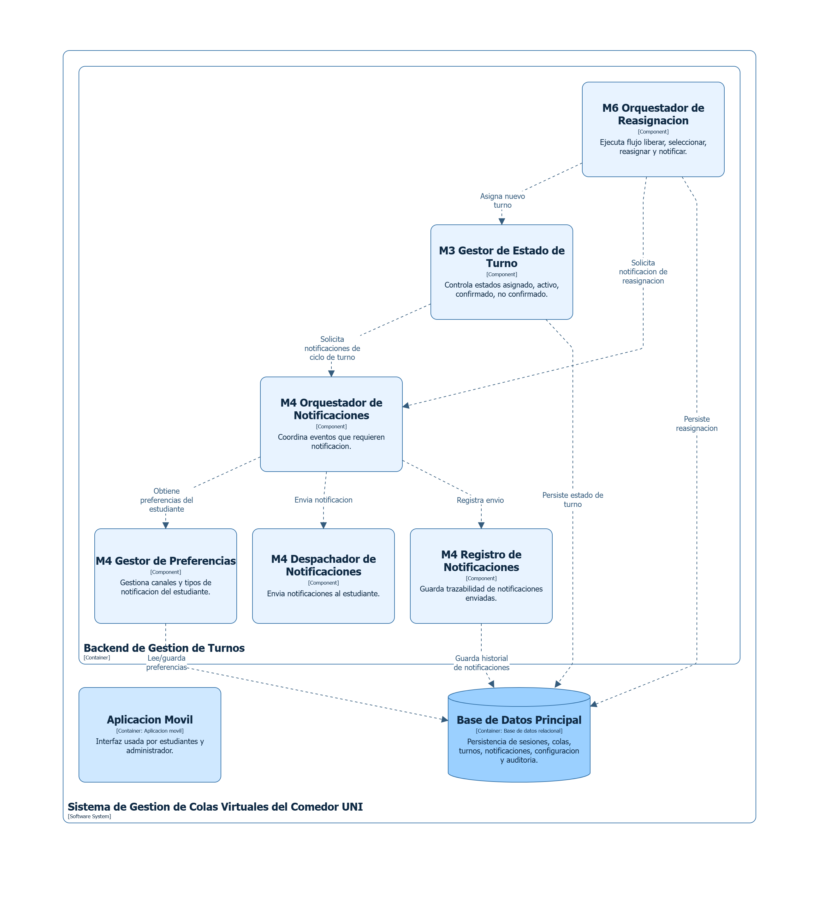
- **`src/modules/notifications/consumer.py`**: Consume eventos `turno.llamado` y `turno.cancelado` desde RabbitMQ.
- **`src/shared/push.py`**: Cliente HTTP asíncrono con timeout y degradación elegante hacia Expo Push Service (`https://exp.host/--/api/v2/push/send`).

#### M5: Módulo de Seguimiento y Auditoría
Garantiza trazabilidad histórica e inmutabilidad de eventos de asistencia.

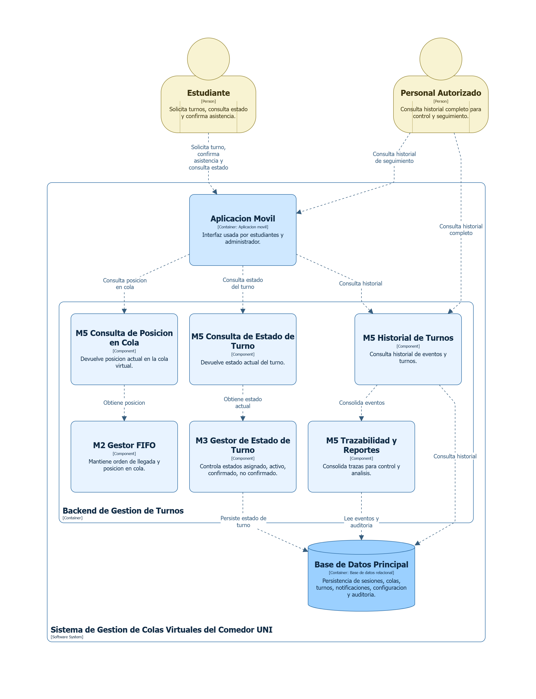
- **`src/modules/tracking/consumer.py`**: Consume eventos `turno.encolado` y `turno.atendido`.
- **`src/modules/tracking/service.py`**: Inserción idempotente en la tabla `registro_seguimiento`.

#### M6: Módulo de Reasignación Automática
Orquesta la liberación de cupos y el avance de la cola virtual.

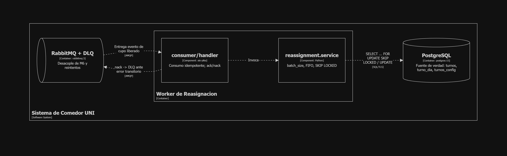
- **`src/modules/queues/worker.py`**: Tarea asíncrona periódica (cada 60 s) protegida por `leader_lock.py`. Cancela turnos llamados que no confirmaron en 3 minutos.
- **`src/modules/reassignment/service.py`**: Calcula los cupos libres (`raciones_max / 10`) y realiza el auto-llamado del siguiente lote de estudiantes en espera. Quien confirma tarde entra al grupo del momento sin desplazar a nadie.

#### M7: Módulo de Configuración y Menú
Provee las interfaces administrativas para horarios, raciones y nutrición.

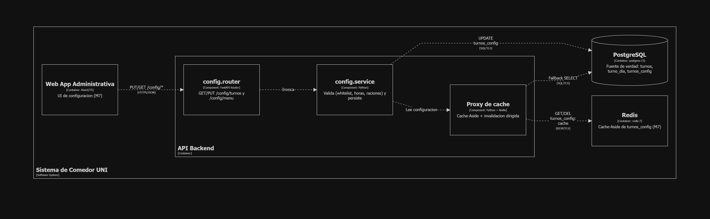
- **`src/modules/config/router.py`**: Configuración de `turnos_config` (horas de apertura, inicio, cierre y `raciones_max`).
- **`src/modules/menu/router.py`**: Gestión de platos, calorías y componentes nutricionales del menú diario.

---

## Nivel 4: Diagrama de Despliegue y Código

Ilustra la topología física y de contenedores en tiempo de ejecución, así como la organización interna del código fuente.

### Topología de Despliegue de Módulos

El backend se despliega en una topología multi-worker con coordinación distribuida:

#### Despliegue M1, M4 y M5 (Identidad, Push y Trazabilidad)
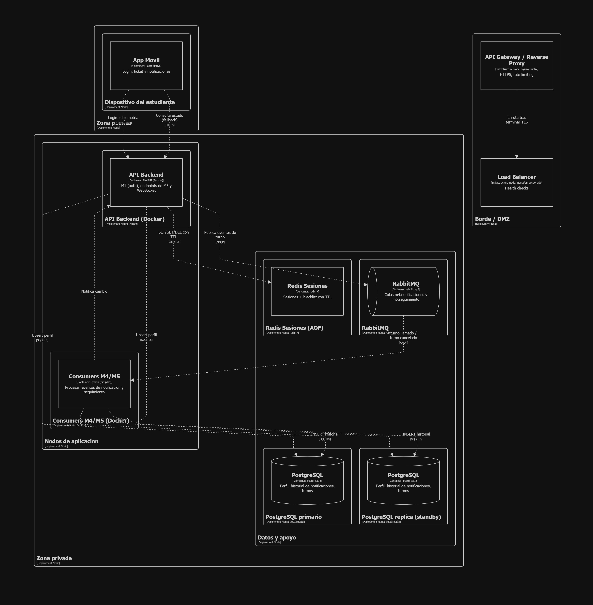

#### Despliegue M2 y M3 (Colas y Turnos con WebSockets y Redis Pub/Sub)
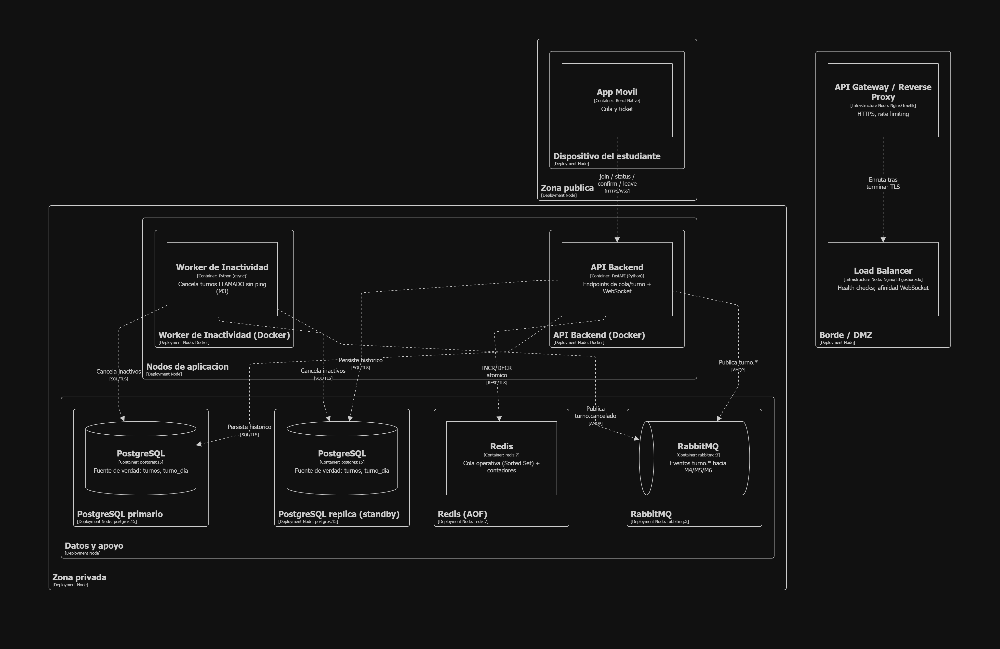

#### Despliegue M6 y M7 (Reasignación, Workers y Configuración)
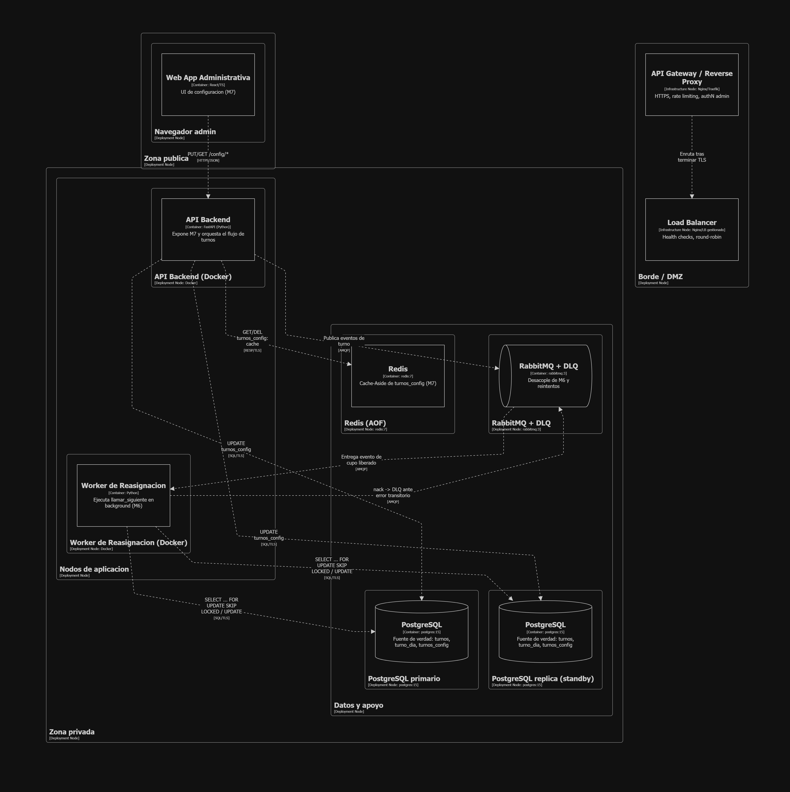

### Arquitectura de Código (Rodaja Hexagonal)

En el paquete `src/modules/queues/`, se implementó una rodaja de **Arquitectura Hexagonal (Puertos y Adaptadores)**:
- **Dominio (`src/modules/queues/domain/`)**:
  - `casos_uso.py`: Caso de uso puro `AsignarTurno`, independiente de la base de datos o frameworks.
  - `puertos.py`: Protocolo abstracto `RepositorioTurnos`.
- **Infraestructura (`src/modules/queues/infraestructura/`)**:
  - `adaptador_memoria.py`: Implementación en memoria (`RepositorioTurnosMemoria`) para pruebas unitarias sin latencia de I/O (`tests/test_asignar_turno.py`).
  - `adaptador_postgres.py`: Adaptador real contra PostgreSQL.
