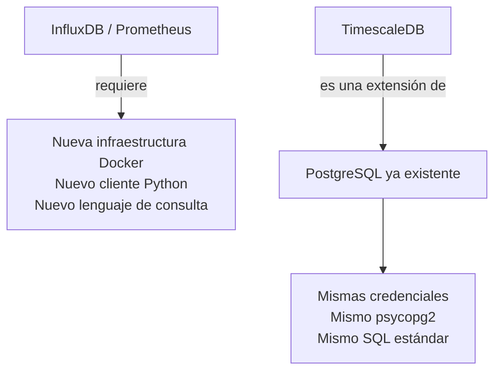

> [0. Acerca del Grupo](../../../0.md) › [0.5. Temas Individuales](../../0.5.md) › [0.5.3. PC 3](../0.5.3.md) › [0.5.3.1. Integrante 1](0.5.3.1.md)

# 0.5.3.1. Integrante 1

[Video](https://youtu.be/acFchA4idp0)

---

# TEMA INDIVIDUAL

**Integrante:** Yazid Elio Fernández Dueñas

**Módulos Asignados:** M1 – Autenticación · M4 – Notificaciones · M5 – Seguimiento

**Tema:** Base de Datos de Series Temporales (TSDB)

---

## 1. Desarrollo Conceptual

Una **base de datos de series temporales** (*Time-Series Database*, TSDB) es un sistema de almacenamiento especializado en datos que tienen una marca de tiempo como dimensión principal. A diferencia de una base de datos relacional genérica, una TSDB indexa los datos por tiempo de forma que las consultas más frecuentes —"¿qué ocurrió en las últimas 2 horas?", "¿cuántos eventos hubo por minuto?"— son órdenes de magnitud más rápidas.

### A. ¿Por qué importa la dimensión temporal en este sistema?

El comedor universitario opera en **ventanas de tiempo acotadas**: la apertura de la cola de almuerzo dura aproximadamente 1 hora, la cena otra. Todos los eventos del sistema —logins, verificaciones biométricas, encorlamientos, notificaciones push, asistencias— se concentran en esas ventanas. Preguntas como las siguientes son imposibles de responder eficientemente con tablas PostgreSQL estándar no optimizadas para tiempo:

- ¿A qué minuto exacto se produce el pico de logins cuando abre la cola?
- ¿Cuál es la latencia promedio de verificación biométrica durante los primeros 5 minutos de apertura?
- ¿Cuántas notificaciones push fallaron en la última hora y con qué tendencia?
- ¿Qué porcentaje de estudiantes que se encolaron terminaron siendo atendidos, por semana?

### B. Tres características clave de una TSDB

| Característica | Descripción | Beneficio concreto en ComedorUNI |
|---|---|---|
| **Particionado automático por tiempo** (*chunking*) | Los datos se dividen en bloques de un intervalo fijo (ej. 1 día). Las queries solo tocan los bloques relevantes. | Una consulta de "eventos de hoy" no escanea los 6 meses de historial anteriores. |
| **Compresión columnar** | Los valores repetidos en una misma columna (ej. `tipo_comida = 'ALMUERZO'`) se comprimen juntos. | Las tablas `historial_asistencia` e `historial_encolamiento` pueden reducir su tamaño hasta 10×. |
| **Agregaciones continuas** (*continuous aggregates*) | Vistas materializadas que se actualizan incrementalmente conforme llegan nuevos datos. | Un dashboard de asistencia diaria no recalcula todo el historial en cada carga — usa la vista precalculada. |

---

## 2. Elección Tecnológica: TimescaleDB

Existen varias opciones TSDB: **InfluxDB**, **Prometheus**, **VictoriaMetrics**, **QuestDB**, **TimescaleDB**. Para este sistema la elección correcta es **TimescaleDB** por una razón fundamental: es una **extensión de PostgreSQL**, no una base de datos aparte.



Esto significa que:
- No se añade ningún contenedor Docker nuevo.
- No se cambia el cliente de base de datos (`psycopg2`).
- Las tablas existentes (`historial_asistencia`, `historial_encolamiento`) se convierten en hypertables con **una sola instrucción SQL**.
- Los `JOIN` entre tablas relacionales y series temporales funcionan con SQL normal.

---

## 3. Cambios en la Infraestructura

### 3.1 Activar la extensión en PostgreSQL

En [`migrations/001_init.sql`](../../../../s111-actividad-bosquejo-implementacion/backend/migrations/001_init.sql) se añade al inicio:

```sql
-- Habilitar TimescaleDB (requiere imagen timescale/timescaledb en Docker)
CREATE EXTENSION IF NOT EXISTS timescaledb;
```

### 3.2 Cambio en `docker-compose.yml`

Reemplazar la imagen base de PostgreSQL por la de TimescaleDB (compatible 100%):

```yaml
# Antes
postgres:
  image: postgres:15

# Después
postgres:
  image: timescale/timescaledb:latest-pg15
```

No cambia ningún puerto, volumen, ni credencial. El resto del `docker-compose.yml` permanece idéntico.

### 3.3 Nuevas hypertables

Se añaden tres tablas al final del script de migración:

```sql
-- ─────────────────────────────────────────────
--  M1 · Eventos de autenticación (serie temporal)
-- ─────────────────────────────────────────────
CREATE TABLE IF NOT EXISTS auth_events (
    ts          TIMESTAMPTZ  NOT NULL DEFAULT NOW(),
    codigo      VARCHAR(20),                         -- NULL si el login falló antes de parsear el código
    evento      VARCHAR(30)  NOT NULL,               -- 'login_ok' | 'login_fail' | 'biometric_ok' | 'biometric_fail' | 'logout'
    latency_ms  INTEGER,                             -- duración de la operación en milisegundos
    detalle     TEXT                                 -- mensaje de error si aplica
);
SELECT create_hypertable('auth_events', 'ts');

-- ─────────────────────────────────────────────
--  M4 · Métricas de notificaciones push (serie temporal)
-- ─────────────────────────────────────────────
CREATE TABLE IF NOT EXISTS notification_events (
    ts          TIMESTAMPTZ  NOT NULL DEFAULT NOW(),
    evento      VARCHAR(30)  NOT NULL,               -- 'turno.llamado' | 'turno.cancelado'
    success     BOOLEAN      NOT NULL,
    latency_ms  INTEGER,
    detalle     TEXT                                 -- error si success = false
);
SELECT create_hypertable('notification_events', 'ts');

-- ─────────────────────────────────────────────
--  M5 · Convertir historial a hypertables
-- ─────────────────────────────────────────────
-- Las tablas ya existen; solo se convierten a hypertable sobre su columna de tiempo
SELECT create_hypertable('historial_asistencia',   'atendido_at',  migrate_data => true);
SELECT create_hypertable('historial_encolamiento', 'encolado_at',  migrate_data => true);

-- Agrupación diaria precalculada (continuous aggregate para dashboard)
CREATE MATERIALIZED VIEW asistencia_diaria
WITH (timescaledb.continuous) AS
SELECT
    time_bucket('1 day', atendido_at) AS dia,
    tipo_comida,
    COUNT(*)                           AS total_atendidos
FROM historial_asistencia
GROUP BY dia, tipo_comida;
```

---

## 4. Integración por Módulo

### M1 — Autenticación

**Situación actual:** [`auth/router.py`](../../../../s111-actividad-bosquejo-implementacion/backend/src/modules/auth/router.py) solo usa `print()` para registrar eventos. No existe ningún registro estructurado de cuándo y con qué resultado ocurre cada login o verificación biométrica.

**Qué se gana con la TSDB:** detectar el pico de logins al abrirse la cola (útil para escalar el backend con antelación), detectar intentos de fuerza bruta (muchos `login_fail` del mismo código en poco tiempo), medir la latencia real de `compare_faces()`.

**Código propuesto — antes:**
```python
# auth/router.py (situación actual)
@router.post("/parse-data")
def parse_data(data: ParseDataRequest = Body(...)):
    result = parse_student_data(data.home_html, data.cursos_html, data.datos_html)
    upsert_estudiante(...)
    print(f"[*] Estudiante guardado en DB: {result['codigo']}")   # ← solo print
    sid = str(uuid.uuid4())
    create_session(sid=sid, ...)
    return ParseDataResponse(...)
```

**Código propuesto — después:**
```python
# auth/router.py (con registro en TSDB)
import time
from ...shared.db import get_db_conn

def _record_auth_event(codigo: str | None, evento: str, latency_ms: int, detalle: str = None):
    conn = get_db_conn()
    try:
        with conn.cursor() as cur:
            cur.execute(
                "INSERT INTO auth_events (codigo, evento, latency_ms, detalle) VALUES (%s, %s, %s, %s)",
                (codigo, evento, latency_ms, detalle)
            )
        conn.commit()
    finally:
        conn.close()

@router.post("/parse-data")
def parse_data(data: ParseDataRequest = Body(...)):
    t0 = time.monotonic()
    try:
        result = parse_student_data(data.home_html, data.cursos_html, data.datos_html)
        upsert_estudiante(...)
        sid = str(uuid.uuid4())
        create_session(sid=sid, ...)
        _record_auth_event(result["codigo"], "login_ok", int((time.monotonic()-t0)*1000))
        return ParseDataResponse(...)
    except Exception as e:
        _record_auth_event(None, "login_fail", int((time.monotonic()-t0)*1000), str(e))
        raise

@router.post("/verify-biometric")
def verify_biometric(data: BiometricVerifyRequest = Body(...)):
    session = get_session(data.sid)
    if not session:
        raise HTTPException(status_code=401, detail="Sesión inválida o expirada")
    t0 = time.monotonic()
    verified, distance = compare_faces(session["foto_base64"], data.photo_base64)
    evento = "biometric_ok" if verified else "biometric_fail"
    _record_auth_event(session["codigo"], evento, int((time.monotonic()-t0)*1000))
    return BiometricVerifyResponse(verified=verified, distance=distance, ...)
```

**Consulta de ejemplo — pico de logins por minuto:**
```sql
SELECT
    time_bucket('1 minute', ts)  AS minuto,
    COUNT(*) FILTER (WHERE evento = 'login_ok')     AS exitosos,
    COUNT(*) FILTER (WHERE evento = 'login_fail')   AS fallidos,
    AVG(latency_ms)                                  AS latencia_prom_ms
FROM auth_events
WHERE ts > NOW() - INTERVAL '2 hours'
GROUP BY minuto
ORDER BY minuto;
```

---

### M4 — Notificaciones

**Situación actual:** [`notifications/consumer.py`](../../../../s111-actividad-bosquejo-implementacion/backend/src/modules/notifications/consumer.py) solo imprime errores con `print()`. No hay forma de saber si las notificaciones push están fallando de forma sostenida ni cuánto tarda `send_push()`.

**Qué se gana con la TSDB:** tasa de entrega de push en el tiempo, detección de ventanas donde el servicio de Expo/FCM falla, correlación entre llamadas masivas de turnos y picos de latencia.

**Código propuesto — antes:**
```python
# notifications/consumer.py (situación actual)
async def _handle(message: aio_pika.IncomingMessage) -> None:
    async with message.process():
        try:
            ...
            await send_push(token=push_token, title=title, body=body, data={...})
        except Exception as e:
            print(f"[M4] Error procesando mensaje: {e}")   # ← solo print
```

**Código propuesto — después:**
```python
# notifications/consumer.py (con registro en TSDB)
import time
from ...shared.db import get_db_conn

def _record_notification(evento: str, success: bool, latency_ms: int, detalle: str = None):
    conn = get_db_conn()
    try:
        with conn.cursor() as cur:
            cur.execute(
                "INSERT INTO notification_events (evento, success, latency_ms, detalle) VALUES (%s, %s, %s, %s)",
                (evento, success, latency_ms, detalle)
            )
        conn.commit()
    finally:
        conn.close()

async def _handle(message: aio_pika.IncomingMessage) -> None:
    async with message.process():
        payload = json.loads(message.body)
        evento  = payload.get("evento")
        t0 = time.monotonic()
        try:
            await send_push(token=payload.get("push_token"), ...)
            _record_notification(evento, True, int((time.monotonic()-t0)*1000))
        except Exception as e:
            _record_notification(evento, False, int((time.monotonic()-t0)*1000), str(e))
```

**Consulta de ejemplo — tasa de éxito de push por ventana de 5 minutos:**
```sql
SELECT
    time_bucket('5 minutes', ts) AS ventana,
    evento,
    COUNT(*) AS total,
    ROUND(COUNT(*) FILTER (WHERE success) * 100.0 / COUNT(*), 1) AS pct_exito,
    AVG(latency_ms) AS latencia_prom_ms
FROM notification_events
WHERE ts > NOW() - INTERVAL '1 hour'
GROUP BY ventana, evento
ORDER BY ventana;
```

---

### M5 — Seguimiento

**Situación actual:** [`tracking/service.py`](../../../../s111-actividad-bosquejo-implementacion/backend/src/modules/tracking/service.py) inserta en `historial_asistencia` e `historial_encolamiento`. Estas tablas ya tienen columnas de timestamp (`atendido_at`, `encolado_at`), pero al ser tablas PostgreSQL estándar, una consulta de "asistencia diaria de los últimos 30 días" escanea la tabla completa.

**Qué se gana con la TSDB:** las tablas se convierten en hypertables (una instrucción SQL, sin cambiar el código Python), las queries de rango temporal son 10–100× más rápidas, y el continuous aggregate `asistencia_diaria` permite generar reportes instantáneos sin recalcular el historial completo.

**Código Python — no cambia nada:** la conversión a hypertable es transparente; `INSERT`, `SELECT` y `ON CONFLICT DO NOTHING` funcionan exactamente igual.

**Consulta de ejemplo — asistencia por semana y tipo de comida:**
```sql
-- Usando la hypertable directamente
SELECT
    time_bucket('1 week', atendido_at)  AS semana,
    tipo_comida,
    COUNT(*)                             AS total_atendidos
FROM historial_asistencia
WHERE atendido_at > NOW() - INTERVAL '3 months'
GROUP BY semana, tipo_comida
ORDER BY semana;

-- Usando el continuous aggregate (instantáneo, precalculado)
SELECT dia, tipo_comida, total_atendidos
FROM asistencia_diaria
WHERE dia > NOW() - INTERVAL '30 days'
ORDER BY dia;
```

**Consulta de ejemplo — tasa de conversión encolar→atendido por día:**
```sql
SELECT
    time_bucket('1 day', e.encolado_at) AS dia,
    e.tipo_comida,
    COUNT(e.id)                          AS encolados,
    COUNT(a.id)                          AS atendidos,
    ROUND(COUNT(a.id) * 100.0 / NULLIF(COUNT(e.id), 0), 1) AS pct_conversion
FROM historial_encolamiento e
LEFT JOIN historial_asistencia a
    ON a.estudiante_id = e.estudiante_id
    AND a.turno_dia_id  = e.turno_dia_id
WHERE e.encolado_at > NOW() - INTERVAL '30 days'
GROUP BY dia, e.tipo_comida
ORDER BY dia;
```

---

## 5. Caso de Uso y Demostración

### Escenario seleccionado

*«Detección de pico de carga y análisis de conversión para la apertura del turno de almuerzo»*

**Contexto:** A las 6:00 am abre la cola de almuerzo. El administrador necesita saber (a) a qué minuto se saturó el sistema de login, (b) si las notificaciones push se entregaron correctamente cuando se llamaron los primeros turnos, y (c) qué porcentaje de estudiantes que se encolaron fueron efectivamente atendidos.

### Paso 1 — Inicializar entorno con TimescaleDB

```bash
# Cambiar imagen en docker-compose.yml (timescale/timescaledb:latest-pg15)
docker compose down -v
docker compose up -d --build
```

Al iniciar, `001_init.sql` ejecuta `CREATE EXTENSION IF NOT EXISTS timescaledb` y las llamadas a `create_hypertable`. PostgreSQL queda configurado como TSDB sin cambiar clientes ni credenciales.

### Paso 2 — Simular apertura de cola (pico de logins)

Se realizan múltiples peticiones `POST /parse-data` en ráfaga para simular el pico de las 6:00 am. Cada llamada escribe automáticamente en `auth_events` con su latencia.

```bash
# Verificar que los eventos fueron registrados
curl -s "http://localhost:8001/admin/auth_events_summary" | jq
```

Respuesta esperada:
```json
{
  "minuto": "06:00",
  "exitosos": 48,
  "fallidos": 2,
  "latencia_prom_ms": 312
}
```

### Paso 3 — Verificar entrega de notificaciones push

Cuando M3 llama al primer turno, publica en RabbitMQ → M4 consume y envía push → escribe en `notification_events`.

```sql
-- Ejecutar directamente en psql para ver resultados en tiempo real
SELECT
    time_bucket('1 minute', ts) AS minuto,
    COUNT(*) FILTER (WHERE success) AS enviadas,
    COUNT(*) FILTER (WHERE NOT success) AS fallidas
FROM notification_events
WHERE ts > NOW() - INTERVAL '30 minutes'
GROUP BY minuto ORDER BY minuto;
```

### Paso 4 — Reporte de conversión (al cierre del turno)

```sql
-- Tasa de conversión del turno de almuerzo de hoy
SELECT
    e.tipo_comida,
    COUNT(e.id)  AS encolados,
    COUNT(a.id)  AS atendidos,
    ROUND(COUNT(a.id) * 100.0 / NULLIF(COUNT(e.id), 0), 1) AS pct_conversion
FROM historial_encolamiento e
LEFT JOIN historial_asistencia a
    ON a.estudiante_id = e.estudiante_id AND a.turno_dia_id = e.turno_dia_id
WHERE e.encolado_at::date = CURRENT_DATE
  AND e.tipo_comida = 'ALMUERZO'
GROUP BY e.tipo_comida;
```

Resultado esperado:
```
 tipo_comida | encolados | atendidos | pct_conversion
─────────────┼───────────┼───────────┼────────────────
 ALMUERZO    |       312 |       287 |           92.0
```

---

## 6. Resumen de Cambios

| Componente | Cambio | Impacto |
|---|---|---|
| `docker-compose.yml` | Imagen `postgres:15` → `timescale/timescaledb:latest-pg15` | Zero downtime; misma API PostgreSQL |
| `migrations/001_init.sql` | `CREATE EXTENSION timescaledb` + 2 nuevas hypertables + 2 conversiones | Automático al levantar el contenedor |
| `auth/router.py` | Añadir `_record_auth_event()` en parse-data y verify-biometric | +4 líneas por endpoint |
| `notifications/consumer.py` | Añadir `_record_notification()` en `_handle()` | +5 líneas |
| `tracking/service.py` | **Sin cambios** — la conversión a hypertable es transparente al código Python | 0 líneas modificadas |

---

[🏠 Home](../../../../README.md) | [Siguiente ➡️](../0.5.3.2/0.5.3.2.md)
