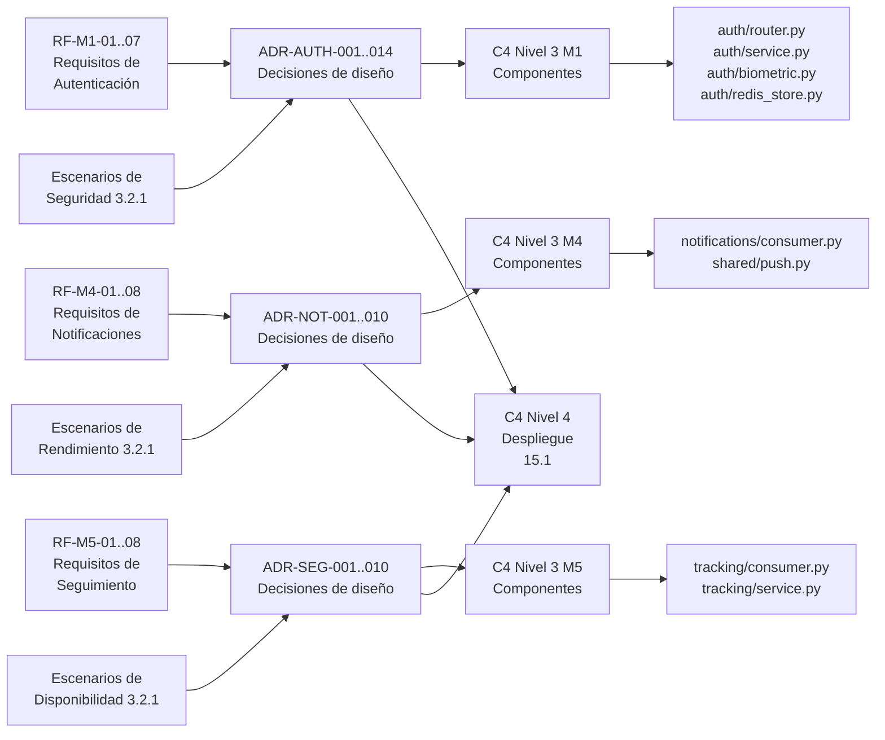

> [0. Acerca del Grupo](../../../0.md) › [0.5. Temas Individuales](../../0.5.md) › [0.5.4. PC 4](../0.5.4.md) › [0.5.4.1. Integrante 1](0.5.4.1.md)

# 0.5.4.1. Video Individual — Yazid Elio Fernández Dueñas

**Módulos cubiertos:** M1 – Autenticación · M4 – Notificaciones · M5 – Seguimiento

[Video](https://youtu.be/g4voiWE8LB8)

---

## 1. Aspectos Funcionales — Flujo Básico (Transacción Principal)

### Transacción elegida: Autenticar estudiante (M1)

La transacción principal del módulo es el **flujo completo de autenticación del estudiante**, que comprende los endpoints `POST /parse-data` → `POST /verify-biometric` → `GET /me` → `POST /logout`. Esta transacción es la puerta de entrada al sistema: sin ella, ningún otro módulo (cola virtual, turnos, notificaciones, seguimiento) puede operar.

#### Flujo de extremo a extremo demostrado en el video

| Paso | Endpoint | Descripción | Resultado esperado |
|---|---|---|---|
| 1 | `POST /parse-data` | El estudiante envía el HTML capturado de ORCE (`home_html`, `cursos_html`, `datos_html`). El backend parsea el perfil (código, nombre, email, créditos, foto) y crea la sesión en Redis. | `200` con `sid`, `nombre`, `codigo`, `email`, `creditos_llevados` |
| 2 | `POST /verify-biometric` | El estudiante envía su selfie en base64 junto con el `sid`. El backend compara la selfie contra la foto institucional almacenada en la sesión Redis usando deepface. | `200` con `verified: true`, `distance`, `message` |
| 3 | `GET /me` | El estudiante consulta su sesión activa usando el `sid`. | `200` con perfil del estudiante |
| 4 | `POST /logout` | El estudiante cierra sesión. El backend borra la sesión de Redis y el índice de usuario. | `200` confirmación de cierre |
| 5 | `GET /me` (post-logout) | Se verifica que el `sid` ya no es válido. | `401 Sesión inválida o expirada` |

#### Componentes C4 que participan

```
Estudiante
  └─→ App Móvil (React Native/Expo)
        └─→ API Backend (FastAPI)
              ├─→ auth.router (Facade: /parse-data, /verify-biometric, /me, /logout)
              │     ├─→ Servicio de Scraping (parse_student_data)
              │     ├─→ Servicio de Biometría (compare_faces - deepface)
              │     └─→ Gestor de Sesiones (create_session, get_session, delete_session)
              ├─→ Redis Sesiones (sid + TTL 8h + foto efímera)
              └─→ PostgreSQL (tabla estudiantes - upsert)
```

Ver diagrama C4 Nivel 3 en [4.1](../../../../4/4.1/4.1.md) y diagrama actualizado en [15.1](../../../../15/15.1/15.1.md).

#### Código fuente involucrado

| Archivo | Responsabilidad |
|---|---|
| [`auth/router.py`](../../../../s111-actividad-bosquejo-implementacion/backend/src/modules/auth/router.py) | Endpoints HTTP (Facade) |
| [`auth/service.py`](../../../../s111-actividad-bosquejo-implementacion/backend/src/modules/auth/service.py) | Parsing del HTML de ORCE |
| [`auth/biometric.py`](../../../../s111-actividad-bosquejo-implementacion/backend/src/modules/auth/biometric.py) | Comparación facial con deepface |
| [`auth/redis_store.py`](../../../../s111-actividad-bosquejo-implementacion/backend/src/modules/auth/redis_store.py) | Gestión de sesiones en Redis (Singleton) |
| [`auth/db_service.py`](../../../../s111-actividad-bosquejo-implementacion/backend/src/modules/auth/db_service.py) | Upsert en tabla `estudiantes` |

#### Comandos de ejecución mostrados en el video

```bash
# 1. Levantar infraestructura
cd s111-actividad-bosquejo-implementacion/
docker compose up -d                     # postgres:5433, redis:6379, rabbitmq:5672

# 2. Levantar backend
cd backend/
pip install -r requirements.txt
python run.py                            # uvicorn en http://localhost:8000

# 3. Transacción principal
# Paso 1: Login (parseo de ORCE)
curl -X POST http://localhost:8000/parse-data \
  -H "Content-Type: application/json" \
  -d '{"home_html":"<html>...</html>","cursos_html":"<html>...</html>","datos_html":"<html>...</html>"}'

# Paso 2: Verificación biométrica
curl -X POST http://localhost:8000/verify-biometric \
  -H "Content-Type: application/json" \
  -d '{"sid":"<sid_devuelto>","photo_base64":"/9j/4AAQ..."}'

# Paso 3: Consultar sesión
curl "http://localhost:8000/me?sid=<sid_devuelto>"

# Paso 4: Logout
curl -X POST http://localhost:8000/logout \
  -H "Content-Type: application/json" \
  -d '{"sid":"<sid_devuelto>"}'

# Paso 5: Verificar invalidación
curl -s -o /dev/null -w "%{http_code}\n" "http://localhost:8000/me?sid=<sid_devuelto>"
# Resultado: 401
```

### Flujos complementarios — M4 (Notificaciones) y M5 (Seguimiento)

**M4 – Notificaciones:** El consumer de RabbitMQ escucha los eventos `turno.llamado` y `turno.cancelado` publicados por M3. Al recibir un evento, despacha una push notification via Expo Push Notifications al dispositivo del estudiante y registra el envío. Se demuestra publicando un mensaje manualmente en RabbitMQ (`http://localhost:15672`, guest/guest) y observando el log del consumer.

- Código: [`notifications/consumer.py`](../../../../s111-actividad-bosquejo-implementacion/backend/src/modules/notifications/consumer.py)

**M5 – Seguimiento:** El consumer escucha `turno.atendido` y `turno.encolado`, y persiste los registros en `historial_asistencia` e `historial_encolamiento` con idempotencia (`ON CONFLICT DO NOTHING`). El estado en tiempo real se entrega por WebSocket.

- Código: [`tracking/consumer.py`](../../../../s111-actividad-bosquejo-implementacion/backend/src/modules/tracking/consumer.py)

---

## 2. Escenarios de Calidad Abordados

En el video se demuestran los siguientes escenarios provocando la condición y mostrando el comportamiento resultante:

### Escenario 1 — Seguridad: Rechazo de sesión inválida

| Aspecto | Detalle |
|---|---|
| **Escenario de calidad** | Una petición usa un `sid` inválido o expirado → el sistema rechaza con `401` |
| **Atributo** | Seguridad |
| **Condición provocada** | Se llama a `GET /me?sid=inexistente` |
| **Comportamiento esperado** | `401 Sesión inválida o expirada` |
| **Táctica implementada** | Validación de sesión en Redis antes de ejecutar la lógica de negocio |
| **Decisión (ADR)** | [ADR-AUTH-003](../../../../5/5.1/5.1.md) — Sesiones UUID en Redis; [ADR-AUTH-010](../../../../5/5.1/5.1.md) — Verificación de sid |
| **Diagrama C4** | [15.1](../../../../15/15.1/15.1.md) → API Backend → Gestor de Sesiones |
| **Código** | [`auth/router.py`](../../../../s111-actividad-bosquejo-implementacion/backend/src/modules/auth/router.py) → `get_session(data.sid)` + `HTTPException(401)` |

```bash
# Demostración en video
curl -s -o /dev/null -w "%{http_code}\n" "http://localhost:8000/me?sid=sid-falso-12345"
# → 401
```

### Escenario 2 — Seguridad: Verificación biométrica fallida (impostor)

| Aspecto | Detalle |
|---|---|
| **Escenario de calidad** | Un impostor presenta una selfie que no coincide con la foto institucional |
| **Atributo** | Seguridad |
| **Condición provocada** | `POST /verify-biometric` con una foto de otra persona |
| **Comportamiento esperado** | `200` con `verified: false` y `distance` alto |
| **Táctica implementada** | Comparación facial con umbral de distancia usando deepface |
| **Decisión (ADR)** | [ADR-AUTH-011](../../../../5/5.1/5.1.md) — Comparación biométrica local con deepface |
| **Diagrama C4** | [15.1](../../../../15/15.1/15.1.md) → Servicio de Biometría (M1) |
| **Código** | [`auth/biometric.py`](../../../../s111-actividad-bosquejo-implementacion/backend/src/modules/auth/biometric.py) → `compare_faces()` |

### Escenario 3 — Seguridad: Sesión única por estudiante

| Aspecto | Detalle |
|---|---|
| **Escenario de calidad** | El estudiante inicia sesión en un segundo dispositivo → la sesión anterior se invalida automáticamente |
| **Atributo** | Seguridad |
| **Condición provocada** | Se hace login dos veces con el mismo código de estudiante |
| **Comportamiento esperado** | El primer `sid` deja de validar (`/me` → `401`), solo el segundo `sid` es válido |
| **Táctica implementada** | Al crear sesión, se verifica si existe una sesión previa del mismo `codigo` y se borra |
| **Decisión (ADR)** | [ADR-AUTH-003](../../../../5/5.1/5.1.md) — Sesión UUID en Redis con índice `user_session:{codigo}` |
| **Diagrama C4** | [15.1](../../../../15/15.1/15.1.md) → Gestor de Sesiones → Redis |
| **Código** | [`auth/redis_store.py`](../../../../s111-actividad-bosquejo-implementacion/backend/src/modules/auth/redis_store.py) → `create_session` (borra `session:{old_sid}`) |

```bash
# Demostración en video
# Login 1 → obtiene sid_1
# Login 2 (mismo estudiante) → obtiene sid_2
curl "http://localhost:8000/me?sid=<sid_1>"   # → 401 (invalidado)
curl "http://localhost:8000/me?sid=<sid_2>"   # → 200 (activo)
```

### Escenario 4 — Seguridad/Continuidad: TTL de sesión (expiración automática)

| Aspecto | Detalle |
|---|---|
| **Escenario de calidad** | Una sesión queda abandonada y no debe vivir indefinidamente |
| **Atributo** | Seguridad / Continuidad |
| **Condición provocada** | Se verifica el TTL de la sesión en Redis tras el login |
| **Comportamiento esperado** | La sesión tiene TTL de 8 horas (`28800` segundos); al expirar, `GET /me` → `401` |
| **Táctica implementada** | `setex` en Redis con `SESSION_TTL = 8 * 3600` |
| **Decisión (ADR)** | [ADR-AUTH-003](../../../../5/5.1/5.1.md) — UUID sid con TTL en Redis |
| **Diagrama C4** | [15.1](../../../../15/15.1/15.1.md) → Redis Sesiones (despliegue) |
| **Código** | [`auth/redis_store.py`](../../../../s111-actividad-bosquejo-implementacion/backend/src/modules/auth/redis_store.py) → `SESSION_TTL`, `r.setex(...)` |

```bash
# Demostración en video
docker exec -it comedor-redis redis-cli TTL session:<sid>
# → 28800 (o valor decrementando)
```

### Escenario 5 — Seguridad/Privacidad: Foto biométrica efímera (no persistida)

| Aspecto | Detalle |
|---|---|
| **Escenario de calidad** | La foto institucional no debe quedar almacenada de forma permanente |
| **Atributo** | Seguridad / Privacidad |
| **Condición provocada** | Se inspecciona la tabla `estudiantes` en PostgreSQL tras el login |
| **Comportamiento esperado** | No existe columna `foto` ni `foto_base64` en la tabla; la foto solo vive en Redis con TTL |
| **Táctica implementada** | Minimización de datos biométricos: `foto_base64` solo en sesión Redis |
| **Decisión (ADR)** | [ADR-AUTH-004](../../../../5/5.1/5.1.md) — Foto biométrica almacenada en sesión Redis (efímera) |
| **Diagrama C4** | [15.1](../../../../15/15.1/15.1.md) → Gestor de Sesiones → Redis (no DB) |
| **Código** | [`auth/router.py`](../../../../s111-actividad-bosquejo-implementacion/backend/src/modules/auth/router.py) → `create_session(foto_base64=...)`, `upsert_estudiante` sin foto |

```bash
# Demostración en video
docker exec -it comedor-postgres psql -U admin -d comedor -c "\d estudiantes"
# → No hay columna foto_base64
docker exec -it comedor-redis redis-cli GET session:<sid>
# → Contiene foto_base64 (solo mientras la sesión esté activa)
```

### Escenario 6 — Seguridad: Revocación de sesión en logout

| Aspecto | Detalle |
|---|---|
| **Escenario de calidad** | El estudiante cierra sesión y su `sid` no debe seguir válido |
| **Atributo** | Seguridad |
| **Condición provocada** | `POST /logout` seguido de `GET /me?sid=<sid>` |
| **Comportamiento esperado** | `401 Sesión inválida o expirada` |
| **Táctica implementada** | `delete_session(sid)` borra la clave de Redis inmediatamente |
| **Decisión (ADR)** | [ADR-AUTH-003](../../../../5/5.1/5.1.md) — UUID sid en Redis; revocación = borrar clave |
| **Diagrama C4** | [15.1](../../../../15/15.1/15.1.md) → Gestor de Sesiones → Redis |
| **Código** | [`auth/redis_store.py`](../../../../s111-actividad-bosquejo-implementacion/backend/src/modules/auth/redis_store.py) → `delete_session` |

### Escenario 7 — Continuidad: Resiliencia de consumers (M4/M5)

| Aspecto | Detalle |
|---|---|
| **Escenario de calidad** | Un mensaje de notificación llega malformado o incompleto al consumer |
| **Atributo** | Continuidad |
| **Condición provocada** | Se publica manualmente un evento sin `push_token` en la cola `m4.notificaciones` desde RabbitMQ Management UI |
| **Comportamiento esperado** | El consumer descarta el mensaje y sigue vivo procesando los siguientes |
| **Táctica implementada** | `try/except` + guard clauses + `message.process()` (ack implícito) |
| **Decisión (ADR)** | [ADR-NOT-009](../../../../5/5.1/5.1.md) — Manejo de errores con ack implícito; [ADR-SEG-009](../../../../5/5.1/5.1.md) |
| **Diagrama C4** | [15.1](../../../../15/15.1/15.1.md) → Consumers M4/M5 (contenedores aislados) |
| **Código** | [`notifications/consumer.py`](../../../../s111-actividad-bosquejo-implementacion/backend/src/modules/notifications/consumer.py) → `_handle` (guard + try/except) |

```bash
# Demostración en video
# Publicar en RabbitMQ Management (localhost:15672) un mensaje sin push_token
# → Log: "[M4] Descartado: sin push_token o evento"
# → El consumer sigue procesando mensajes posteriores
```

### Escenario 8 — Integridad: Idempotencia del historial (M5)

| Aspecto | Detalle |
|---|---|
| **Escenario de calidad** | Un evento `turno.atendido` se reintenta (RabbitMQ redelivery) y no debe duplicar el historial |
| **Atributo** | Integridad / Auditoría |
| **Condición provocada** | Se publica el mismo evento `turno.atendido` dos veces con el mismo `estudiante_id` y `turno_dia_id` |
| **Comportamiento esperado** | Solo un registro en `historial_asistencia`; la segunda inserción se descarta silenciosamente |
| **Táctica implementada** | `UNIQUE (estudiante_id, turno_dia_id)` + `INSERT ... ON CONFLICT DO NOTHING` |
| **Decisión (ADR)** | [ADR-SEG-005](../../../../5/5.1/5.1.md) — Idempotencia con ON CONFLICT DO NOTHING |
| **Diagrama C4** | [15.1](../../../../15/15.1/15.1.md) → Consumer M5 → PostgreSQL |
| **Código** | [`tracking/consumer.py`](../../../../s111-actividad-bosquejo-implementacion/backend/src/modules/tracking/consumer.py) → `registrar_asistencia` / [`001_init.sql`](../../../../s111-actividad-bosquejo-implementacion/backend/migrations/001_init.sql) → `UNIQUE` constraint |

```sql
-- Demostración en video
SELECT COUNT(*) FROM historial_asistencia
  WHERE estudiante_id = X AND turno_dia_id = Y;
-- → 1 (aunque el evento se procesó 2 veces)
```

---

## 3. Trazabilidad Completa

En esta sección se muestra el hilo completo de trazabilidad para cada aspecto clave del módulo: **Requisito/Escenario → Decisión de Diseño → Diagrama C4 → Código**.

### Hilo 1: Autenticación del estudiante

```
REQUISITO                  DECISIÓN                         DIAGRAMA C4                      CÓDIGO
─────────                  ────────                         ───────────                      ──────
RF-M1-01/02/03             ADR-AUTH-001                     Nivel 3 M1 (4.1)                 auth/service.py
"Validar credenciales      "Parsing de HTML del ORCE        → Servicio de Scraping           → parse_student_data()
 institucionales"           enviado por el cliente"           (Componentes)

RF-M1-05                   ADR-AUTH-003                     Nivel 3 M1 (4.1)                 auth/redis_store.py
"Crear sesión personal     "UUID sid en Redis               → Gestor de Sesiones             → create_session()
 e intransferible"          con TTL"                         → Redis Sesiones

Seguridad (3.2.1)          ADR-AUTH-011                     Nivel 3 M1 (15.1)                auth/biometric.py
"Verificar identidad       "Comparación biométrica          → Servicio de Biometría          → compare_faces()
 real del estudiante"       local con deepface"              (Componentes)

RF-M1-07                   ADR-AUTH-003                     Nivel 3 M1 (4.1)                 auth/redis_store.py
"Cerrar sesión de          "Revocación = borrar             → Gestor de Sesiones             → delete_session()
 manera segura"             clave Redis"                     → Redis
```

### Hilo 2: Notificaciones push (M4)

```
REQUISITO                  DECISIÓN                         DIAGRAMA C4                      CÓDIGO
─────────                  ────────                         ───────────                      ──────
RF-M4-01/02/03             ADR-NOT-001                      Nivel 3 M4 (4.1)                 shared/push.py
"Notificar eventos         "Expo Push Notifications         → Despachador de                 → send_push()
 del turno"                 como canal principal"             Notificaciones

RF-M4-01                   ADR-NOT-002                      Nivel 2 (15.1)                   notifications/consumer.py
"Enviar notificación       "RabbitMQ con colas              → RabbitMQ (Contenedores)        → consumer._handle()
 al asignar turno"          durables"

RF-M4-01                   ADR-NOT-004                      Nivel 3 M4 (4.1)                 notifications/consumer.py
"M3 genera el evento,      "M3 publica, M4 consume          → Orquestador de                → _handle() consume
 M4 lo despacha"            (Observer via RabbitMQ)"          Notificaciones                   turno.llamado

Rendimiento (3.2.1)        ADR-NOT-006                      Nivel 2 (15.1)                   consumer.py
"Latencia < 2s en          "Colas durables; ack             → RabbitMQ → Consumer M4         → message.process()
 notificación"              con message.process()"
```

### Hilo 3: Seguimiento e historial (M5)

```
REQUISITO                  DECISIÓN                         DIAGRAMA C4                      CÓDIGO
─────────                  ────────                         ───────────                      ──────
RF-M5-04/05                ADR-SEG-001                      Nivel 3 M5 (4.1)                 tracking/service.py
"Registrar todos los       "PostgreSQL con tablas            → Historial de Turnos            → registrar_asistencia()
 eventos con timestamp"     de append"                       → Trazabilidad

RF-M5-04                   ADR-SEG-003                      Nivel 2 (15.1)                   tracking/consumer.py
"Registro desacoplado      "M5 consume eventos de            → Consumer M5 →                 → _handle()
 del módulo de cola"        RabbitMQ"                         PostgreSQL

RF-M5-05                   ADR-SEG-005                      Nivel 3 M5 (4.1)                 tracking/service.py
"Evitar duplicados         "ON CONFLICT DO NOTHING           → Historial de Turnos            → INSERT ... ON CONFLICT
 en auditoría"              + UNIQUE constraint"              (PostgreSQL)                      DO NOTHING

Disponibilidad (3.2.1)     ADR-SEG-006                      Nivel 3 M5 (4.1)                 consumer.py
"Consistencia sin          "Eventos enriquecidos;            → Consumer M5                    → payload.get()
 consultas extra"           M5 no consulta a M3"              (sin dependency)                  (datos inline)
```

### Resumen visual del hilo de trazabilidad


---

## 4. Referencias Cruzadas

| Sección | Contenido | Enlace |
|---|---|---|
| 3.1.1 | Requisitos funcionales de M1, M4, M5 | [3.1.1](../../../../3/3.1/3.1.1/3.1.1.md) |
| 3.2.1 | Escenarios de calidad de M1, M4, M5 | [3.2.1](../../../../3/3.2/3.2.1/3.2.1.md) |
| 4.1 | Diagramas C4 Nivel 3 (Componentes) | [4.1](../../../../4/4.1/4.1.md) |
| 5.1 | Decisiones de diseño (ADRs) | [5.1](../../../../5/5.1/5.1.md) |
| 15.1 | C4 actualizado + Diagrama de Despliegue | [15.1](../../../../15/15.1/15.1.md) |
| 16.1 | Prototipo ejecutable — Flujo principal | [16.1](../../../../16/16.1/16.1.md) |
| 17.1 | Prototipo ejecutable — Escenarios de calidad | [17.1](../../../../17/17.1/17.1.md) |

---

[⬅️ Anterior](../0.5.4.1/0.5.4.1.md) | [🏠 Home](../../../../README.md) | [Siguiente ➡️](../0.5.4.2/0.5.4.2.md)
