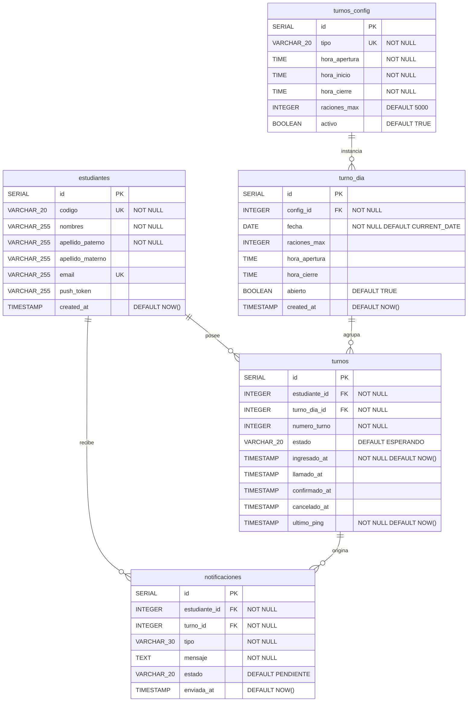

> [10. Modelo de Datos por Motor](../10.md) › [10.1. Módulo 1 / Integrante 1](10.1.md)

# 10.1. Módulo 1 / Integrante 1

**Módulos cubiertos:** M1 – Autenticación · M4 – Notificaciones · M5 – Seguimiento

**Motores utilizados:** PostgreSQL (relacional) · Redis (clave/valor)

---

## PostgreSQL — Modelo Relacional (ERD)

Las tablas marcadas con el módulo propietario indican quién es responsable de escribir en ellas. M5 no tiene tablas propias: lee de `turnos` (propietario M3) y `turno_dia` (propietario M2). M4 no tiene tabla en la migración actual: el diseño propuesto se incluye al final de esta sección.



### Restricciones e índices relevantes

| Tabla | Restricción | Detalle |
|---|---|---|
| `estudiantes` | `UNIQUE(codigo)` | Un solo perfil por código institucional |
| `estudiantes` | `UNIQUE(email)` | Un solo perfil por correo |
| `turno_dia` | `UNIQUE(config_id, fecha)` | Un ALMUERZO y una CENA por día como máximo |
| `turnos` | `CHECK(estado IN (...))` | Solo acepta: `ESPERANDO`, `LLAMADO`, `ATENDIDO`, `CANCELADO` |
| `turnos` | Índice parcial `UNIQUE(estudiante_id, turno_dia_id) WHERE estado != 'CANCELADO'` | Un estudiante no puede tener dos turnos activos para el mismo servicio del día |
| `turnos` | Índice compuesto `(turno_dia_id, estado)` | Optimiza las consultas de cola por servicio y estado |
| `notificaciones` | `CHECK(tipo IN (...))` | Solo acepta: `TURNO_LLAMADO`, `TURNO_CANCELADO`, `PING_REQUEST`, `TURNO_ATENDIDO` |
| `notificaciones` | `CHECK(estado IN (...))` | Solo acepta: `PENDIENTE`, `ENTREGADO`, `EXPIRADO` |

> La tabla `notificaciones` es el diseño propuesto por el ADR de M4. No existe aún en la migración `001_init.sql` pero corresponde al motor y esquema decididos.

---

## Redis — Modelo Clave/Valor (M1)

Redis almacena exclusivamente los datos de sesión de M1. No interviene en M4 ni M5.

### Convención de claves y formato de valor

#### Sesión activa por `sid`

| Campo | Valor |
|---|---|
| **Patrón de clave** | `session:{sid}` |
| **Tipo de valor** | String JSON con campos: `codigo`, `email`, `nombre`, `creditos`, `foto_base64` |
| **TTL** | 28 800 segundos (8 horas) |
| **Patrón de acceso** | Escritura en login · Lectura en cada request autenticado y en verificación biométrica · Eliminación en logout |

Ejemplo:
```
CLAVE:  session:a7f3c2e1-8b4d-4f9a-b2c1-3e5d7f9a1b2c
VALOR:  {"codigo": "20201234A", "email": "yazid.fernandez@uni.pe",
         "nombre": "Yazid Elio Fernandez Dueñas", "creditos": 120,
         "foto_base64": "<cadena base64 de la foto vigente en ORCE>"}
TTL:    28800
```

#### Sesión activa por `codigo` (sesión única)

| Campo | Valor |
|---|---|
| **Patrón de clave** | `user_session:{codigo}` |
| **Tipo de valor** | String con el `sid` activo del estudiante |
| **TTL** | 28 800 segundos (8 horas), igual que `session:{sid}` |
| **Patrón de acceso** | Escritura en login · Lectura en login (para invalidar sesión previa) · Eliminación en logout |

Ejemplo:
```
CLAVE:  user_session:20201234A
VALOR:  "a7f3c2e1-8b4d-4f9a-b2c1-3e5d7f9a1b2c"
TTL:    28800
```

Esta segunda clave sirve para garantizar **sesión única**: cuando el estudiante inicia sesión desde un nuevo dispositivo, el backend consulta `user_session:{codigo}`, encuentra el `sid` anterior, elimina `session:{sid_anterior}` y crea las nuevas claves. Así el estudiante solo puede tener una sesión activa a la vez.

### Flujo de acceso (login → request → logout)

1. **Login:** se crea `session:{sid}` y `user_session:{codigo}` en Redis. Si ya existía una sesión previa para ese código, se elimina antes de crear la nueva.
2. **Request autenticado:** el backend recibe el `sid` del cliente, consulta `session:{sid}` en Redis. Si existe, el request procede con los datos del JSON. Si no existe (expiró o fue cerrada), se rechaza con 401.
3. **Logout:** se eliminan ambas claves (`session:{sid}` y `user_session:{codigo}`). No hay blacklist: la eliminación inmediata es suficiente.

---

## Diccionario de datos

### `estudiantes` (M1 — PostgreSQL)

| Atributo | Tipo | Longitud / Formato | Obligatorio | Dominio / Restricciones | Descripción funcional |
|---|---|---|---|---|---|
| `id` | SERIAL | Entero autoincremental | Sí | PK, generado automáticamente | Identificador interno del estudiante |
| `codigo` | VARCHAR | 20 caracteres | Sí | UNIQUE, no nulo | Código institucional UNI (ej. `20201234A`) |
| `nombres` | VARCHAR | 255 caracteres | Sí | No nulo | Nombres del estudiante según Intranet UNI |
| `apellido_paterno` | VARCHAR | 255 caracteres | Sí | No nulo | Apellido paterno según Intranet UNI |
| `apellido_materno` | VARCHAR | 255 caracteres | No | Puede ser nulo | Apellido materno según Intranet UNI |
| `email` | VARCHAR | 255 caracteres | No | UNIQUE, formato email | Correo institucional `@uni.pe` |
| `push_token` | VARCHAR | 255 caracteres | No | Cadena opaca del proveedor | Token del dispositivo móvil para envío de notificaciones push (OneSignal) |
| `created_at` | TIMESTAMP | `YYYY-MM-DD HH:MM:SS` | Sí | DEFAULT `NOW()` | Fecha y hora de registro del estudiante en el sistema |

---

### `turnos` (M3 propietario — M5 lectura — PostgreSQL)

| Atributo | Tipo | Longitud / Formato | Obligatorio | Dominio / Restricciones | Descripción funcional |
|---|---|---|---|---|---|
| `id` | SERIAL | Entero autoincremental | Sí | PK | Identificador interno del turno |
| `estudiante_id` | INTEGER | Entero | Sí | FK → `estudiantes.id`, no nulo | Estudiante al que pertenece el turno |
| `turno_dia_id` | INTEGER | Entero | Sí | FK → `turno_dia.id`, no nulo | Servicio del día al que pertenece el turno |
| `numero_turno` | INTEGER | Entero positivo | Sí | No nulo, secuencial por `turno_dia_id` | Posición de llegada del estudiante a la cola; se muestra en pantalla mientras el estado es `ESPERANDO` o `LLAMADO` |
| `estado` | VARCHAR | 20 caracteres | Sí | CHECK: `ESPERANDO`, `LLAMADO`, `ATENDIDO`, `CANCELADO`; DEFAULT `ESPERANDO` | Estado actual del turno en su ciclo de vida |
| `ingresado_at` | TIMESTAMP | `YYYY-MM-DD HH:MM:SS` | Sí | DEFAULT `NOW()` | Momento en que el estudiante se unió a la cola |
| `llamado_at` | TIMESTAMP | `YYYY-MM-DD HH:MM:SS` | No | Nulo hasta que el turno sea llamado | Momento en que el sistema llamó al grupo de turnos que incluye a este estudiante |
| `confirmado_at` | TIMESTAMP | `YYYY-MM-DD HH:MM:SS` | No | Nulo hasta confirmar presencia | Momento en que el estudiante confirmó su presencia; define el límite del alcance del sistema |
| `cancelado_at` | TIMESTAMP | `YYYY-MM-DD HH:MM:SS` | No | Nulo si no fue cancelado | Momento en que el turno fue cancelado (por inactividad o por el estudiante) |
| `ultimo_ping` | TIMESTAMP | `YYYY-MM-DD HH:MM:SS` | Sí | DEFAULT `NOW()`, actualizado con cada heartbeat | Última vez que el estudiante confirmó que sigue en la app; usado para detectar abandono |

---

### `turno_dia` (M2 propietario — M5 lectura — PostgreSQL)

| Atributo | Tipo | Longitud / Formato | Obligatorio | Dominio / Restricciones | Descripción funcional |
|---|---|---|---|---|---|
| `id` | SERIAL | Entero autoincremental | Sí | PK | Identificador interno de la instancia del servicio |
| `config_id` | INTEGER | Entero | Sí | FK → `turnos_config.id`, no nulo | Plantilla de configuración de la que hereda horarios y capacidad |
| `fecha` | DATE | `YYYY-MM-DD` | Sí | DEFAULT `CURRENT_DATE`; UNIQUE con `config_id` | Fecha del servicio; garantiza un único ALMUERZO y una única CENA por día |
| `raciones_max` | INTEGER | Entero positivo | No | Sobreescribe el valor de `turnos_config` si se especifica | Máximo de raciones disponibles para este día; determina el tamaño de los grupos de turno (`⌈raciones_max / 10⌉`) |
| `hora_apertura` | TIME | `HH:MM:SS` | No | Sobreescribe el valor de `turnos_config` si se especifica | Hora desde la cual los estudiantes pueden unirse a la cola este día |
| `hora_cierre` | TIME | `HH:MM:SS` | No | Sobreescribe el valor de `turnos_config` si se especifica | Hora en que cierra la cola este día |
| `abierto` | BOOLEAN | `true` / `false` | Sí | DEFAULT `TRUE` | Permite cerrar manualmente el servicio del día sin eliminar el registro |
| `created_at` | TIMESTAMP | `YYYY-MM-DD HH:MM:SS` | Sí | DEFAULT `NOW()` | Fecha y hora de creación del registro del servicio diario |

---

### `turnos_config` (M7 propietario — M1/M5 referencia — PostgreSQL)

| Atributo | Tipo | Longitud / Formato | Obligatorio | Dominio / Restricciones | Descripción funcional |
|---|---|---|---|---|---|
| `id` | SERIAL | Entero autoincremental | Sí | PK | Identificador interno de la plantilla |
| `tipo` | VARCHAR | 20 caracteres | Sí | UNIQUE, valores: `ALMUERZO`, `CENA`, `PRUEBA` | Nombre del tipo de servicio |
| `hora_apertura` | TIME | `HH:MM:SS` | Sí | No nulo | Hora predeterminada de apertura de la cola |
| `hora_inicio` | TIME | `HH:MM:SS` | Sí | No nulo | Hora predeterminada de inicio de atención |
| `hora_cierre` | TIME | `HH:MM:SS` | Sí | No nulo | Hora predeterminada de cierre del servicio |
| `raciones_max` | INTEGER | Entero positivo | Sí | DEFAULT `5000` | Capacidad predeterminada del servicio; puede sobreescribirse en `turno_dia` |
| `activo` | BOOLEAN | `true` / `false` | Sí | DEFAULT `TRUE` | Indica si el tipo de servicio está habilitado en el sistema |

---

### `notificaciones` (M4 — PostgreSQL — diseño propuesto)

| Atributo | Tipo | Longitud / Formato | Obligatorio | Dominio / Restricciones | Descripción funcional |
|---|---|---|---|---|---|
| `id` | SERIAL | Entero autoincremental | Sí | PK | Identificador interno de la notificación |
| `estudiante_id` | INTEGER | Entero | Sí | FK → `estudiantes.id`, no nulo | Estudiante destinatario de la notificación |
| `turno_id` | INTEGER | Entero | Sí | FK → `turnos.id`, no nulo | Turno que originó el evento que disparó la notificación |
| `tipo` | VARCHAR | 30 caracteres | Sí | CHECK: `TURNO_LLAMADO`, `TURNO_CANCELADO`, `PING_REQUEST`, `TURNO_ATENDIDO` | Categoría del aviso; determina el contenido y la urgencia de la entrega |
| `mensaje` | TEXT | Sin límite fijo | Sí | No nulo | Texto de la notificación tal como se envió al estudiante |
| `estado` | VARCHAR | 20 caracteres | Sí | CHECK: `PENDIENTE`, `ENTREGADO`, `EXPIRADO`; DEFAULT `PENDIENTE` | Estado de entrega de la notificación; permite reenviar las que quedaron pendientes |
| `enviada_at` | TIMESTAMP | `YYYY-MM-DD HH:MM:SS` | Sí | DEFAULT `NOW()` | Momento en que el sistema intentó enviar la notificación |

---

### Redis — `session:{sid}` (M1)

| Atributo | Tipo | Formato | Obligatorio | Dominio / Restricciones | Descripción funcional |
|---|---|---|---|---|---|
| clave | String | `session:{sid}` | Sí | `sid` es un UUID v4 opaco generado en el login | Identifica unívocamente la sesión activa del estudiante |
| `codigo` | String | Alfanumérico, máx 20 | Sí | Igual a `estudiantes.codigo` | Código institucional del estudiante; permite asociar el request a su perfil |
| `email` | String | Formato email | No | Igual a `estudiantes.email` | Correo del estudiante cacheado en sesión |
| `nombre` | String | Texto libre | Sí | Igual a `estudiantes.nombres` | Nombre completo cacheado para mostrarlo en la interfaz sin consultar PostgreSQL |
| `creditos` | Integer | Entero positivo | Sí | Obtenido del scraping de Intranet UNI en el login | Créditos llevados del estudiante; cacheados en sesión para no repetir el scraping en cada request |
| `foto_base64` | String | Cadena Base64 de imagen JPG/PNG | No | Obtenida de ORCE durante el scraping del login; vacía si ORCE no devuelve foto | Foto vigente del estudiante usada en la verificación biométrica (`/verify-biometric`). No se persiste en PostgreSQL: al vencer la sesión o cerrar sesión se elimina automáticamente, garantizando que el próximo login siempre compara contra la foto actual de ORCE |
| TTL | Integer | Segundos | Sí | 28 800s (8 horas) | Tiempo de vida de la sesión; al vencerse el estudiante debe autenticarse de nuevo |

### Redis — `user_session:{codigo}` (M1)

| Atributo | Tipo | Formato | Obligatorio | Dominio / Restricciones | Descripción funcional |
|---|---|---|---|---|---|
| clave | String | `user_session:{codigo}` | Sí | `codigo` es el código institucional del estudiante | Permite localizar el `sid` activo de un estudiante dado su código |
| valor | String | UUID v4 | Sí | Igual al `sid` de la sesión activa | Usado en el login para detectar y eliminar una sesión previa antes de crear la nueva; garantiza sesión única por estudiante |
| TTL | Integer | Segundos | Sí | 28 800s (8 horas), sincronizado con `session:{sid}` | Se elimina junto con la sesión en el logout |

---

[🏠 Home](../../README.md) | [Siguiente ➡️](../10.2/10.2.md)
