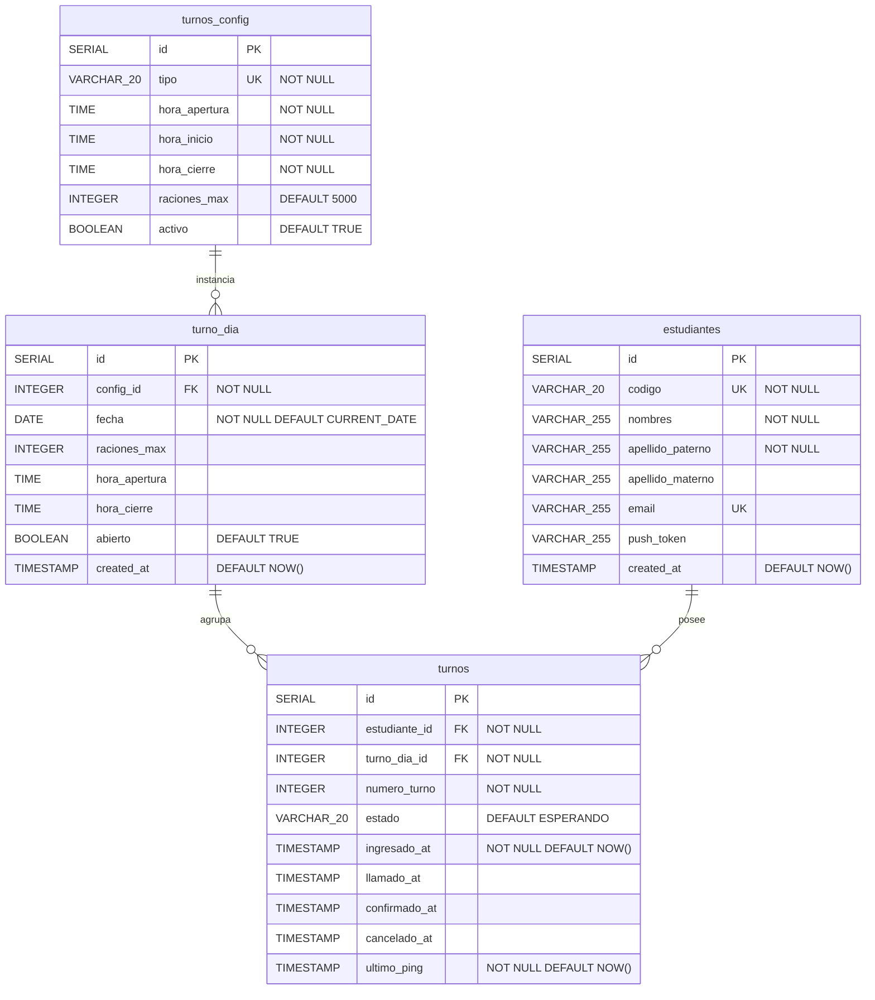

> [10. Modelo de Datos por Motor](../10.md) › [10.2. Módulo 2 / Integrante 2](10.2.md)

# 10.2. Módulo 2 / Integrante 2

**Módulos cubiertos:** M2 – Gestión de Colas · M3 – Gestión de Turnos

**Motor utilizado:** PostgreSQL (relacional)

M2 y M3 usan exclusivamente PostgreSQL. No se emplea Redis ni ningún motor adicional: el orden FIFO se mantiene con `numero_turno` secuencial, la disponibilidad de cupos se calcula con `COUNT`, y la expiración de turnos inactivos se detecta comparando `ultimo_ping` con el timestamp actual.

---

## PostgreSQL — Modelo Relacional (ERD)



---

## Restricciones e índices

| Tabla | Restricción | Detalle |
|---|---|---|
| `turnos_config` | `UNIQUE(tipo)` | Solo puede existir una configuración por tipo de servicio |
| `turno_dia` | `UNIQUE(config_id, fecha)` | Un único ALMUERZO y una única CENA por día |
| `turnos` | `CHECK(estado IN (...))` | Solo acepta: `ESPERANDO`, `LLAMADO`, `ATENDIDO`, `CANCELADO` |
| `turnos` | Índice parcial `UNIQUE(estudiante_id, turno_dia_id) WHERE estado != 'CANCELADO'` | Impide que un estudiante tenga dos turnos activos para el mismo servicio del día (RF03, RF10) |
| `turnos` | Índice compuesto `(turno_dia_id, estado)` | Acelera las consultas de cola filtradas por servicio y estado (RF04, RF06) |

---

## Cómo PostgreSQL resuelve los casos de uso de M2 y M3

### Orden FIFO (RF04)

`numero_turno` es un entero secuencial calculado como `MAX(numero_turno) + 1` dentro del mismo `turno_dia_id`. El primero en registrarse recibe el número más bajo y es atendido antes. No se necesita ninguna estructura externa.

```sql
SELECT COALESCE(MAX(numero_turno), 0) + 1
FROM turnos
WHERE turno_dia_id = :id
```

### Control de capacidad (RF05, RF06)

Los cupos consumidos se cuentan directamente en PostgreSQL. Un turno ocupa cupo mientras no esté cancelado.

```sql
SELECT COUNT(*) FROM turnos
WHERE turno_dia_id = :id AND estado != 'CANCELADO'
```

Si `raciones_max - COUNT >= 1` el estudiante puede unirse; si no, se rechaza la solicitud.

### Posición en cola (RF04)

La posición de un estudiante es el número de personas con `numero_turno` menor que el suyo que aún están esperando.

```sql
SELECT COUNT(*) FROM turnos
WHERE turno_dia_id = :id AND estado = 'ESPERANDO'
  AND numero_turno < :mi_numero
```

### Confirmación y ciclo de vida del turno (RF12, RF13, RF14)

El campo `ultimo_ping` se actualiza cada vez que el estudiante manda una señal de vida (heartbeat por WebSocket). El worker periódico detecta los turnos `LLAMADO` sin ping reciente y los cancela:

```sql
UPDATE turnos SET estado = 'CANCELADO', cancelado_at = NOW()
WHERE estado = 'LLAMADO'
  AND ultimo_ping < NOW() - INTERVAL '3 minutes'
```

Al confirmar presencia, el estado pasa a `ATENDIDO` y se registra `confirmado_at`:

```sql
UPDATE turnos SET estado = 'ATENDIDO', confirmado_at = NOW()
WHERE id = :turno_id
```

### Llamado por grupos (RF11)

Los turnos se llaman en grupos de `⌈raciones_max / 10⌉`. El sistema busca la posición mínima `ESPERANDO`, calcula el rango del grupo y actualiza todos los turnos del grupo en una sola sentencia:

```sql
UPDATE turnos SET estado = 'LLAMADO', llamado_at = NOW(), ultimo_ping = NOW()
WHERE turno_dia_id = :id
  AND numero_turno BETWEEN :pos_inicio AND :pos_fin
  AND estado = 'ESPERANDO'
```

---

## Diccionario de datos

### `estudiantes` (M1 propietario — M2/M3/M5 lectura — PostgreSQL)

| Atributo | Tipo | Longitud / Formato | Obligatorio | Dominio / Restricciones | Descripción funcional |
|---|---|---|---|---|---|
| `id` | SERIAL | Entero autoincremental | Sí | PK | Identificador interno del estudiante; usado como FK en `turnos`, `historial_asistencia`, `historial_encolamiento` |
| `codigo` | VARCHAR | 20 caracteres | Sí | UNIQUE, NOT NULL; formato `20XXXXXXL` | Código universitario del estudiante; clave de búsqueda desde la sesión Redis |
| `nombres` | VARCHAR | 255 caracteres | Sí | NOT NULL | Nombres del estudiante tal como aparecen en el portal ORCE |
| `apellido_paterno` | VARCHAR | 255 caracteres | Sí | NOT NULL | Apellido paterno; parseado de ORCE |
| `apellido_materno` | VARCHAR | 255 caracteres | No | Nullable | Apellido materno; puede ser nulo si el portal ORCE no lo devuelve |
| `email` | VARCHAR | 255 caracteres | No | UNIQUE; Nullable | Correo institucional; puede no estar presente en todos los perfiles ORCE |
| `push_token` | VARCHAR | 255 caracteres | No | Nullable; actualizado en cada login exitoso | Token de Expo Push Notifications; M4 lo usa para enviar notificaciones al dispositivo del estudiante |
| `created_at` | TIMESTAMP | `YYYY-MM-DD HH:MM:SS` | Sí | DEFAULT `CURRENT_TIMESTAMP` | Fecha del primer upsert exitoso del estudiante en el sistema |

---

### `turnos_config` (M7 propietario — M2 lectura — PostgreSQL)

| Atributo | Tipo | Longitud / Formato | Obligatorio | Dominio / Restricciones | Descripción funcional |
|---|---|---|---|---|---|
| `id` | SERIAL | Entero autoincremental | Sí | PK | Identificador interno de la plantilla de configuración |
| `tipo` | VARCHAR | 20 caracteres | Sí | UNIQUE; valores: `ALMUERZO`, `CENA`, `PRUEBA` | Nombre del tipo de servicio del comedor |
| `hora_apertura` | TIME | `HH:MM:SS` | Sí | No nulo | Hora predeterminada desde la que los estudiantes pueden unirse a la cola |
| `hora_inicio` | TIME | `HH:MM:SS` | Sí | No nulo | Hora predeterminada en que comienza la atención |
| `hora_cierre` | TIME | `HH:MM:SS` | Sí | No nulo | Hora predeterminada en que cierra el servicio |
| `raciones_max` | INTEGER | Entero positivo | Sí | DEFAULT `5000` | Capacidad máxima predeterminada; determina el tamaño de los grupos de llamado (`⌈raciones_max / 10⌉`) |
| `activo` | BOOLEAN | `true` / `false` | Sí | DEFAULT `TRUE` | Si es `false`, M2 no permite el encolamiento aunque exista un `turno_dia` para hoy |

---

### `turno_dia` (M2 propietario — PostgreSQL)

| Atributo | Tipo | Longitud / Formato | Obligatorio | Dominio / Restricciones | Descripción funcional |
|---|---|---|---|---|---|
| `id` | SERIAL | Entero autoincremental | Sí | PK | Identificador de la instancia del servicio para un día concreto |
| `config_id` | INTEGER | Entero | Sí | FK → `turnos_config.id`, no nulo | Plantilla de la que hereda horarios y capacidad |
| `fecha` | DATE | `YYYY-MM-DD` | Sí | DEFAULT `CURRENT_DATE`; UNIQUE con `config_id` | Fecha del servicio; la restricción UNIQUE garantiza un único registro por tipo de servicio por día |
| `raciones_max` | INTEGER | Entero positivo | No | Sobreescribe `turnos_config.raciones_max` si se especifica | Capacidad ajustada para un día específico |
| `hora_apertura` | TIME | `HH:MM:SS` | No | Sobreescribe `turnos_config.hora_apertura` si se especifica | Hora de apertura de cola específica para este día |
| `hora_cierre` | TIME | `HH:MM:SS` | No | Sobreescribe `turnos_config.hora_cierre` si se especifica | Hora de cierre específica para este día |
| `abierto` | BOOLEAN | `true` / `false` | Sí | DEFAULT `TRUE` | Permite cerrar manualmente el servicio sin eliminar el registro; M2 rechaza nuevos encolamientos si es `false` |
| `created_at` | TIMESTAMP | `YYYY-MM-DD HH:MM:SS` | Sí | DEFAULT `NOW()` | Fecha y hora de creación del registro |

---

### `turnos` (M3 propietario — PostgreSQL)

| Atributo | Tipo | Longitud / Formato | Obligatorio | Dominio / Restricciones | Descripción funcional |
|---|---|---|---|---|---|
| `id` | SERIAL | Entero autoincremental | Sí | PK | Identificador único del turno (RF09) |
| `estudiante_id` | INTEGER | Entero | Sí | FK → `estudiantes.id`, no nulo | Estudiante al que pertenece el turno |
| `turno_dia_id` | INTEGER | Entero | Sí | FK → `turno_dia.id`, no nulo | Servicio del día al que corresponde el turno |
| `numero_turno` | INTEGER | Entero positivo | Sí | No nulo; `MAX + 1` por `turno_dia_id` al momento del registro | Posición de llegada; define el orden FIFO (RF04) y se muestra al estudiante mientras espera |
| `estado` | VARCHAR | 20 caracteres | Sí | CHECK: `ESPERANDO`, `LLAMADO`, `ATENDIDO`, `CANCELADO`; DEFAULT `ESPERANDO` | Estado actual en el ciclo de vida del turno; gestionado por M3 |
| `ingresado_at` | TIMESTAMP | `YYYY-MM-DD HH:MM:SS` | Sí | DEFAULT `NOW()` | Momento de ingreso a la cola |
| `llamado_at` | TIMESTAMP | `YYYY-MM-DD HH:MM:SS` | No | Nulo hasta que M3 llame al grupo | Momento en que el sistema llamó al grupo del turno (RF11) |
| `confirmado_at` | TIMESTAMP | `YYYY-MM-DD HH:MM:SS` | No | Nulo si no confirmó | Momento en que el estudiante confirmó su presencia (RF12) |
| `cancelado_at` | TIMESTAMP | `YYYY-MM-DD HH:MM:SS` | No | Nulo si no fue cancelado | Momento de cancelación por inactividad (RF13) o por decisión del estudiante |
| `ultimo_ping` | TIMESTAMP | `YYYY-MM-DD HH:MM:SS` | Sí | DEFAULT `NOW()`; actualizado con cada heartbeat del WebSocket | Última señal de vida del estudiante; cuando lleva más de 3 minutos sin actualizarse en un turno `LLAMADO`, el worker lo cancela (RF13, RF14) |

---

[⬅️ Anterior](../10.1/10.1.md) | [🏠 Home](../../README.md) | [Siguiente ➡️](../10.3/10.3.md)
