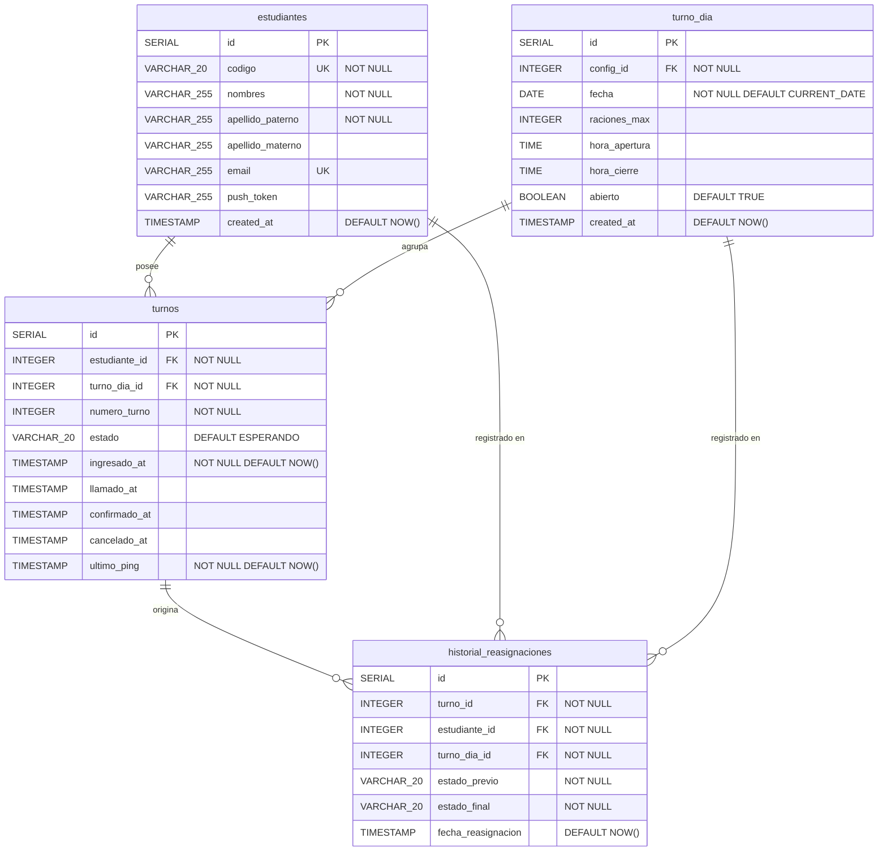
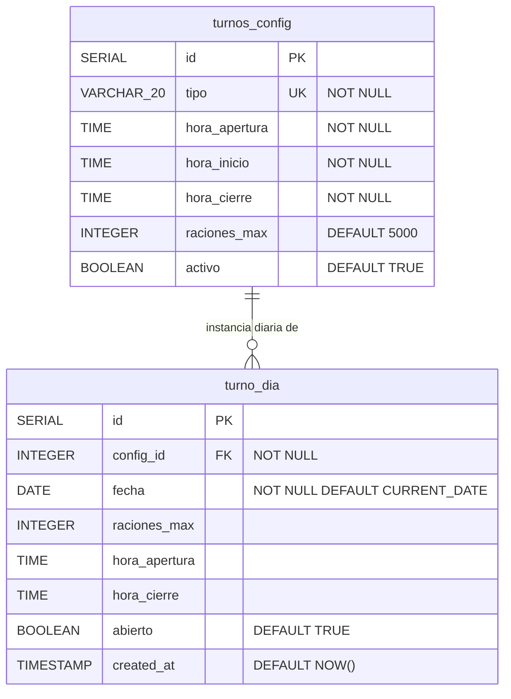

> [10. Modelo de Datos por Motor](../10.md) › [10.3. Módulo 3 / Integrante 3](10.3.md)

# 10.3. Módulo 3 / Integrante 3

**Módulos cubiertos:** M6 – Reasignación de Turnos · M7 – Configuración Operativa

**Motores utilizados:** PostgreSQL (relacional) · Redis (clave/valor en M7)

M6 no tiene tablas propias en la migración actual: opera directamente sobre `turnos` (propietario M3) para seleccionar y actualizar el siguiente candidato con `FOR UPDATE SKIP LOCKED`. M7 es propietario de `turnos_config`; su capa Redis se documenta aquí.

---

## PostgreSQL — Módulo M6 (Reasignación)

M6 no crea tablas propias. Trabaja sobre las mismas tablas que M2/M3 — lee `turno_dia` para saber qué servicio está activo, y escribe `turnos` para transicionar estados.

### ERD — tablas que M6 lee y escribe



> `historial_reasignaciones` es una tabla propuesta (diseño); no está en la migración actual.

### SQL operacional de M6

```sql
-- Seleccionar el siguiente turno ESPERANDO en orden FIFO (sin bloquear otros workers)
SELECT t.id, t.estudiante_id, t.numero_turno
FROM   turnos t
WHERE  t.turno_dia_id = :turno_dia_id
  AND  t.estado = 'ESPERANDO'
ORDER  BY t.numero_turno ASC
LIMIT  1
FOR UPDATE SKIP LOCKED;

-- Transicionar el candidato seleccionado a LLAMADO
UPDATE turnos
SET    estado     = 'LLAMADO',
       llamado_at = NOW(),
       ultimo_ping = NOW()
WHERE  id = :turno_id;
```

### Diccionario de datos — tablas de integración (M6)

| Entidad | Atributo | Tipo | Obligatorio | Dominio / Restricciones | Descripción funcional |
|---------|----------|------|-------------|-------------------------|-----------------------|
| estudiantes | id | SERIAL | Sí | PK, auto-incremental | Identificador del estudiante |
| estudiantes | codigo | VARCHAR(20) | Sí | UNIQUE, NOT NULL | Código universitario UNI |
| estudiantes | nombres | VARCHAR(255) | Sí | NOT NULL | Nombres parseados de ORCE |
| estudiantes | apellido_paterno | VARCHAR(255) | Sí | NOT NULL | Apellido paterno |
| estudiantes | apellido_materno | VARCHAR(255) | No | Nullable | Apellido materno |
| estudiantes | email | VARCHAR(255) | No | UNIQUE, Nullable | Correo institucional |
| estudiantes | push_token | VARCHAR(255) | No | Nullable | Token Expo; M6 lo consulta al notificar una reasignación |
| estudiantes | created_at | TIMESTAMP | Sí | DEFAULT NOW() | Fecha del primer registro |
| turnos | id | SERIAL | Sí | PK, auto-incremental | Identificador del turno |
| turnos | estudiante_id | INTEGER | Sí | FK → estudiantes.id | Estudiante dueño del turno |
| turnos | turno_dia_id | INTEGER | Sí | FK → turno_dia.id | Servicio del día |
| turnos | numero_turno | INTEGER | Sí | MAX+1 por turno_dia_id | Posición FIFO; M6 ordena por este campo |
| turnos | estado | VARCHAR(20) | Sí | CHECK: ESPERANDO/LLAMADO/ATENDIDO/CANCELADO | M6 lee ESPERANDO y escribe LLAMADO o CANCELADO |
| turnos | ultimo_ping | TIMESTAMP | Sí | DEFAULT NOW() | M6 detecta inactividad si > 3 min sin actualización en estado LLAMADO |
| historial_reasignaciones | id | SERIAL | Sí | PK, auto-incremental | Identificador del registro de auditoría |
| historial_reasignaciones | turno_id | INTEGER | Sí | FK → turnos.id | Turno que fue reasignado a LLAMADO |
| historial_reasignaciones | estudiante_id | INTEGER | Sí | FK → estudiantes.id | Estudiante que recibió el llamado |
| historial_reasignaciones | turno_dia_id | INTEGER | Sí | FK → turno_dia.id | Servicio del día donde ocurrió la reasignación |
| historial_reasignaciones | estado_previo | VARCHAR(20) | Sí | Valor: `ESPERANDO` | Estado del turno antes de la reasignación |
| historial_reasignaciones | estado_final | VARCHAR(20) | Sí | Valor: `LLAMADO` | Estado del turno tras la reasignación |
| historial_reasignaciones | fecha_reasignacion | TIMESTAMP | Sí | DEFAULT NOW() | Momento exacto de la reasignación |

---

## PostgreSQL — Módulo M7 (Configuración Operativa)

M7 es propietario de `turnos_config` (plantilla de servicios) y gestiona instancias diarias en `turno_dia`.

### ERD — tablas propietarias de M7



### Diccionario de datos (M7)

| Entidad | Atributo | Tipo | Obligatorio | Dominio / Restricciones | Descripción funcional |
|---------|----------|------|-------------|-------------------------|-----------------------|
| turnos_config | id | SERIAL | Sí | PK, auto-incremental | Identificador de la plantilla de servicio |
| turnos_config | tipo | VARCHAR(20) | Sí | UNIQUE; valores: `ALMUERZO`, `CENA`, `PRUEBA` | Nombre del tipo de servicio |
| turnos_config | hora_apertura | TIME | Sí | NOT NULL | Hora predeterminada de apertura de la cola |
| turnos_config | hora_inicio | TIME | Sí | NOT NULL | Hora predeterminada de inicio de atención |
| turnos_config | hora_cierre | TIME | Sí | NOT NULL | Hora predeterminada de cierre del servicio |
| turnos_config | raciones_max | INTEGER | Sí | DEFAULT 5000 | Capacidad predeterminada de raciones |
| turnos_config | activo | BOOLEAN | Sí | DEFAULT TRUE | Si es `false`, M2 no permite encolamiento |
| turno_dia | id | SERIAL | Sí | PK, auto-incremental | Identificador de la instancia diaria |
| turno_dia | config_id | INTEGER | Sí | FK → turnos_config.id, NOT NULL | Plantilla de la que hereda horarios y capacidad |
| turno_dia | fecha | DATE | Sí | DEFAULT CURRENT_DATE; UNIQUE con config_id | Fecha del servicio |
| turno_dia | raciones_max | INTEGER | No | Sobreescribe turnos_config.raciones_max si se especifica | Capacidad ajustada para este día |
| turno_dia | hora_apertura | TIME | No | Sobreescribe turnos_config.hora_apertura si se especifica | Hora de apertura específica del día |
| turno_dia | hora_cierre | TIME | No | Sobreescribe turnos_config.hora_cierre si se especifica | Hora de cierre específica del día |
| turno_dia | abierto | BOOLEAN | Sí | DEFAULT TRUE | Permite cerrar manualmente el servicio |
| turno_dia | created_at | TIMESTAMP | Sí | DEFAULT NOW() | Fecha y hora de creación del registro |

---

## Redis — Módulo M7 (Caché de configuración)

M7 implementa el patrón **Cache-Aside** sobre `turnos_config`: lectura desde Redis con fallback a PostgreSQL; invalidación dirigida (`DEL`) al actualizar la configuración.

### `turnos_config:cache`

| Campo | Tipo | Formato | Obligatorio | Dominio | Descripción funcional |
|-------|------|---------|-------------|---------|----------------------|
| clave | String | `turnos_config:cache` (fija) | Sí | — | Copia en caché de las filas activas de `turnos_config` |
| valor | String JSON | Array de objetos con todos los campos de `turnos_config` | Sí | Ver tabla `turnos_config` | Leído por M2 y M7 sin consultar PostgreSQL |
| TTL | Integer | Segundos | Sí | 180 s | Expiración automática como red de seguridad; invalidación con `DEL` al modificar la configuración |

**Ejemplo de valor cacheado:**

```json
[
  {
    "id": 1,
    "tipo": "ALMUERZO",
    "hora_apertura": "11:00:00",
    "hora_inicio": "11:30:00",
    "hora_cierre": "14:00:00",
    "raciones_max": 5000,
    "activo": true
  },
  {
    "id": 2,
    "tipo": "CENA",
    "hora_apertura": "17:00:00",
    "hora_inicio": "17:30:00",
    "hora_cierre": "20:00:00",
    "raciones_max": 3000,
    "activo": true
  }
]
```

---

[⬅️ Anterior](../10.2/10.2.md) | [🏠 Home](../../README.md) | [Siguiente ➡️](../10.4/10.4.md)
