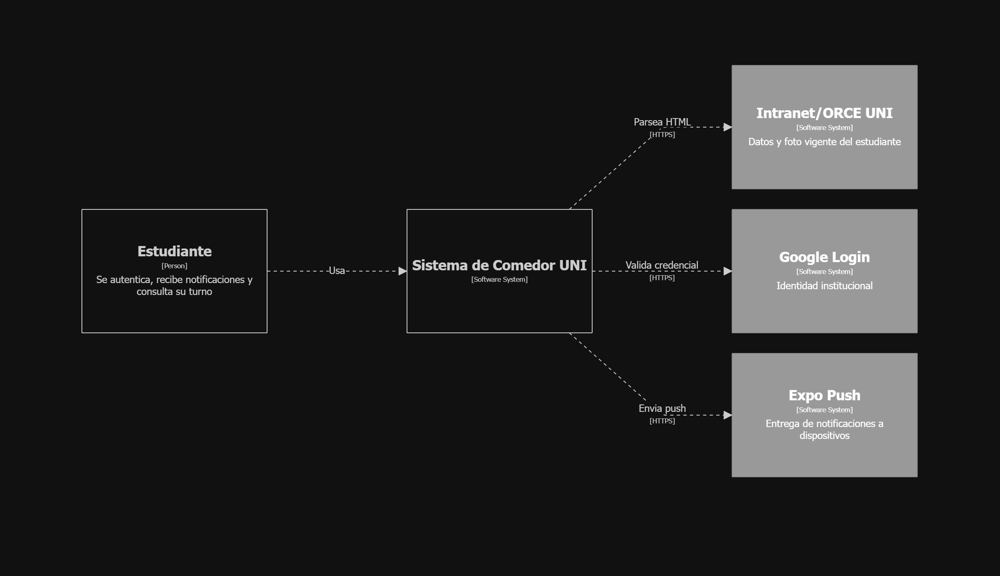
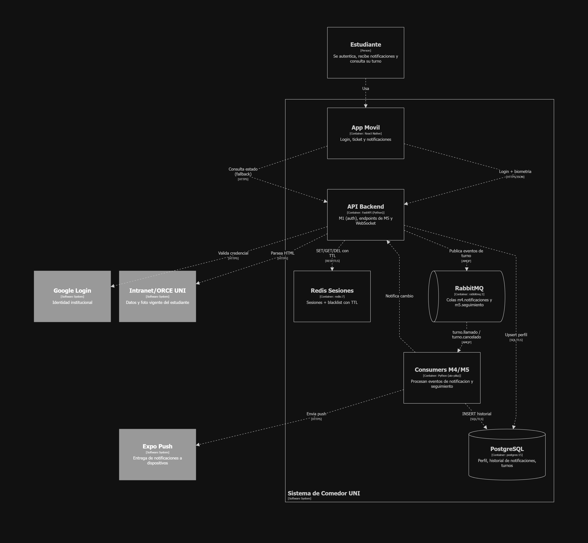
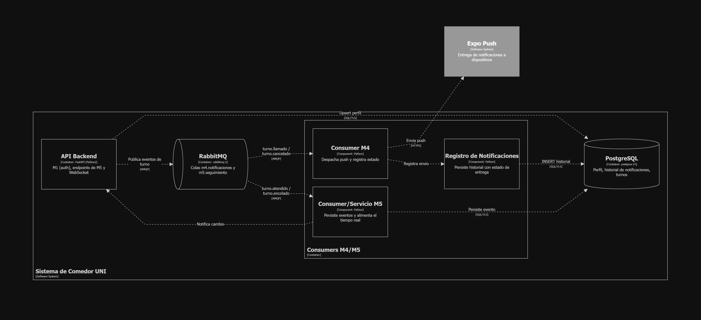

> [15. Documentación de Arquitectura C4 - Actualización y Despliegue](../15.md) › [15.1. Módulo 1 / Integrante 1](15.1.md)

# 15.1. Módulo 1 / Integrante 1

**Módulos cubiertos:** M1 – Autenticación · M4 – Notificaciones · M5 – Seguimiento

Esta sección mantiene actualizados los tres niveles C4 (Contexto, Contenedores, Componentes) reflejando las decisiones de las secciones 1 (patrones/diseño) y 2 (estabilidad — ver [14.1](../../14/14.1/14.1.md)), y agrega el **diagrama de despliegue**. Los diagramas se definen como código **Structurizr DSL**; los renders ya disponibles de los niveles 1–3 están en la [Documentación de Arquitectura (sección 7)](../../7/7.md).

---

## Nivel 1 — Contexto (actualizado)

| Elemento | Propósito | Notas de actualización (Sec. 1 y 2) |
|---|---|---|
| Estudiante | Único actor de M1/M4/M5 | La identidad se establece una vez (M1) y se reutiliza por sesión |
| Google Login / ORCE | Proveedores de identidad y datos | Autenticación delegada + biometría (2.3) |
| Servicio Push (Expo) | Canal de entrega de avisos | Dependencia externa con reintento ante fallo (2.1) |

---

## Nivel 2 — Contenedores (actualizado)

| Contenedor | Tecnología | Responsabilidad | Decisión de Sec. 2 que evidencia |
|---|---|---|---|
| App Móvil | React Native | UI de login, ticket y notificaciones | Reconexión WebSocket (2.1) |
| API Backend | FastAPI | M1 + endpoints/WebSocket de M5 | Verificación de sesión en memoria (2.2) |
| Consumers M4/M5 | Python (aio-pika) | Procesan eventos asíncronos | Bulkhead + reintento/clasificación de error (2.1) |
| PostgreSQL | postgres:15 | Fuente de verdad | 0 pérdida de historial (2.1) |
| Redis Sesiones | redis:7 | Sesiones + blacklist con TTL | Datos auxiliares con TTL (2.1), revocación < 1 s (2.3) |
| RabbitMQ | rabbitmq:3 | Desacople de notificación/seguimiento | Pub-Sub asíncrono (2.2) |

---

## Nivel 3 — Componentes (actualizado)

| Componente | Responsabilidad | Táctica que soporta (Sec. 2) |
|---|---|---|
| Servicio de Biometría | Verifica identidad real | Autenticación multifactor (2.3) |
| Gestor de Sesiones | sid + blacklist con TTL | Datos auxiliares con TTL, revocación (2.1/2.3) |
| Consumer M4 | Despacho + clasificación de error | Reintento/`nack` (2.1) |
| Registro de Notificaciones | Auditoría de envíos | Traza inmutable (2.3) |
| RealTime Channel (M5) | Tiempo real por WebSocket | Push vs polling (2.2) |

---

## Diagrama de Despliegue (nuevo)

### Documentación de respaldo por nodo

| Nodo | Tecnología | Propósito y responsabilidades | Despliegue (réplicas / recursos) | Zona / seguridad |
|---|---|---|---|---|
| API Gateway / Reverse Proxy | Nginx/Traefik | Termina TLS, rate limiting, oculta topología | 1+ (activo/standby) | Borde; punto de cifrado |
| Load Balancer | Nginx/LB gestionado | Distribuye entre réplicas del API con health checks | Integrado/gestionado | Borde |
| API Backend | FastAPI (Docker) | M1 + M5 + WebSocket; stateless (sesión en Redis) | ≥ 2 réplicas | Privada |
| Consumers M4/M5 | Python aio-pika (Docker) | Procesan eventos; aislados del API (bulkhead) | 1+ réplicas; reintento/DLQ | Privada |
| PostgreSQL primario | postgres:15 | Fuente de verdad (perfil, historial, turnos) | 1 primario; volumen persistente | Privada; TLS; sin acceso público |
| PostgreSQL réplica | postgres:15 (standby) | HA y descarga de lecturas | 1 standby (streaming) | Privada |
| Backups | WAL + `pg_dump` | Recuperación ante desastre (PITR) | Programados; externo cifrado | Privada/externa |
| Redis Sesiones | redis:7 (AOF) | Sesiones + blacklist con TTL; AOF como respaldo | 1 (réplica a futuro) | Privada; TLS |
| RabbitMQ | rabbitmq:3 | Colas de notificación/seguimiento | 1 (clúster a futuro) | Privada |
| Servicios externos | Google / ORCE / Expo | Identidad, datos y push | Gestionados por terceros | Acceso saliente HTTPS |

> **Trazabilidad con Sección 2:** réplicas API + LB → continuidad/escalabilidad (2.1/2.2); Redis con AOF y TTL → sesiones rápidas + recuperación (2.1/2.2); PostgreSQL primario+réplica+backups → 0 pérdida de historial (2.1); gateway + zonas + TLS → autenticación y cifrado en tránsito (2.3); consumers aislados con reintento → tolerancia a fallos del push (2.1).

---

## Actualización de ADRs

| ADR | Estado | Cambio |
|---|---|---|
| **ADR-15.1-M1-003 — Redis de sesiones con AOF en zona privada** | Nuevo | Redis se despliega con persistencia AOF y sin exposición pública; mitiga la pérdida de sesiones ante reinicio (complementa [ADR-9.1-M1-002](../../9/9.1/9.1.md)). |
| **ADR-15.1-SYS-001 — API stateless tras balanceador** | Nuevo | El API no guarda estado de sesión en memoria (vive en Redis), habilitando ≥ 2 réplicas tras LB (continuidad/escalabilidad, Sec. 2). |
| **ADR-15.1-M4-002 — Consumers como contenedores aislados** | Nuevo | M4/M5 corren como consumers separados del API (bulkhead) con política de reintento/DLQ. |
| [ADR-9.1-M4-001 — Historial en PostgreSQL](../../9/9.1/9.1.md) | Actualizado | Se confirma PostgreSQL primario+réplica+backups para garantizar el historial auditable. |

---

[🏠 Home](../../README.md) | [Siguiente ➡️](../15.2/15.2.md)
