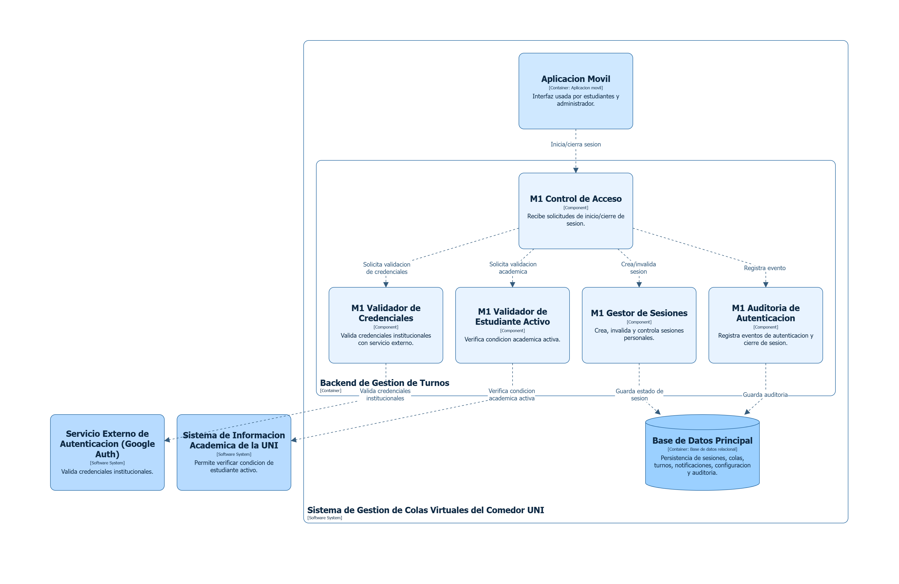

> [4. Documentación de Arquitectura (Modelo C4)](../4.md) › [4.1. Módulo 1 / Integrante 1](4.1.md)

# 4.1. Módulo 1 / Integrante 1

### Módulos asignados:

- Módulo de Autenticación
- Módulo de Notificaciones
- Módulo de Seguimiento

---

## Modulo de Autenticación (M1)

El proceso comienza cuando la Aplicación Móvil envía una solicitud de inicio o cierre de sesión al M1 Control de Acceso. En caso de inicio de sesión, el control de acceso coordina la validación a través de tres componentes: el M1 Validador de Credenciales verifica las credenciales institucionales consultando al Servicio Externo de Autenticación (Google Auth), el M1 Validador de Estudiante Activo confirma la condición académica activa consultando el Sistema de Información Académica de la UNI, y el M1 Gestor de Sesiones crea una sesión personal e intransferible.

En paralelo, el M1 Auditoria de Autenticación registra todos los eventos de autenticación y cierre de sesión. Una vez validadas todas las condiciones, la sesión se persiste en la Base de Datos Principal, permitiendo al estudiante acceder al sistema. En caso de cierre de sesión, el gestor invalida la sesión inmediatamente y la auditoría registra el evento, garantizando control total de acceso y trazabilidad completa de eventos de autenticación.

---

## Modulo de Notificaciones (M4)

El proceso de notificaciones comienza cuando el M3 Gestor de Estado de Turno o el M6 Orquestador de Reasignación disparan eventos que requieren notificación. El M4 Orquestador de Notificaciones recibe estos eventos y coordina el envío mediante tres componentes: el M4 Gestor de Preferencias obtiene las preferencias de notificación del estudiante (canales y tipos de eventos), el M4 Despachador de Notificaciones envía el mensaje a través de los canales configurados (correo, SMS, push) directamente a la Aplicación Móvil, y el M4 Registro de Notificaciones guarda la trazabilidad de cada envío realizado.

El flujo garantiza que cada estudiante reciba notificaciones solo según sus preferencias configuradas, y que todas las comunicaciones queden registradas en la Base de Datos Principal para auditoría y seguimiento. Esto asegura trazabilidad completa de eventos críticos del turno (asignación, confirmación requerida, reasignación, liberación) y permite al administrador y al estudiante verificar el historial de comunicaciones del sistema.

---

## Modulo de Seguimiento (M5)

El módulo de seguimiento proporciona visibilidad en tiempo real a través de tres consultas principales: la M5 Consulta de Posición en Cola recupera la posición actual del estudiante consultando el M2 Gestor FIFO, la M5 Consulta de Estado de Turno obtiene el estado actual (asignado, activo, confirmado, no confirmado) del M3 Gestor de Estado de Turno, y la M5 Historial de Turnos accede al historial completo de eventos y turnos previos a través de la M5 Trazabilidad y Reportes. El Estudiante puede acceder a estas tres consultas desde la Aplicación Móvil en cualquier momento durante la operación.

Además, el Personal Autorizado tiene acceso a la consulta historial completa para propósitos de control y seguimiento administrativo. Toda la información se consolida desde la Base de Datos Principal, que almacena sesiones, colas, turnos, notificaciones, configuración y auditoría, asegurando que los datos consultados sean siempre actualizados y que la trazabilidad completa de todas las acciones quede registrada para control y análisis posterior.

---

[🏠 Home](../../README.md) | [Siguiente ➡️](../4.2/4.2.md)
