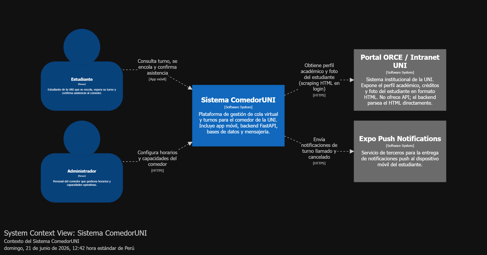

> [7. Documentación de Arquitectura - Versión 2](../../7.md) › [7.5. Documentación Consolidada](../7.5.md) › [7.5.1. Contexto](7.5.1.md)

# 7.5.1. Diagrama de Contexto (C1)

## Descripción del diagrama

| Actor / Sistema | Rol |
|---|---|
| **Estudiante** | Usuario principal. Usa la app móvil para encolarse, ver su posición y confirmar asistencia. |
| **Administrador** | Gestiona `turnos_config` y `turno_dia` a través del backend. |
| **Sistema ComedorUNI** | El sistema a documentar. Orquesta cola virtual, autenticación, notificaciones y seguimiento. |
| **Portal ORCE / Intranet UNI** | Sistema externo institucional. El backend parsea su HTML al hacer login — no existe OAuth ni API oficial. |
| **Expo Push Notifications** | Servicio externo. M4 le envía el `push_token` del estudiante para entregar notificaciones push. |

---

[🏠 Home](../../../README.md) | [Siguiente ➡️](../7.5.2/7.5.2.md)
