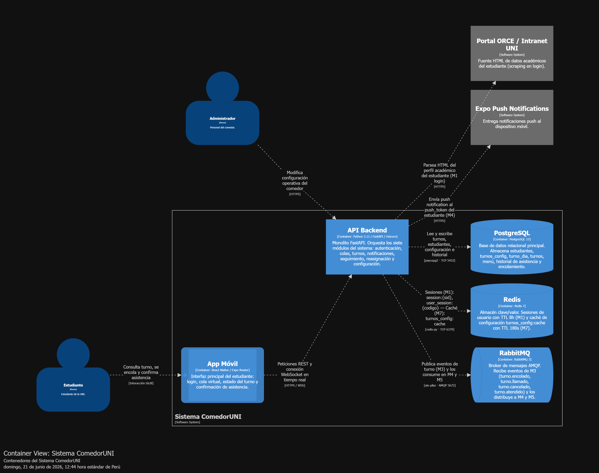

> [7. Documentación de Arquitectura - Versión 2](../../7.md) › [7.5. Documentación Consolidada](../7.5.md) › [7.5.2. Contenedores](7.5.2.md)

# 7.5.2. Diagrama de Contenedores (C2)

## Descripción de contenedores

| Contenedor | Tecnología | Responsabilidad |
|---|---|---|
| **App Móvil** | React Native / Expo Router | Pantallas de login, cola, estado de turno y confirmación de asistencia |
| **API Backend** | Python / FastAPI | Monolito que aloja los 7 módulos (M1–M7) en un solo proceso |
| **PostgreSQL** | PostgreSQL 15 | Fuente de verdad: `estudiantes`, `turnos`, `turno_dia`, `turnos_config`, `historial_*` |
| **Redis** | Redis 7 | `session:{sid}` para M1 · `turnos_config:cache` para M7 |
| **RabbitMQ** | RabbitMQ 3 | Cola AMQP para eventos M3 → M4 (push) y M3 → M5 (historial) |

---

[⬅️ Anterior](../7.5.1/7.5.1.md) | [🏠 Home](../../../README.md) | [Siguiente ➡️](../7.5.3/7.5.3.md)
