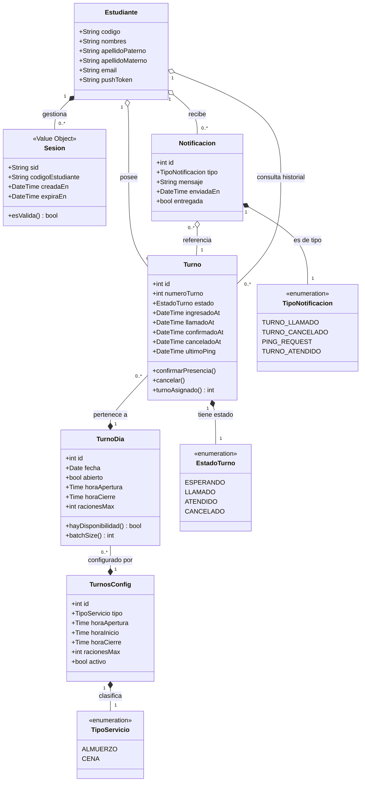

> [8. Modelo de Dominio](../8.md) › [8.1. Módulo 1 / Integrante 1](8.1.md)

# 8.1. Módulo 1 / Integrante 1

**Módulos:** M1 – Autenticación · M4 – Notificaciones · M5 – Seguimiento

---

## Diagrama de Clases UML

---

## Agregados y Raíces

| Agregado | Raíz | Objetos contenidos |
|---|---|---|
| **Identidad del Estudiante** | `Estudiante` | `Sesion` |
| **Turno del Servicio** | `Turno` | `EstadoTurno` (VO) |
| **Oferta del Día** | `TurnoDia` | — (referencia `TurnosConfig`) |
| **Canal de Aviso** | `Notificacion` | `TipoNotificacion` (VO) |
| **Seguimiento (M5)** | — | Vista de consulta sobre `Turno` |

---

## Descripción de Entidades

### M1 – Autenticación

#### `Estudiante` *(Raíz de Agregado)*
Representa al alumno universitario habilitado para usar el sistema. Almacena el código institucional, nombre completo, email y el `pushToken` que M4 necesita para enviar notificaciones push. No almacena la foto del estudiante: en cada login el sistema la obtiene en tiempo real desde la Intranet UNI (ORCE) y la compara con la selfie capturada en el dispositivo — guardarla en BD implicaría comparar contra una foto potencialmente desactualizada si el estudiante cambia su foto oficial. No almacena créditos ni estado de elegibilidad — esos datos también viven en sistemas externos y se consultan en tiempo real.

#### `Sesion` *(Value Object)*
Credencial efímera generada tras la autenticación exitosa. Identificada por un `sid` opaco, vincula al estudiante con cada operación del sistema durante su ciclo de vida. No tiene tabla propia en la BD — se gestiona en memoria (o cache) en el backend. Expirar o invalidar una sesión equivale a destruirla y crear una nueva.

---

### M4 – Notificaciones

#### `Notificacion` *(Entidad)*
Representa un aviso enviado al estudiante sobre un evento de su turno. Tiene identidad propia porque debe rastrearse si fue entregada (`entregada: bool`) y cuándo (`enviadaEn`). Se clasifica por `TipoNotificacion`: los tipos `TURNO_LLAMADO` y `PING_REQUEST` son críticos para la confirmación de presencia; `TURNO_CANCELADO` y `TURNO_ATENDIDO` son informativos. El canal de entrega puede ser push (usando `pushToken`) o WebSocket según disponibilidad.

#### `TipoNotificacion` *(Value Object / Enumeración)*
Categoriza el propósito del aviso. Determina tanto el contenido del mensaje como la urgencia con que el módulo de transporte debe entregarlo.

---

### M5 – Seguimiento

M5 no introduce entidades propias. Actúa como la **interfaz de consulta** del sistema: integra datos de `TurnoDia` (M2) y `Turno` (M3) para mostrar al estudiante en tiempo real su posición en la cola y el estado actual de su turno.

El historial básico de eventos que describe el módulo —asignación, llamado, confirmación, cancelación— se deriva directamente de los timestamps que `Turno` ya almacena (`ingresadoAt`, `llamadoAt`, `confirmadoAt`, `canceladoAt`). No se requiere una tabla de eventos separada.

El alcance del sistema termina cuando el turno llega a `ATENDIDO` (el estudiante confirmó presencia al ser llamado). Lo que ocurre en la ventanilla del comedor está fuera del dominio de la app.

---

### Entidades de Contexto (M2 / M3 / M7)

#### `Turno` *(Raíz de Agregado — M3)*
Representa la participación individual de un estudiante en un servicio. Almacena la **posición de llegada** (`numeroTurno`) que se muestra al alumno mientras espera. El **turno asignado** no se persiste en BD — se calcula en tiempo de consulta como `⌈numeroTurno / batchSize⌉` y solo se comunica al frontend tras la confirmación. Su ciclo de vida completo es: `ESPERANDO → LLAMADO → ATENDIDO` (o `CANCELADO`).

#### `TurnoDia` *(Raíz de Agregado — M2)*
Instancia concreta de un servicio en una fecha específica. Define la ventana de tiempo durante la cual los estudiantes pueden unirse a la cola y el máximo de raciones disponibles. El método `batchSize()` calcula `⌈racionesMax / 10⌉`, determinando cuántos alumnos comparten cada número de turno grupal. La restricción `UNIQUE(config_id, fecha)` garantiza un único ALMUERZO y una única CENA por día.

#### `TurnosConfig` *(Entidad — M7)*
Plantilla reutilizable que define los parámetros fijos de cada tipo de servicio: horarios de apertura, inicio de atención, cierre y capacidad máxima. `TurnoDia` puede sobreescribir cualquiera de estos valores para un día específico.

---

[🏠 Home](../../README.md) | [Siguiente ➡️](../8.2/8.2.md)
