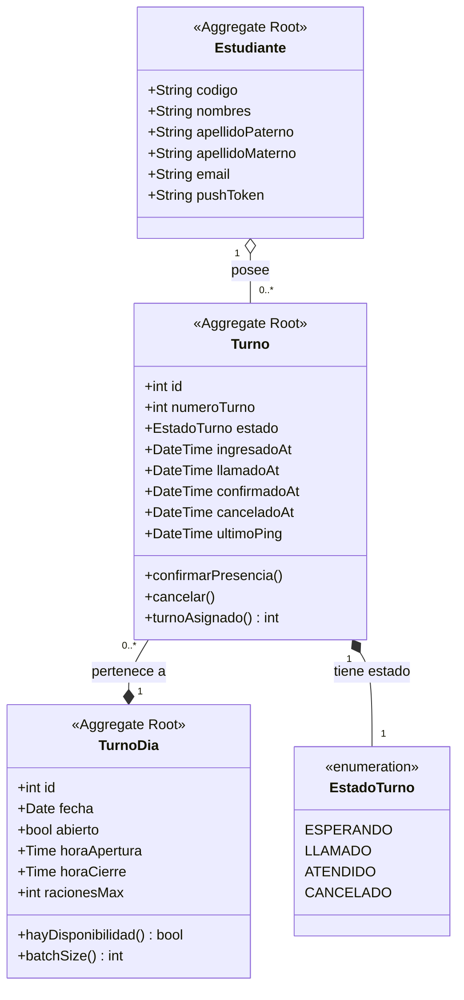

> [8. Modelo de Dominio](../8.md) › [8.2. Módulo 2 / Integrante 2](8.2.md)

# 8.2. Módulo 2 / Integrante 2

## Modelo de Dominio – Módulo de Colas (M2) y Módulo de Turnos (M3)

### Diagrama de Clases UML (Mermaid)

---

## 1. Catálogo y Rol de Componentes en el Dominio

---

## 1.1. Agregado: TurnoDia (M2 - Gestión de Colas)

Es la unidad raíz que encapsula la jornada de servicio de alimentación en una fecha determinada. Controla los límites generales del aforo de la cola.

###  Rol en el Dominio:
Actúa como la entidad raíz controladora (Aggregate Root) de la disponibilidad diaria. Se encarga de evaluar si la barrera de capacidad del comedor se ha sobrepasado en base a las raciones máximas permitidas.

###  Atributos Clave:
- id (int): Clave única secuencial lógica de la sesión del día  
- fecha (Date): Fecha específica de atención  
- abierto (bool): Flag de negocio que indica si la cola interactiva acepta nuevas peticiones  
- horaApertura / horaCierre (Time): Ventana de tiempo oficial donde opera el comedor  
- racionesMax (int): El techo técnico de porciones de alimentos a emitir  

###  Comportamiento Crítico:
- `hayDisponibilidad()` valida en memoria el saldo remanente de alimentos  
- `batchSize()` determina dinámicamente el tamaño de grupos permitidos  

---

## 1.2. Agregado: Turno (M3 - Gestión de Turnos)

Representa la asignación concreta de una posición de atención ganada por un alumno elegible en el sistema.

###  Rol en el Dominio:
Es la raíz transaccional (Aggregate Root) encargada de monitorizar y cambiar el ciclo de vida de la reserva individual de alimentos. Controla y restringe los pasos del estudiante a través de la máquina de estados.

###  Atributos Clave:
- id (int): Identificador único global del turno emitido  
- numeroTurno (int): Valor posicional relativo e indexable que define el orden secuencial físico de atención al alumno  
- estado (EstadoTurno): El estado actual del flujo  
- ingresadoAt / llamadoAt / confirmadoAt / canceladoAt (DateTime): Auditoría interna precisa de marcas de tiempo del ciclo de vida  
- ultimoPing (DateTime): Mecanismo de persistencia de presencia lógica del cliente  

###  Comportamiento Crítico:
- `confirmarPresencia()` realiza la validación definitiva del usuario para pasar a ser atendido  
- `cancelar()` revoca los derechos de reserva liberando la capacidad  

---

## 1.3. Objetos de Valor y Enumeraciones Compartidas

---

### A. EstadoTurno (<<enumeration>>)

###  Rol en el Dominio:
Objeto inmutable que dicta de manera estricta el estado lógico del Agregado Turno. Contiene únicamente las cuatro opciones de negocio validadas por el sistema consolidado:

- **ESPERANDO:** El turno se encuentra en cola virtual a la espera de un cupo físico inmediato  
- **LLAMADO:** El sistema selecciona el turno y activa la alerta para requerir la presencia del estudiante  
- **ATENDIDO:** Flujo finalizado exitosamente donde el alumno consume su ración  
- **CANCELADO:** Turno abortado por inacción del usuario o por declaración voluntaria  

---

[⬅️ Anterior](../8.1/8.1.md) | [🏠 Home](../../README.md) | [Siguiente ➡️](../8.3/8.3.md)
