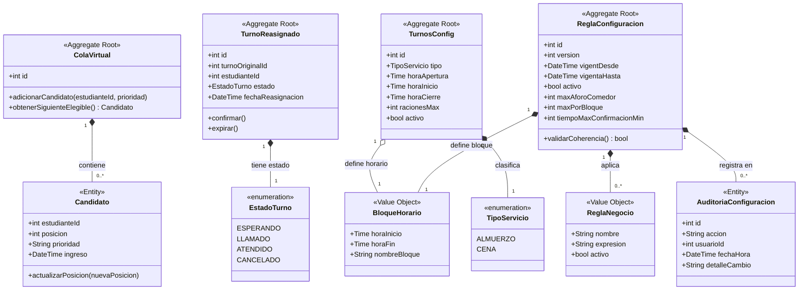

> [8. Modelo de Dominio](../8.md) › [8.3. Módulo 3 / Integrante 3](8.3.md)

# 8.3. Módulo 3 / Integrante 3

## Modelo de Dominio - Módulo de Reasignación (M6) y Configuración (M7)

###  1. Diagrama de Clases UML (Mermaid)

## 2. Documentación Detallada de Entidades y Agregados

---

## A. Módulo de Reasignación de Turnos (M6)

---

### 1. ColaVirtual (Raíz del Agregado / Aggregate Root)

**Rol en el Dominio:**  
Es el componente responsable de gestionar de manera ordenada y priorizada la lista de espera de los estudiantes que no alcanzaron un cupo regular para un servicio del comedor. Su principal responsabilidad es garantizar la equidad en la asignación masiva asíncrona mediante el método `obtenerSiguienteElegible()`, asegurando que no existan accesos concurrentes destructivos.

**Atributos clave:**
- id (Identificador único de la cola)

**Relaciones y Cardinalidades:**  
Composición estricta de uno a muchos (1 *-- 0..*) con la entidad interna `Candidato`.

---

### 2. Candidato (Entidad / Entity)

**Rol en el Dominio:**  
Representa a un estudiante que se ha registrado activamente dentro de la lista de espera. Su ciclo de vida está completamente ligado al de la `ColaVirtual`. No posee razón de ser de forma aislada en el sistema y expone el comportamiento `actualizarPosicion()` para soportar el reordenamiento dinámico de la fila en background.

**Atributos clave:**
- estudianteId (ID primitivo que referencia al alumno en el módulo M1)  
- posicion (índice numérico actual)  
- prioridad (criterio de vulnerabilidad o FIFO)  
- ingreso (marca de tiempo exacta de llegada)

**Relaciones y Cardinalidades:**  
Pertenece exclusivamente a una (1) `ColaVirtual`.

---

### 3. TurnoReasignado (Raíz del Agregado / Aggregate Root)

**Rol en el Dominio:**  
Controla la máquina de estados y las transiciones del ciclo de vida de una vacante de emergencia que ha sido recuperada y transferida a un candidato en espera. Gobierna las acciones de `confirmar()` y `expirar()` basándose de manera estricta en las ventanas de tiempo parametrizadas por el negocio.

**Atributos clave:**
- id (Código único de reasignación)  
- turnoOriginalId (ID primitivo que referencia al turno cancelado/expirado del módulo M3)  
- estudianteId (ID del nuevo alumno beneficiado)  
- estado (Instancia de la enumeración global `EstadoTurno`)  
- fechaReasignacion  

**Relaciones y Cardinalidades:**  
Asociación unidireccional de uno a uno (1 *-- 1) con la enumeración compartida `EstadoTurno`.

---

## B. Módulo de Configuración Operativa (M7)

---

### 1. ReglaConfiguracion (Raíz del Agregado / Aggregate Root)

**Rol en el Dominio:**  
Actúa como la máxima autoridad y fuente de la verdad para las políticas y parámetros globales del comedor. Centraliza los topes físicos y temporales. Utiliza el método predictivo `validarCoherencia()` para salvaguardar al sistema de colisiones lógicas operativas (como solapamientos horarios o aforos negativos) antes de activarse.

**Atributos clave:**
- id  
- version (Control secuencial para auditoría histórica)  
- vigentDesde / vigentaHasta (Fechas operativas de vigencia)  
- activo (Flag de estado)  
- maxAforoComedor  
- maxPorBloque  
- tiempoMaxConfirmacionMin  

**Relaciones y Cardinalidades:**
- Composición de uno a uno (1 *-- 1) con el Value Object `BloqueHorario`  
- Composición de uno a muchos (1 *-- 0..*) con el Value Object `ReglaNegocio`  
- Composición de uno a muchos (1 *-- 0..*) con la entidad interna `AuditoriaConfiguracion`

---

### 2. TurnosConfig (Raíz del Agregado / Aggregate Root)

**Rol en el Dominio:**  
Define y estructura las directrices específicas de los servicios alimenticios diarios (desayuno, almuerzo, cena) vinculándolos con la capacidad máxima de raciones disponibles para producción en cocina.

**Atributos clave:**
- id  
- tipo (TipoServicio)  
- horaApertura  
- horaInicio  
- horaCierre  
- racionesMax  
- activo  

**Relaciones y Cardinalidades:**
- Composición de uno a uno (1 *-- 1) con la enumeración `TipoServicio`  
- Agregación por valor de uno a uno (1 o-- 1) con el Value Object `BloqueHorario`

---

### 3. AuditoriaConfiguracion (Entidad / Entity)

**Rol en el Dominio:**  
Proporciona un mecanismo inmutable de rastreo exigido por el negocio. Registra de manera exacta qué usuario con rol administrativo ejecutó una mutación sobre las políticas operativas, almacenando un volcado del estado anterior y posterior. Su ciclo de vida es dependiente de su raíz de agregado.

**Atributos clave:**
- id  
- accion (Creación, modificación, baja)  
- usuarioId (ID del administrador)  
- fechaHora  
- detalleCambio (Estructura de texto con los campos modificados)

**Relaciones y Cardinalidades:**  
Compuesta de forma obligatoria por una (1) `ReglaConfiguracion`.

---

## 3. Objetos de Valor (Value Objects) Relevantes

Son componentes inmutables que no poseen identidad propia pero definen y encapsulan lógica de comportamiento esencial para el negocio dentro de los agregados:

---

### BloqueHorario

Abstrae las fronteras cronológicas operacionales (horaInicio, horaFin) y su etiqueta descriptiva (ej. "Bloque A - Almuerzo"). Es un objeto altamente reutilizado ya que sirve tanto para delimitar la validez de una regla de configuración (M7) como para estructurar las ventanas horarias de atención de los turnos diarios (M2).

---

### ReglaNegocio

Encapsula expresiones booleanas dinámicas o fórmulas lógicas aplicables en tiempo de ejecución. Permite a los administradores activar, desactivar o modificar flujos algorítmicos sin necesidad de alterar o redesplegar el código fuente del sistema.

---

[⬅️ Anterior](../8.2/8.2.md) | [🏠 Home](../../README.md) | [Siguiente ➡️](../8.4/8.4.md)
