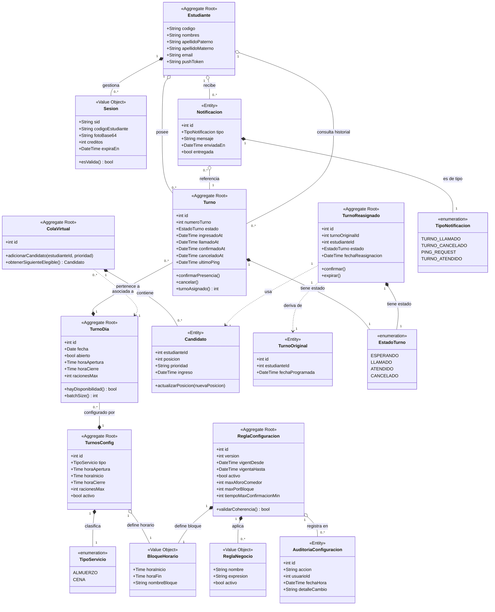

> [8. Modelo de Dominio](../8.md) › [8.5. Diagrama Consolidado y Especificación](8.5.md)

# 8.5. Diagrama Consolidado y Especificación

Este documento integra los modelos de dominio de los siete módulos del sistema en un único diagrama de clases UML y una tabla de especificación de entidades.

---

## Diagrama Consolidado de Clases UML

---

## Especificación de Entidades y Objetos de Valor

### Raíces de Agregado

| Entidad | Módulo propietario | Descripción |
|---|---|---|
| `Estudiante` | M1 | Alumno universitario habilitado para el sistema. Identificado por código institucional. No almacena foto ni créditos — se obtienen de ORCE en cada login. |
| `TurnoDia` | M2 | Instancia concreta de un servicio (ALMUERZO, CENA, PRUEBA) para una fecha específica. Controla la ventana de tiempo y los cupos disponibles. |
| `Turno` | M3 | Participación individual de un estudiante en un servicio del día. Ciclo de vida: `ESPERANDO → LLAMADO → ATENDIDO` (o `CANCELADO`). |
| `ColaVirtual` | M6 | Lista FIFO de candidatos que esperan un cupo liberado. Garantiza que la reasignación respete el orden de llegada y la prioridad. |
| `TurnoReasignado` | M6 | Cupo liberado que se ofrece al siguiente candidato elegible. Se confirma o expira dentro de un tiempo límite. |
| `TurnosConfig` | M7 | Plantilla reutilizable de parámetros fijos por tipo de servicio. `TurnoDia` puede sobreescribir cualquier valor para un día específico. |
| `ReglaConfiguracion` | M7 | Versión activa de las reglas operativas del comedor (aforos, tiempos de confirmación). Solo puede existir una versión activa simultáneamente. |

### Entidades

| Entidad | Módulo propietario | Descripción |
|---|---|---|
| `Notificacion` | M4 | Aviso enviado al estudiante sobre un evento de su turno. Tiene identidad propia para rastrear si fue entregada y cuándo. |
| `Candidato` | M6 | Estudiante en la cola virtual de reasignación. Tiene posición, prioridad y timestamp de ingreso para el ordenamiento FIFO. |
| `TurnoOriginal` | M6 | Registro del turno que quedó libre (cancelado o expirado) y que origina el proceso de reasignación. |
| `AuditoriaConfiguracion` | M7 | Log inmutable de cada modificación a `ReglaConfiguracion`. Registra quién cambió qué y cuándo. |

### Objetos de Valor

| Objeto | Módulo(s) | Descripción |
|---|---|---|
| `Sesion` | M1 | Credencial efímera creada al autenticarse. Almacena en Redis el `sid`, datos del estudiante y la foto vigente de ORCE para la verificación biométrica. No tiene tabla en BD. |
| `BloqueHorario` | M2, M7 | Intervalo temporal inmutable (horaInicio, horaFin) que define cuándo opera un servicio. |
| `ReglaNegocio` | M3, M7 | Restricción del dominio encapsulada como valor (ej. "un estudiante no puede tener dos turnos activos para el mismo servicio"). |
| `EstadoTurno` | M3, M6 | Enumeración del ciclo de vida de un turno: `ESPERANDO`, `LLAMADO`, `ATENDIDO`, `CANCELADO`. |
| `TipoServicio` | M2, M7 | Categoría del servicio del comedor: `ALMUERZO`, `CENA`. |
| `TipoNotificacion` | M4 | Categoría del aviso: `TURNO_LLAMADO`, `PING_REQUEST` (críticos) o `TURNO_CANCELADO`, `TURNO_ATENDIDO` (informativos). |

### M5 — Sin entidades propias

M5 (Seguimiento) no introduce entidades ni tablas. Opera como interfaz de consulta sobre `Turno` y `TurnoDia`: el historial de eventos de un turno se deriva de los timestamps `ingresadoAt`, `llamadoAt`, `confirmadoAt`, `canceladoAt`. Las actualizaciones en tiempo real se entregan por WebSocket sin motor adicional.

---

[⬅️ Anterior](../8.4/8.4.md) | [🏠 Home](../../README.md)
